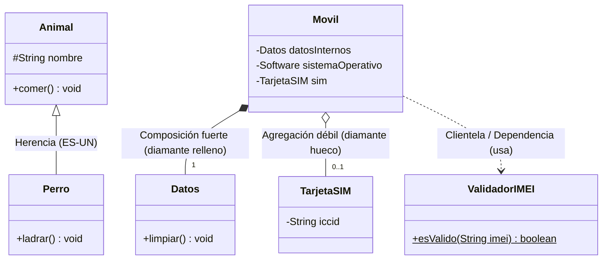
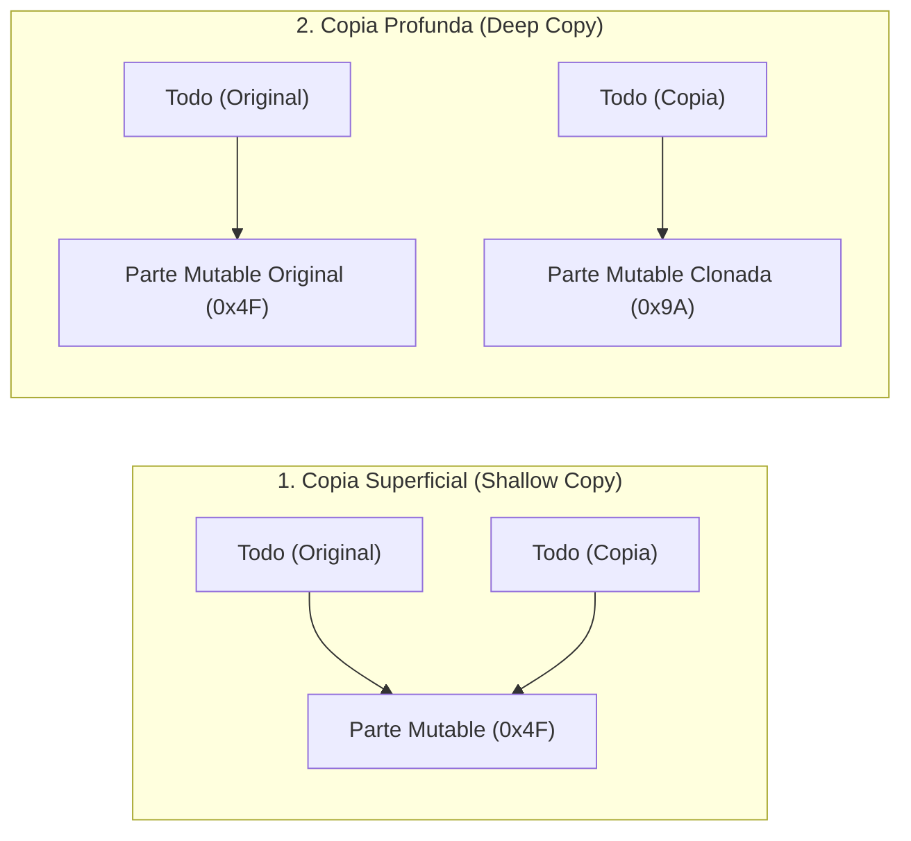
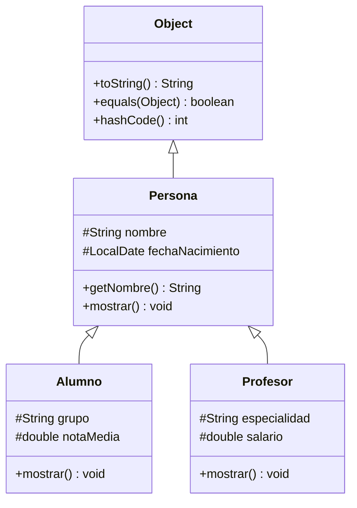
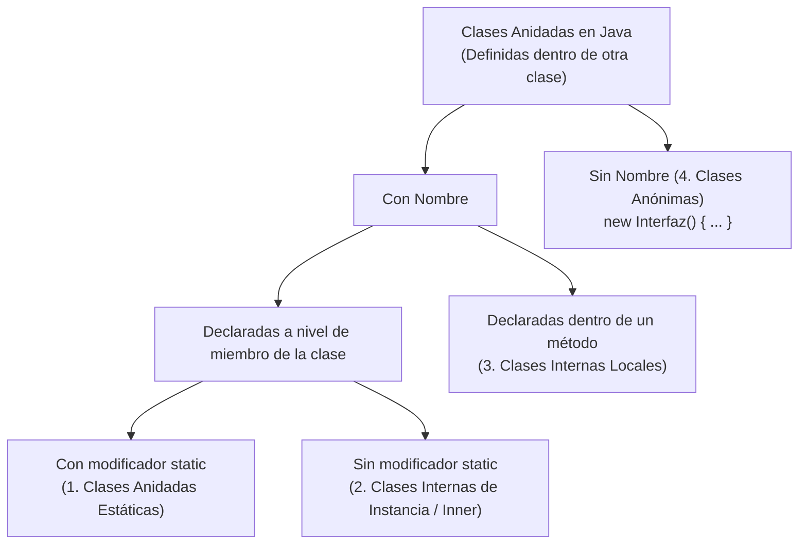

## Objetivos de Aprendizaje (RA4 y RA7 — 30 horas)

Al finalizar esta unidad didáctica serás capaz de:

* Modelar sistemas complejos identificando con precisión las relaciones entre clases: **clientela (dependencia)**, **asociación**, **agregación**, **composición** y **herencia**, representándolas en diagramas de clases **UML**.
* Proteger el encapsulamiento en objetos compuestos evitando fugas de referencias mutables (*privacy leaks*) mediante **constructores de copia**, el método **`clone()` (`Cloneable`)** y métodos factoría.
* Construir **jerarquías de herencia (`extends`)** aplicando las reglas de encadenamiento de constructores con **`super(...)`**, visibilidad protegida (**`protected`**), sobrescritura de métodos (**`@Override`**), bloqueo con **`final`** y jerarquías selladas (**`sealed` / `permits`**).
* Diseñar contratos arquitectónicos desacoplados combinando **clases abstractas (`abstract class`)** e **interfaces (`interface`)**, aprovechando métodos **`default`**, **`static`** y las interfaces de ordenación **`Comparable<T>`** y **`Comparator<T>`**.
* Dominar el **polimorfismo** y la **ligadura dinámica (*late binding*)**, realizando conversiones seguras de tipos (*upcasting* y *downcasting*) con **`instanceof`** y *Pattern Matching*.
* Organizar el código con **clases anidadas** (estáticas, internas de instancia, locales y anónimas) y dar el salto a la **programación funcional en Java** mediante **interfaces funcionales (`@FunctionalInterface`)**, **expresiones lambda (`->`)**, el paquete **`java.util.function`**, **referencias a métodos (`::`)** y composición funcional.

---

## 1. Relaciones entre Clases y Objetos en el Dominio del Problema

En la Unidad 4 aprendimos a diseñar una clase como un molde encapsulado que agrupa estado (atributos) y comportamiento (métodos). Sin embargo, en el software profesional ninguna clase vive aislada: un programa real es un ecosistema de decenas o cientos de objetos que colaboran entre sí enviándose mensajes.

### 1.1. Especialización frente a Generalización

Cuando analizamos las entidades de un dominio, es muy frecuente encontrar conceptos que guardan una relación jerárquica de **especie a género**:

* **Especialización (de arriba hacia abajo):** una clase (**subclase** o clase derivada) es una versión más concreta y específica de otra (**superclase** o clase base). Comparte todos los rasgos generales de la superclase, pero añade atributos propios o modifica comportamientos que la singularizan. Por ejemplo, una `Gallina` o un `Aguila` son especializaciones del concepto general `Ave`.
* **Generalización (de abajo hacia arriba):** es el punto de vista inverso. Consiste en abstraer las características comunes de varias clases concretas (`Gallina`, `Aguila`, `Gorrion`) en una superclase superior (`Ave`) que capture lo esencial de todas ellas sin entrar en los detalles particulares de si planea a gran altura o vive en un corral.

### 1.2. Taxonomía de Relaciones entre Clases

En Programación Orientada a Objetos distinguimos cinco grandes formas en que una clase `A` puede relacionarse con otra clase `B`:

| Relación | Lema conceptual | Descripción técnica | Ejemplo en Java |
| :--- | :--- | :--- | :--- |
| **1. Clientela (Dependencia)** | *«A USA A B»* (`USES-A`) | La relación más habitual y efímera. Una clase utiliza objetos de otra como variables locales dentro de un método, como parámetros de entrada o invocando sus métodos estáticos. | Nuestra clase principal con `main` es cliente de `String`, `Scanner` y `System`. |
| **2. Asociación** | *«A CONOCE A B»* | Dos objetos independientes mantienen un vínculo estable (unidireccional o bidireccional) mediante un atributo de referencia, sin que ninguno sea «dueño» ni «parte física» del otro. | Un `Medico` atiende a un `Paciente`; una `Persona` reside en una `Direccion`. |
| **3. Agregación** | *«A TIENE UN B (débil)»* (`HAS-A`) | Relación **todo-parte** débil. El objeto contenedor (`Todo`) agrupa referencias a objetos componentes (`Parte`), pero si el contenedor desaparece, las partes siguen existiendo por sí mismas. | Una `Universidad` agrupa objetos `Estudiante`; un `Almacen` guarda objetos `Producto`. |
| **4. Composición** | *«A ESTÁ COMPUESTO POR B (fuerte)»* (`PART-OF`) | Relación **todo-parte** exclusiva y fuerte. El ciclo de vida de la `Parte` está atado al del `Todo`: el `Todo` crea sus partes y, si el `Todo` se destruye, sus partes mueren con él. | Una `Factura` está compuesta por sus `LineaFactura`; un `Rectangulo` posee su `Punto2D` vértice. |
| **5. Herencia** | *«A ES UN TIPO DE B»* (`IS-A`) | La subclase `A` extiende a la superclase `B`, heredando su estructura y comportamiento para especializarlo. | Un `Alumno` **es una** `Persona`; un `Perro` **es un** `Animal`. |

Veamos en código cómo se ven las relaciones básicas de clientela y composición:

```java
import java.time.LocalDate;

// Ejemplo 1: Relación de CLIENTELA
// La clase Saludador es cliente de String y de System porque los utiliza en su método.
public class Saludador {
    public static void main(String[] args) {
        System.out.println("Hola, he recibido " + args.length + " argumentos.");
    }
}

// Ejemplo 2: Relación de COMPOSICIÓN
// La clase Persona está compuesta internamente por referencias a String y LocalDate.
class Persona {
    private String nombre;
    private LocalDate fechaNacimiento;
    // Constructores, getters y métodos...
}
```

> **💡 Observación arquitectónica:** En el fondo, tanto la composición como la agregación y el anidamiento se apoyan en la clientela, ya que en todos los casos una clase acaba haciendo uso de otra. La diferencia crucial radica en **dónde** reside la referencia (atributo frente a variable local) y **quién controla el ciclo de vida** del objeto referenciado.

### 1.3. Representación en Diagramas de Clases UML y Cardinalidad

En el lenguaje de modelado unificado (**UML**), cada relación tiene una flecha o conector específico para que cualquier ingeniero de software entienda la arquitectura de un vistazo:



En los extremos de las líneas de asociación, agregación y composición se indica la **cardinalidad (o multiplicidad)** en formato `mínima..máxima`:
* **`0..1`:** Opcional (puede no estar relacionado con ningún objeto o como máximo con uno; por ejemplo, un móvil puede funcionar sin tarjeta SIM o tener una).
* **`1` (o `1..1`):** Obligatorio y único (exactamente una instancia).
* **`0..*` (o simplemente `*`):** De cero a muchos (sin límite superior).
* **`1..*`:** Al menos uno y hasta un número ilimitado (por ejemplo, una empresa debe tener como mínimo 1 empleado y puede tener muchos).

### 1.4. Gestión de Relaciones `1..*` con `ArrayList<E>`

Cuando una clase mantiene una relación de *uno a muchos* (`1..*` o `0..*`), como una `Universidad` que tiene cientos de `Estudiantes` o un `Inventario` lleno de `Productos`, los arrays estáticos tradicionales (`Estudiante[]`) resultan rígidos porque nos obligan a fijar un tamaño máximo al instanciarlos.

Aunque estudiaremos a fondo el marco de colecciones en la **Unidad 6**, es fundamental conocer desde ahora la clase **`java.util.ArrayList<E>`**, que actúa como un array dinámico cuyo tamaño crece y decrece automáticamente a medida que insertamos o eliminamos objetos:

```java
import java.util.ArrayList;
import java.util.Iterator;

public class EjemploRelacionMuchos {
    public static void main(String[] args) {
        // 1. Declaración parametrizada con el tipo de objeto entre ángulos < >
        ArrayList<String> modulos = new ArrayList<>();

        // 2. Inserción de elementos al final (add) o en un índice concreto
        modulos.add("Programación");
        modulos.add("Bases de Datos");
        modulos.add(1, "Entornos de Desarrollo"); // Desplaza el resto a la derecha

        // 3. Consulta de tamaño (size) y acceso por índice (get)
        System.out.println("Total módulos: " + modulos.size());
        System.out.println("Primer módulo: " + modulos.get(0));

        // 4. Recorrido completo con for-each
        for (String m : modulos) {
            System.out.println(" - " + m);
        }

        // 5. Eliminación segura durante un recorrido usando Iterator
        Iterator<String> it = modulos.iterator();
        while (it.hasNext()) {
            String actual = it.next();
            if (actual.startsWith("Entornos")) {
                it.remove(); // Elimina de forma segura sin lanzar ConcurrentModificationException
            }
        }
    }
}
```

| Método de `ArrayList<E>` | Descripción |
| :--- | :--- |
| `boolean add(E elemento)` | Añade el objeto al final de la lista. |
| `void add(int index, E elemento)` | Inserta el objeto en la posición `index` desplazando los siguientes. |
| `E get(int index)` | Devuelve la referencia al objeto situado en la posición `index` (`0` a `size() - 1`). |
| `E set(int index, E elemento)` | Sustituye el elemento de la posición `index` por el nuevo objeto. |
| `int size()` | Devuelve el número actual de elementos almacenados (equivalente a `.length` en arrays). |
| `boolean isEmpty()` / `void clear()` | Comprueba si está vacía / Vacía por completo la lista. |
| `boolean contains(Object o)` | Devuelve `true` si existe un objeto igual en la lista (**invoca internamente a `equals()`**). |
| `int indexOf(Object o)` | Devuelve la primera posición donde se encuentra `o` (según `equals()`), o `-1` si no está. |
| `E remove(int index)` / `boolean remove(Object o)` | Elimina por posición o elimina la primera aparición igual según `equals()`. |

---

## 2. Composición y Agregación: Diseño Seguro y Copia de Objetos

Para indicar en Java que una clase (`Todo`) se forma a partir de objetos de otras clases (`Parte`), no existe ninguna palabra reservada especial: simplemente declaramos esos objetos como **atributos de instancia** dentro de la clase contenedora.

Veamos el caso clásico: una clase `Punto2D` que modela una coordenada `(x, y)` en el plano, y una clase `Rectangulo` definida a partir de su esquina superior izquierda (un atributo `vertice` de tipo `Punto2D`), su `ancho` y su `alto`:

```java
public class Punto2D {
    private double x;
    private double y;

    public Punto2D(double x, double y) {
        this.x = x;
        this.y = y;
    }

    public double getX() { return this.x; }
    public double getY() { return this.y; }
    public void setX(double x) { this.x = x; }
    public void setY(double y) { this.y = y; }

    @Override
    public String toString() {
        return String.format("(%.2f, %.2f)", this.x, this.y);
    }
}
```

### 2.1. Preservar los Modificadores de Acceso (El Peligro de las Referencias Mutables)

En una relación de composición declaramos los atributos de la clase contenedora como `private` para proteger su estado. Sin embargo, cuando un atributo es un **objeto mutable** (como nuestro `Punto2D`, que tiene métodos `setX` y `setY`), debemos extremar la precaución en cualquier método que intercambie referencias con el exterior:

1. **Si el atributo es de tipo primitivo (`int`, `double`):** los getters y setters copian los bits del valor. El atributo interno sigue totalmente a salvo.
2. **Si el atributo es un objeto inmutable (`String`, `LocalDate`, `Integer`):** aunque devolvamos o guardemos su referencia directamente, nadie puede alterar el contenido del objeto porque carece de métodos mutadores.
3. **Si el atributo es un objeto mutable (`Punto2D`, `Date`, un array, otra clase propia):**
   * **¡Peligro en el Getter!** Si escribimos `public Punto2D getVertice() { return this.vertice; }`, estamos entregando al código exterior la dirección de memoria exacta de nuestro objeto privado. Si el cliente hace `rect.getVertice().setX(9999)`, habrá modificado el interior del rectángulo saltándose todas nuestras validaciones. **¡Hemos convertido en público un objeto privado!**
   * **¡Peligro en el Constructor y en el Setter!** Si escribimos `public Rectangulo(Punto2D v, ...) { this.vertice = v; }` o `public void setVertice(Punto2D v) { this.vertice = v; }`, el rectángulo no es dueño exclusivo de su vértice: comparte el mismo objeto en el `Heap` con quien se lo pasó por parámetro. Cualquier cambio posterior sobre la variable externa alterará silenciosamente al rectángulo.

```java
// ❌ IMPLEMENTACIÓN PELIGROSA (Rompe el encapsulamiento y la composición)
class RectanguloInseguro {
    private Punto2D vertice;
    private double ancho, alto;

    public RectanguloInseguro(Punto2D v, double ancho, double alto) {
        this.vertice = v; // ❌ Peligro: comparte la referencia externa
        this.ancho = ancho;
        this.alto = alto;
    }

    public Punto2D getVertice() {
        return this.vertice; // ❌ Peligro: regala la referencia privada al exterior
    }

    public void setVertice(Punto2D v) {
        this.vertice = v; // ❌ Peligro: adopta una referencia controlada desde fuera
    }
}
```

:::caution[Regla de Oro de la Composición Segura]
Salvo que necesites deliberadamente compartir estado (por ejemplo, en una agregación o caché compartida), **nunca intercambies directamente referencias a objetos mutables que sean PARTE interna de tu objeto**. En constructores, setters y getters debes trabajar siempre con **copias defensivas**.
:::

Por ejemplo, para que `getVertice()` en `Rectangulo` sea 100% seguro, debemos instanciar y devolver un nuevo `Punto2D` con las mismas coordenadas en una sola línea:

```java
// ✅ Getter seguro: devuelve un clon independiente del vértice interno
public Punto2D getVertice() {
    return new Punto2D(this.vertice.getX(), this.vertice.getY());
}
```

### 2.2. Copia Superficial (*Shallow Copy*) vs. Copia Profunda (*Deep Copy*)

Cuando necesitamos duplicar un objeto compuesto (`Todo`) que contiene en su interior referencias a otros objetos (`Parte`), existen dos estrategias de copia con un impacto radicalmente distinto en la memoria `Heap`:



* **Copia Superficial (*Shallow Copy*):** duplica únicamente los bits directos del objeto `Todo`. Sus atributos primitivos quedan duplicados, pero en sus atributos de tipo objeto **solo se copia la dirección de memoria (la referencia)**. Como consecuencia, el objeto original y el objeto copia apuntan al mismo objeto `Parte` compartido.
* **Copia Profunda (*Deep Copy*):** además de duplicar el contenedor `Todo`, instancia **nuevos objetos independientes** para cada una de sus partes mutables. Original y copia quedan completamente aislados en memoria.

### 2.3. Tres Técnicas para Copiar Objetos: Constructor de Copia, `clone()` y Factoría `copy()`

En Java disponemos de tres mecanismos estándar para materializar copias de objetos:

#### A) El Constructor de Copia (Recomendado)
Un **constructor de copia** es un constructor normal que recibe como único parámetro una referencia a un objeto de su misma clase (`public Clase(Clase original)`) y copia campo a campo sus datos, instanciando copias profundas de las partes mutables:

```java
class Departamento {
    private String nombre;

    public Departamento(String nombre) {
        this.nombre = nombre;
    }

    // Constructor de copia de Departamento
    public Departamento(Departamento original) {
        if (original == null) {
            throw new IllegalArgumentException("El departamento a copiar no puede ser null.");
        }
        // String es inmutable, por lo que basta con copiar su referencia
        this.nombre = original.nombre;
    }

    public String getNombre() { return this.nombre; }
    public void setNombre(String nombre) { this.nombre = nombre; }
}

class Empleado {
    private String nombre;
    private Departamento departamento; // Parte mutable

    public Empleado(String nombre, Departamento dept) {
        this.nombre = nombre;
        // Copia defensiva al construir usando el constructor de copia de Departamento
        this.departamento = (dept != null) ? new Departamento(dept) : null;
    }

    // Constructor de copia profunda de Empleado
    public Empleado(Empleado original) {
        if (original == null) {
            throw new IllegalArgumentException("El empleado a copiar no puede ser null.");
        }
        this.nombre = original.nombre;
        this.departamento = (original.departamento != null)
                ? new Departamento(original.departamento)
                : null;
    }

    public Departamento getDepartamento() {
        return (this.departamento != null) ? new Departamento(this.departamento) : null;
    }
}
```

#### B) El Método `clone()` de `Object` y la Interfaz `Cloneable`
La superclase universal `Object` posee un método protegido `protected Object clone() throws CloneNotSupportedException` que realiza de fábrica una **copia superficial (*shallow copy*)** bit a bit del objeto. Para poder utilizarlo:
1. La clase debe implementar la interfaz marcadora **`Cloneable`** (si no lo hace, `super.clone()` lanzará `CloneNotSupportedException`).
2. Debemos sobrescribir el método ampliando su visibilidad a **`public`**, concretando el tipo de retorno al de nuestra propia clase (retorno covariante) y, tras invocar a `(MiClase) super.clone()`, clonar explícitamente cada atributo mutable para transformar la copia superficial en **copia profunda**:

```java
class DepartamentoClonable implements Cloneable {
    private String nombre;

    public DepartamentoClonable(String nombre) { this.nombre = nombre; }
    public String getNombre() { return this.nombre; }
    public void setNombre(String nombre) { this.nombre = nombre; }

    @Override
    public DepartamentoClonable clone() {
        try {
            return (DepartamentoClonable) super.clone();
        } catch (CloneNotSupportedException ex) {
            throw new IllegalStateException("Error inesperado al clonar Departamento", ex);
        }
    }
}

class EmpleadoClonable implements Cloneable {
    private String nombre;
    private DepartamentoClonable departamento;

    public EmpleadoClonable(String nombre, DepartamentoClonable departamento) {
        this.nombre = nombre;
        this.departamento = (departamento != null) ? departamento.clone() : null;
    }

    @Override
    public EmpleadoClonable clone() {
        try {
            // 1. super.clone() realiza la copia superficial (shallow copy)
            EmpleadoClonable copia = (EmpleadoClonable) super.clone();
            // 2. Clonamos las partes mutables para lograr una copia profunda (deep copy)
            if (this.departamento != null) {
                copia.departamento = this.departamento.clone();
            }
            return copia;
        } catch (CloneNotSupportedException ex) {
            throw new IllegalStateException("Error inesperado al clonar Empleado", ex);
        }
    }
}
```

#### C) Método Factoría de Copia (`copy()`)
Una alternativa muy limpia y expresiva consiste en ofrecer un método público `public Departamento copy()` que invoque internamente al constructor o al constructor de copia:

```java
public Departamento copy() {
    return new Departamento(this);
}
```

### 2.4. Diferencia Práctica entre Agregación y Composición

Aunque en ambas decimos que *«A tiene un B»*, la diferencia conceptual y de código entre **agregación** y **composición** es decisiva:

* **Agregación (diamante hueco `o--`):** relación débil. Si el objeto `Todo` desaparece, el objeto `Parte` continúa existiendo de forma independiente.
  * *Ejemplo:* Un teléfono `Movil` tiene agregadas una `Bateria`, una `Memoria` SD y una `TarjetaSIM`. Si el móvil se estropea y lo tiramos, podemos extraer la tarjeta SIM y la batería y colocarlas en otro teléfono. De igual modo, una `Universidad` agrega objetos `Estudiante`: si la universidad cierra, los estudiantes siguen existiendo como personas.
  * *En código:* El contenedor recibe desde fuera las referencias ya creadas (`public void insertarSIM(TarjetaSIM sim) { this.sim = sim; }`) y comparte la referencia directamente.
* **Composición (diamante relleno `*--`):** relación fuerte y exclusiva. Si el `Todo` se destruye, sus `Partes` deben destruirse con él.
  * *Ejemplo:* El mismo `Movil` está compuesto por sus `Datos` internos y su `Software` instalado. Si el móvil se destruye físicamente, esos datos internos desaparecen con él.
  * *En código:* El propio `Movil` instancia sus partes internas (`new Datos()`, `new Software()`) y **jamás** entrega al exterior la referencia directa a esos objetos mutables (solo devuelve copias o datos calculados).

```java
public class Movil {
    // COMPOSICIÓN FUERTE: El Móvil los crea y es su único propietario
    private final Datos datosInternos = new Datos();
    private Software sistemaOperativo;

    // AGREGACIÓN DÉBIL: Pueden existir fuera del Móvil y mudarse a otro terminal
    private Bateria bateria;
    private TarjetaSIM sim;

    public Movil(Bateria bateriaExterna, TarjetaSIM simExterna) {
        this.sistemaOperativo = new Software("Android 15"); // Compuesto: nace con el móvil
        this.bateria = bateriaExterna;                      // Agregado: viene de fuera
        this.sim = simExterna;                              // Agregado: viene de fuera
    }

    public void restaurarFabrica() {
        this.sistemaOperativo = new Software("Android 15");
    }

    // ✅ En composición NUNCA devolvemos la referencia directa a datosInternos:
    public Datos getCopiaDatos() {
        return new Datos(this.datosInternos); // Devuelve copia defensiva
    }

    // ✅ En agregación SÍ podemos devolver o intercambiar el objeto externo:
    public TarjetaSIM extraerSIM() {
        TarjetaSIM extraida = this.sim;
        this.sim = null;
        return extraida;
    }
}
```

---

## 3. Herencia y Jerarquías de Clases (`extends`)

La **herencia** es el mecanismo que nos permite crear una nueva clase a partir de otra ya existente, absorbiendo automáticamente todos sus atributos y métodos no estáticos (excepto los constructores) y añadiendo o modificando únicamente aquello que la hace especial.

En Java la herencia se expresa con la palabra reservada **`extends`**:

```java
public class Subclase extends Superclase {
    // Atributos y métodos adicionales o sobrescritos
}
```

* **Herencia simple en clases:** En Java una clase **solo puede extender a una única superclase directa** (no existe herencia múltiple de clases para evitar el *problema del diamante*).
* **`java.lang.Object` como raíz universal:** Si al declarar una clase no escribimos `extends`, el compilador inserta implícitamente `extends Object`. Por tanto, todas las clases de Java forman un gran árbol genealógico cuya cúspide es `Object`:

```java
public class Pera { }  // Equivale exactamente a: public class Pera extends Object { }
```



Cuanto más arriba nos situamos en la jerarquía (`Object`, `Persona`), más **generales y abstractas** son las clases (contienen lo común a toda la familia). A medida que descendemos (`Alumno`, `Profesor`), las clases se vuelven más **concretas y especializadas**.

### 3.1. Uso de Constructores en la Herencia y la Palabra Clave `super`

Los constructores **no se heredan**: cada clase de la jerarquía tiene la responsabilidad de inicializar su propia parte del objeto.

Cuando ejecutamos `new Alumno(...)`, el objeto se construye de arriba hacia abajo en cadena:
1. Primero se ejecuta el constructor de `Object`.
2. Después se ejecuta el constructor de `Persona` (inicializando `nombre` y `fechaNacimiento`).
3. Finalmente se ejecuta el resto del constructor de `Alumno` (inicializando `grupo` y `notaMedia`).

Para garantizar este orden, **la primera instrucción de todo constructor es siempre una llamada al constructor de su superclase mediante `super(...)`** (salvo que llame a otro constructor de la misma clase con `this(...)`, el cual a su vez llamará a `super(...)`).
* Si no escribimos `super(...)` explícitamente, el compilador de Java inserta de forma invisible en la primera línea una llamada sin argumentos: **`super();`**.

#### El Error Clásico de Examen con `super()`
Observa qué ocurre cuando la clase padre define un constructor con parámetros (perdiendo así el constructor vacío por defecto) y la subclase olvida invocar a `super(...)`:

```java
class Persona {
    protected String nombre;

    // Al definir este constructor, Persona YA NO TIENE constructor vacío Persona()
    public Persona(String nombre) {
        this.nombre = nombre;
    }
}

class Empleado extends Persona {
    protected double sueldo;

    /* ❌ ERROR DE COMPILACIÓN:
     * Como no hemos puesto super(nombre), Java inserta implícitamente super();
     * en la primera línea, ¡pero el constructor Persona() sin parámetros no existe!
     */
    // public Empleado(double sueldo) {
    //     this.sueldo = sueldo;
    // }

    // ✅ SOLUCIÓN CORRECTA: Invocar explícitamente a super(nombre) en la 1ª línea
    public Empleado(String nombre, double sueldo) {
        super(nombre);        // 1º Construye la parte heredada de Persona
        this.sueldo = sueldo; // 2º Inicializa los atributos propios de Empleado
    }
}
```

#### Reglas de Convivencia entre `super(...)` y `this(...)`
1. `super(...)` y `this(...)` **no pueden aparecer juntos en el mismo constructor**, porque ambos exigen ser la primera sentencia ejecutable.
2. Si un constructor delega en otro de su misma clase con `this(...)`, será ese segundo constructor el encargado de llamar a `super(...)`:

```java
class Base {
    public Base() { System.out.println("1. Constructor de Base"); }
}

class Derivada extends Base {
    private int dato;

    public Derivada() {
        this(10); // Llama a Derivada(int), que es quien llamará a super()
    }

    public Derivada(int x) {
        super();  // Primera línea: construye Base
        this.dato = x;
        System.out.println("2. Constructor de Derivada con dato = " + this.dato);
    }
}
```

> **💡 Truco avanzado:** ¿Qué ocurre si antes de llamar a `super(...)` necesitas realizar un cálculo complejo para pasarlo como argumento al constructor del padre, pero Java te prohíbe escribir código antes de `super(...)`? La solución consiste en crear un **método privado y estático (`private static`)** en la subclase e invocarlo directamente dentro de los paréntesis: `super(calcularValorInicial(param));`.

:::danger[Errores típicos a evitar en Herencia]
* ❌ Olvidar `super(...)` cuando la superclase no tiene constructor sin parámetros.
* ❌ Pensar que los constructores se heredan automáticamente en la clase hija.
* ❌ Escribir instrucciones antes de `super(...)` o intentar poner `this(...)` y `super(...)` en el mismo constructor.
* ❌ Intentar acceder directamente a atributos `private` del padre sin usar `protected` o getters/setters.
* ❌ Confundir sobrescritura (`@Override`, misma firma) con sobrecarga (distintos parámetros).
:::

### 3.2. No Confundir Herencia (`ES-UN`) con Composición (`TIENE-UN`)

Un error de diseño muy común en principiantes consiste en utilizar `extends` simplemente para «ahorrarse escribir un método» aunque entre ambas clases no exista una relación conceptual de especialización.

* **¿Una `Paloma` tiene el método `vuela()` y quieres crear un caza de combate `F35`?** Hacer `class F35 extends Paloma` para reutilizar `vuela()` es una aberración de diseño, porque un caza `F35` **no es un tipo de** `Paloma`.
* **¿La clase `Motor` tiene `encender()` y quieres crear la clase `Coche`?**

```java
// ❌ DISEÑO INCORRECTO: Un Coche NO ES UN Motor
class CocheMal extends Motor {
    public void arrancar() {
        encender();
    }
}

// ✅ DISEÑO CORRECTO (Composición / Agregación): Un Coche TIENE UN Motor
class CocheBien {
    private final Motor motor;

    public CocheBien(Motor motor) {
        this.motor = motor;
    }

    public void arrancar() {
        this.motor.encender();
        System.out.println("Coche en marcha.");
    }
}
```

### 3.3. Visibilidad `protected` y Acceso a Miembros Heredados

Cuando una subclase hereda de su superclase, recibe todos sus atributos y métodos de instancia, pero **no puede acceder directamente por su nombre a los miembros declarados como `private`** en la superclase (solo podría leerlos o modificarlos a través de métodos públicos o protegidos del padre).

Si diseñamos una clase pensando en que tendrá descendientes y queremos que las subclases accedan directamente a sus atributos sin exponerlos al resto del mundo, utilizamos el modificador **`protected`**:

| Modificador | Misma Clase | Mismo Paquete | Subclase (otro paquete) | Resto del Mundo |
| :--- | :---: | :---: | :---: | :---: |
| **`public`** | ✅ Sí | ✅ Sí | ✅ Sí | ✅ Sí |
| **`protected`** | ✅ Sí | ✅ Sí | ✅ Sí (por herencia) | ❌ No |
| *(Por defecto / paquete)* | ✅ Sí | ✅ Sí | ❌ No | ❌ No |
| **`private`** | ✅ Sí | ❌ No | ❌ No | ❌ No |

### 3.4. Sobrescritura (`@Override`) y Ampliación de Métodos con `super.metodo()`

Cuando una subclase necesita cambiar el comportamiento de un método heredado, define un método con **exactamente la misma firma** (nombre y tipos de parámetros). A esto lo llamamos **sobrescritura (*Overriding*)**.

En muchas ocasiones no queremos borrar por completo lo que hacía el método de la superclase, sino **aprovechar su trabajo y ampliarlo** añadiendo los datos específicos de la subclase. Para invocar la versión original del padre antes de que quede oculta por la nuestra, usamos **`super.nombreMetodo()`**:

```java
import java.time.LocalDate;
import java.time.format.DateTimeFormatter;

public class Persona {
    protected String nombre;
    protected LocalDate fechaNacimiento;

    public Persona(String nombre, LocalDate fechaNacimiento) {
        this.nombre = nombre;
        this.fechaNacimiento = fechaNacimiento;
    }

    public String getNombre() { return this.nombre; }

    public void mostrar() {
        DateTimeFormatter fmt = DateTimeFormatter.ofPattern("dd/MM/yyyy");
        System.out.printf("Nombre: %s | Nacimiento: %s%n",
                this.nombre, this.fechaNacimiento.format(fmt));
    }
}

class Alumno extends Persona {
    protected String grupo;
    protected double notaMedia;

    public Alumno(String nombre, LocalDate fechaNacimiento, String grupo, double notaMedia) {
        super(nombre, fechaNacimiento);
        this.grupo = grupo;
        this.notaMedia = notaMedia;
    }

    // 1. Sustitución total del método heredado getNombre()
    @Override
    public String getNombre() {
        return "Alumno: " + this.nombre;
    }

    // 2. Ampliación del método heredado mostrar() apoyándose en super.mostrar()
    @Override
    public void mostrar() {
        super.mostrar(); // Ejecuta primero el mostrar() de Persona
        System.out.printf("Grupo: %s | Nota media: %.2f%n", this.grupo, this.notaMedia);
    }
}

class Profesor extends Persona {
    protected String especialidad;
    protected double salario;

    public Profesor(String nombre, LocalDate fechaNacimiento, String especialidad, double salario) {
        super(nombre, fechaNacimiento);
        this.especialidad = especialidad;
        this.salario = salario;
    }

    @Override
    public String getNombre() {
        return "Profesor: " + this.nombre;
    }

    @Override
    public void mostrar() {
        super.mostrar();
        System.out.printf("Especialidad: %s | Salario: %.2f €%n", this.especialidad, this.salario);
    }
}
```

**Reglas estrictas de la sobrescritura en Java:**
1. **Anotación `@Override`:** Aunque opcional, es una práctica obligatoria en entornos profesionales; si te equivocas en una letra del nombre o en un parámetro, el compilador te avisará al instante de que no estás sobrescribiendo nada.
2. **Permisos de acceso:** El método sobrescrito en la hija **puede ampliar la visibilidad** respecto al padre (por ejemplo, pasar de `protected` a `public`), pero **nunca restringirla** (no puedes pasar de `public` a `protected` o `private`).
3. **Métodos `static`:** Los métodos estáticos pertenecen a la clase y **no se pueden sobrescribir** (no participan en el polimorfismo).

### 3.5. El Modificador `final` en los 5 Contextos de Java y Clases Selladas (`sealed`)

La palabra clave `final` actúa siempre como un cerrojo de inmutabilidad o bloqueo de extensión, pero su efecto exacto depende de dónde se coloque:

| Contexto de `final` | Sintaxis de ejemplo | Efecto exacto |
| :--- | :--- | :--- |
| **1. En una Clase** | `public final class String { ... }` | **Prohíbe la herencia:** ninguna clase puede hacer `extends` de ella. Ahí termina su rama jerárquica. |
| **2. En un Método** | `public final void autenticar() { ... }` | **Prohíbe la sobrescritura:** las subclases heredan el método y pueden usarlo, pero no pueden redefinirlo con `@Override`. |
| **3. En un Atributo / Variable Primitiva** | `final double PI = 3.14159265;` | **Valor constante:** una vez asignado (en la declaración o en el constructor), su valor binario no puede modificarse jamás. |
| **4. En una Variable de Referencia** | `final Alumno a = new Alumno(...);` | **Puntero constante:** la variable `a` apuntará siempre al mismo objeto en el `Heap` (no puede hacer `a = otro`), aunque los datos internos del objeto sí puedan mutar si la clase es mutable. |
| **5. En un Parámetro de Método** | `void procesar(final int codigo)` | **Parámetro bloqueado:** impide reasignar el parámetro `codigo` dentro del cuerpo del método. |

#### Jerarquías Selladas en Java Moderno (`sealed`, `permits`, `non-sealed`)
Históricamente en Java una clase solo tenía dos extremos: o era `final` (nadie podía heredar de ella) o estaba abierta a que cualquier clase desconocida la extendiera. En **Java 25 LTS** disponemos de las **clases e interfaces selladas (`sealed`)**, que permiten al autor de una superclase declarar exactamente qué subclases están autorizadas a extenderla mediante la cláusula **`permits`**:

```java
// Solo Circulo, Rectangulo y Triangulo pueden heredar de FiguraSellada
public abstract sealed class FiguraSellada permits Circulo, Rectangulo, Triangulo { }

//Toda subclase permitida debe declararse como: final, sealed o non-sealed
public final class Circulo extends FiguraSellada { }
public final class Rectangulo extends FiguraSellada { }
public non-sealed class Triangulo extends FiguraSellada { } // Reabre su rama a futuros hijos
```

### 3.6. Destruir Objetos de Tipo Recurso (`AutoCloseable` y `Cleaner`)

Algunos objetos reservan recursos críticos del sistema operativo fuera del `Heap` de Java (descriptores de ficheros abiertos, sockets de red, conexiones a bases de datos).
* **El método `finalize()` de `Object` está obsoleto (*deprecated for removal*):** nunca debe utilizarse porque el Recolector de Basura (*Garbage Collector*) no garantiza cuándo se ejecutará ni si llegará a ejecutarse antes de que termine el programa.
* **La solución estándar: `AutoCloseable` + `try-with-resources`:** cualquier clase que gestione un recurso debe implementar la interfaz `AutoCloseable` (definiendo `public void close()`) para que pueda abrirse dentro de un bloque `try (Recurso r = new Recurso()) { ... }`, garantizando su cierre automático e inmediato al salir del bloque.
* **Red de seguridad en Java 9+: `java.lang.ref.Cleaner`:** cuando se necesita registrar una acción de limpieza asíncrona en caso de que el programador olvide cerrar el recurso, se utiliza `Cleaner.create()` registrando una tarea `Runnable` que no retenga referencias a la instancia externa.

---

## 4. Clases Abstractas (`abstract class`)

A medida que ascendemos por una jerarquía de clases, los conceptos se vuelven más esenciales y menos concretos. En una aplicación académica trabajaremos con objetos concretos `Alumno` o `Profesor`, pero ¿tiene algún sentido hacer `new Persona()` a secas? Y en un programa de dibujo geométrico con `Circulo`, `Rectangulo` y `Triangulo`, ¿cómo dibujarías un objeto `new Figura()` si no sabes qué forma tiene?

Una **clase abstracta** es una clase diseñada exclusivamente para actuar como superclase (molde común y marco arquitectónico de sus hijas) de la cual **está prohibido crear instancias directas con `new`**.

```java
public abstract class Figura {
    protected int x, y; // Atributos comunes heredables

    public Figura(int x, int y) {
        this.x = x;
        this.y = y;
    }

    // Método CONCRETO (implementado): todas las figuras se desplazan igual
    public void desplazar(int dx, int dy) {
        this.x += dx;
        this.y += dy;
    }

    // Métodos ABSTRACTOS (sin cuerpo, terminan en punto y coma):
    // Sabemos que toda figura tiene área y se dibuja, pero cada subclase lo calcula distinto
    public abstract double calcularArea();
    public abstract void dibujar();
}
```

### 4.1. Reglas de Compilación de las Clases y Métodos Abstractos

1. **No instanciables:** Intentar ejecutar `new Figura(0, 0)` produce un error de compilación inmediato (*«Figura is abstract; cannot be instantiated»*). Sí tienen constructores, pero solo para ser invocados desde sus subclases mediante `super(...)`.
2. **Combinación de métodos concretos y abstractos:** Una clase abstracta puede tener atributos, constructores, métodos totalmente implementados y métodos abstractos (`abstract`). Incluso puedes declarar una clase como `abstract` aunque no tenga ningún método abstracto, simplemente para impedir que alguien haga `new` de ella (como hicimos con `Persona`).
3. **Un solo método `abstract` obliga a toda la clase:** Si una clase declara al menos un método `abstract`, la clase entera **debe** marcarse obligatoriamente como `abstract class`.
4. **Contrato obligatorio para las subclases:** Toda subclase que extienda (`extends`) a una clase abstracta está obligada a **implementar todos los métodos abstractos heredados**, salvo que ella misma se declare también como `abstract`.
5. **Incompatibilidades de `abstract`:** Un método abstracto **nunca** puede ser `private` (la subclase no lo vería para implementarlo), ni `static` (los métodos estáticos no se sobrescriben), ni `final` (`final` prohíbe sobrescribir y `abstract` obliga a sobrescribir: son opuestos).

### 4.2. Caso Práctico: Jerarquía de Nóminas de Empleados

Imagina una empresa con tres tipos de trabajadores: `EmpleadoFijo`, `EmpleadoTemporal` y `EmpleadoComercial`. Todos comparten `nombre`, `dni` y `salarioBase`, y todos deben responder al mensaje `calcularNomina()`, aunque la fórmula financiera de cada uno sea diferente:

```java
public abstract class Empleado {
    protected String nombre;
    protected String dni;
    protected double salarioBase;

    public Empleado(String nombre, String dni, double salarioBase) {
        this.nombre = nombre;
        this.dni = dni;
        this.salarioBase = salarioBase;
    }

    // Método abstracto: obliga a cada subclase a definir su propia fórmula salarial
    public abstract double calcularNomina();

    @Override
    public String toString() {
        return String.format("%s (%s) -> Nómina neta: %.2f €",
                this.nombre, this.dni, calcularNomina());
    }
}

class EmpleadoFijo extends Empleado {
    private double complementoAntiguedad;

    public EmpleadoFijo(String nombre, String dni, double salarioBase, double complemento) {
        super(nombre, dni, salarioBase);
        this.complementoAntiguedad = complemento;
    }

    @Override
    public double calcularNomina() {
        return this.salarioBase + this.complementoAntiguedad;
    }
}

class EmpleadoComercial extends Empleado {
    private double ventasMes;
    private double porcentajeComision;

    public EmpleadoComercial(String nombre, String dni, double salarioBase,
                             double ventasMes, double porcentajeComision) {
        super(nombre, dni, salarioBase);
        this.ventasMes = ventasMes;
        this.porcentajeComision = porcentajeComision;
    }

    @Override
    public double calcularNomina() {
        return this.salarioBase + (this.ventasMes * this.porcentajeComision / 100.0);
    }
}
```

---

## 5. Interfaces (`interface` e `implements`)

Si llevamos al límite la idea de una clase abstracta donde **todos** sus métodos fuesen abstractos y no existiesen atributos de estado, obtenemos el concepto de **Interfaz (`interface`)**.

Mientras que la herencia de clases (`extends`) define **qué ES** un objeto dentro de su árbol genealógico, una interfaz define **qué SABE HACER** (qué capacidades o protocolo de actuación garantiza) **con total independencia de a qué familia pertenezca**.
* Por eso la mayoría de interfaces en Java se bautizan con adjetivos terminados en **`-able` / `-ible`** o sustantivos de rol: `Imprimible`, `Serializable`, `Cloneable`, `Comparable`, `AutoCloseable`, `Seleccionable`, `Asegurable`, `Depredador`, `Presa`.

### 5.1. Definición e Implementación de Interfaces

Para declarar una interfaz usamos la palabra reservada **`interface`** en lugar de `class`, y para que una clase firme el contrato de cumplirla usamos **`implements`** (pudiendo implementar **múltiples interfaces** separadas por comas):

```java
// 1. Declaración de las interfaces (contratos de capacidad)
public interface Depredador {
    // Constante implícitamente public static final
    int DISTANCIA_MAXIMA_ACECHO = 500;

    // Métodos implícitamente public abstract (sin llaves de cuerpo)
    void localizar(String presa);
    void cazar(String presa);
}

public interface Presa {
    void vigilarEntorno();
    void huir();
}

// 2. La clase Rana hereda de Anfibio (ES-UN) e implementa AMBAS interfaces (SABE-HACER)
class Anfibio {
    protected String especie;
    public Anfibio(String especie) { this.especie = especie; }
}

class Rana extends Anfibio implements Depredador, Presa {
    public Rana() {
        super("Rana común");
    }

    // Obligada a implementar todos los métodos de Depredador como PUBLIC
    @Override
    public void localizar(String presa) {
        System.out.println("La rana enfoca con la vista a: " + presa);
    }

    @Override
    public void cazar(String presa) {
        System.out.println("La rana lanza su lengua y atrapa a: " + presa);
    }

    // Obligada a implementar todos los métodos de Presa como PUBLIC
    @Override
    public void vigilarEntorno() {
        System.out.println("La rana permanece inmóvil vigilando el charco.");
    }

    @Override
    public void huir() {
        System.out.println("La rana salta al agua para escapar.");
    }
}
```

**Propiedades clave de toda `interface`:**
* **No se puede instanciar directamente** (`new Depredador()` da error de compilación).
* **No tiene atributos de instancia (estado mutable)** ni constructores. Todos los datos que declares dentro de una interfaz son automáticamente constantes **`public static final`**.
* **Todos los métodos sin cuerpo son implícitamente `public abstract`**. Cuando una clase los implementa con `@Override`, **debe declararlos obligatoriamente como `public`** (si olvidas poner `public`, su visibilidad pasaría a paquete, restringiendo el permiso de la interfaz y provocando un error de compilación).

### 5.2. Implementar Interfaces en la Superclase y Herencia entre Interfaces

Si todas las subclases de una jerarquía (`Alumno` y `Profesor`) deben implementar la interfaz `Imprimible`, no hace falta repetir `implements Imprimible` en cada hija: basta con que la superclase `Persona` implemente la interfaz (`public abstract class Persona implements Imprimible`), y todas sus descendientes heredarán automáticamente esa condición, pudiendo ampliar los métodos con `super`:

```java
import java.util.ArrayList;

public interface Imprimible {
    String contenidoString();
    ArrayList<String> contenidoArrayList();
}

abstract class PersonaImprimible implements Imprimible {
    protected String nombre;

    public PersonaImprimible(String nombre) { this.nombre = nombre; }

    @Override
    public ArrayList<String> contenidoArrayList() {
        ArrayList<String> datos = new ArrayList<>();
        datos.add("nombre=" + this.nombre);
        return datos;
    }

    @Override
    public String contenidoString() {
        return "{" + String.join(", ", contenidoArrayList()) + "}";
    }
}

class AlumnoImprimible extends PersonaImprimible {
    private String grupo;

    public AlumnoImprimible(String nombre, String grupo) {
        super(nombre);
        this.grupo = grupo;
    }

    // Reutiliza la lista generada por PersonaImprimible y añade su atributo propio
    @Override
    public ArrayList<String> contenidoArrayList() {
        ArrayList<String> datos = super.contenidoArrayList();
        datos.add("grupo=" + this.grupo);
        return datos;
    }
}
```

Además, **una interfaz puede heredar de una o varias interfaces simultáneamente** utilizando la palabra reservada **`extends`** (herencia múltiple de interfaces):

```java
public interface Leible { void leer(); }
public interface Escribible { void escribir(); }

// Herencia múltiple entre interfaces con extends
public interface ArchivoEditable extends Leible, Escribible {
    void guardarCambios();
}
```

#### ¿Qué ocurre si una clase implementa dos interfaces que tienen un método con el mismo nombre? (Colisión de Nombres)
1. **Distintos parámetros:** No hay conflicto; la clase simplemente tendrá el método **sobrecargado**.
2. **Idéntico nombre, idénticos parámetros e idéntico tipo de retorno:** No hay conflicto; una única implementación en la clase satisface simultáneamente el contrato de ambas interfaces.
3. **Idéntica firma (nombre y parámetros) pero distinto tipo de retorno incompatible:** Se produce un **error de compilación irresoluble**, ya que en Java no pueden coexistir en la misma clase dos métodos con igual firma que solo difieran en el retorno.

### 5.3. ¿Es Mejor Usar una Clase Abstracta o una Interfaz? (SER vs. PODER HACER)

Esta es una de las decisiones de diseño más importantes en POO:

| Criterio | Clase Abstracta (`abstract class`) | Interfaz (`interface`) |
| :--- | :--- | :--- |
| **Semántica conceptual** | **«ES UN / UNA» (`IS-A`)**: identidad y linaje común. | **«PUEDE HACER / ES CAPAZ DE» (`CAN-DO`)**: capacidad o habilidad transversal. |
| **Herencia permitida** | **Herencia simple:** una subclase solo puede extender **1** clase abstracta. | **Implementación múltiple:** una clase puede implementar **N** interfaces. |
| **Estado (Atributos)** | Puede tener atributos de instancia mutables (`private`, `protected`) y constructores. | **No tiene estado de instancia** ni constructores; solo constantes `public static final`. |
| **Relación entre clases** | Solo agrupa clases de la **misma familia jerárquica**. | Une clases de **familias totalmente distintas** (ej. un `Coche` y una `Motosierra` implementan `Arrancable`, o un `Avion` y un `Gorrion` implementan `Volador`). |

Observa cómo se combinan magistralmente en el diseño clásico del reino animal (`Pato`, `Tiburon`, `Gorrion` y `Mono`): todos **SON** un `Animal` (clase abstracta con atributo `nombre` y método abstracto `come`), pero solo algunos **PUEDEN** volar (`interface Volador`) y solo algunos **PUEDEN** nadar (`interface Nadador`):

```java
public abstract class Animal {
    private final String nombre;
    public Animal(String nombre) { this.nombre = nombre; }
    public String getNombre() { return this.nombre; }
    public abstract void come(String comida, int cantidad);
}

interface Volador { void vuela(); }
interface Nadador { void nada(); }

// El Pato ES UN Animal, y además PUEDE volar y PUEDE nadar
class Pato extends Animal implements Volador, Nadador {
    public Pato() { super("Pato"); }
    @Override public void come(String comida, int cant) { System.out.println("El pato come " + comida); }
    @Override public void vuela() { System.out.println("El pato vuela sobre el lago."); }
    @Override public void nada() { System.out.println("El pato nada chapoteando."); }
}

class Tiburon extends Animal implements Nadador {
    public Tiburon() { super("Tiburón"); }
    @Override public void come(String comida, int cant) { System.out.println("El tiburón devora " + comida); }
    @Override public void nada() { System.out.println("El tiburón surca el océano."); }
}

class Gorrion extends Animal implements Volador {
    public Gorrion() { super("Gorrión"); }
    @Override public void come(String comida, int cant) { System.out.println("El gorrión picotea " + comida); }
    @Override public void vuela() { System.out.println("El gorrión vuela entre las ramas."); }
}

class Mono extends Animal {
    public Mono() { super("Mono"); }
    @Override public void come(String comida, int cant) { System.out.println("El mono pela " + comida); }
}
```

### 5.4. Mejoras en las Interfaces a partir de Java 8 y Ordenación con `Comparable<T>`

Originalmente en Java, añadir un nuevo método a una interfaz publicada rompía todas las clases existentes que la implementaban. Para permitir la evolución de las APIs sin romper código antiguo, Java introdujo tres mejoras clave en las interfaces:

1. **Métodos por defecto (`default`):** llevan la palabra clave `default` y tienen cuerpo implementado dentro de la propia interfaz. Las clases implementadoras los heredan automáticamente sin obligación de sobrescribirlos (aunque pueden hacerlo si lo desean):

```java
public interface Leible {
    char leeChar(); // Método abstracto que la clase debe implementar

    // Método default: construye una línea apoyándose polimórficamente en leeChar()
    default String leeLinea() {
        StringBuilder linea = new StringBuilder();
        char ch = leeChar();
        while (ch != '\n') {
            linea.append(ch);
            ch = leeChar();
        }
        return linea.toString();
    }
}

class GeneradorEstrellas implements Leible {
    @Override
    public char leeChar() {
        return (Math.random() > 0.10) ? '*' : '\n';
    }
}
```

2. **Métodos estáticos en interfaces (`static`):** permiten incluir métodos de utilidad o factoría directamente dentro de la interfaz (ej. `Comparator.comparing(...)` o `List.of(...)`) sin tener que crear clases auxiliares aparte.
3. **Métodos privados en interfaces (`private`, desde Java 9):** permiten extraer código común reutilizado por varios métodos `default` dentro de la misma interfaz sin exponerlo como público.

#### Ordenación Natural de Objetos Complejos con `Comparable<T>`
Una de las interfaces más utilizadas de la biblioteca estándar es **`java.lang.Comparable<T>`**, que dota a los objetos de una clase de un **orden natural** para que puedan clasificarse automáticamente con `Arrays.sort(array)` o `Collections.sort(lista)`:

```java
import java.util.Arrays;

public class Candidato implements Comparable<Candidato> {
    private String nombre;
    private int puntuacion;

    public Candidato(String nombre, int puntuacion) {
        this.nombre = nombre;
        this.puntuacion = puntuacion;
    }

    public String getNombre() { return this.nombre; }
    public int getPuntuacion() { return this.puntuacion; }

    /* Contrato de compareTo(otro):
     * - Devuelve < 0 si (this) debe ir ANTES que (otro)
     * - Devuelve > 0 si (this) debe ir DESPUÉS que (otro)
     * - Devuelve 0 si ambos tienen el mismo orden
     */
    @Override
    public int compareTo(Candidato otro) {
        // Orden descendente por puntuación (de mayor a menor nota)
        return Integer.compare(otro.puntuacion, this.puntuacion);
    }

    @Override
    public String toString() {
        return this.nombre + " (" + this.puntuacion + " pts)";
    }

    public static void main(String[] args) {
        Candidato[] bolsa = {
            new Candidato("Ana", 85),
            new Candidato("Luis", 98),
            new Candidato("Marta", 91)
        };
        Arrays.sort(bolsa); // Usa automáticamente nuestro compareTo()
        System.out.println(Arrays.toString(bolsa));
        // Imprime: [Luis (98 pts), Marta (91 pts), Ana (85 pts)]
    }
}
```

---

## 6. Polimorfismo, Ligadura Dinámica y Conversión de Objetos

El **polimorfismo** (del griego *poli* = muchas, *morfos* = formas) es, junto con la encapsulación, la abstracción y la herencia, uno de los cuatro grandes pilares de la Programación Orientada a Objetos. Consiste en la capacidad de **utilizar una referencia de un tipo general (superclase o interfaz) para apuntar en tiempo de ejecución a objetos de distintos subtipos concretos**, invocando sobre ellos el mismo método y logrando que cada objeto responda según su propia naturaleza específica.

### 6.1. Los Tres Mecanismos del Polimorfismo

1. **Sobrecarga (*Polimorfismo estático o ad-hoc*):** varios métodos en la misma clase comparten nombre pero difieren en la lista de parámetros (`sumar(int, int)` vs. `sumar(double, double)`). El compilador sabe exactamente cuál llamar antes de ejecutar el programa.
2. **Variables polimórficas:** una variable declarada de tipo `Superclase` (o `Interfaz`) puede almacenar en distintos momentos de la ejecución referencias a objetos de cualquiera de sus subclases (`Animal a = new Perro();` y líneas después `a = new Gato();`).
3. **Sobrescritura (*Polimorfismo de inclusión o dinámico*):** las subclases redefinen con `@Override` un método declarado en la superclase o interfaz, y la máquina virtual decide en vivo qué versión ejecutar.

### 6.2. Ligadura Estática (*Early Binding*) vs. Ligadura Dinámica (*Late Binding*)

Llamamos **ligadura (*binding*)** a la conexión entre la llamada a un método (`x.metodo()`) y el bloque real de código binario que debe ejecutarse:

* **Ligadura Estática (*Vinculación temprana*):** se resuelve en **tiempo de compilación** fijándose únicamente en el tipo declarado de la variable. Se aplica a métodos `private`, `static` y `final`, así como a la sobrecarga.
* **Ligadura Dinámica (*Vinculación tardía / Late Binding*):** se resuelve en **tiempo de ejecución (*Runtime*)**. La JVM inspecciona el **objeto real instanciado en el `Heap`** (aquel creado con `new`) y ejecuta la versión sobrescrita de esa subclase concreta, sin importar que la variable referencia sea de la superclase.

Observa la ligadura dinámica en acción con la jerarquía musical `Instrumento`, `Flauta` y `Piano`:

```java
public class Instrumento {
    public void tocarNota(String nota) {
        System.out.printf("Instrumento genérico: suena la nota %s.%n", nota);
    }
}

class Flauta extends Instrumento {
    @Override
    public void tocarNota(String nota) {
        System.out.printf("Flauta travesera: soplo dulcemente la nota %s.%n", nota);
    }

    // Método exclusivo de Flauta (NO existe en Instrumento)
    public void cambiarBoquilla() {
        System.out.println("Flauta: cambiando y limpiando la boquilla.");
    }
}

class Piano extends Instrumento {
    @Override
    public void tocarNota(String nota) {
        System.out.printf("Piano de cola: percuto la tecla de la nota %s.%n", nota);
    }
}

class ConciertoPolimorfico {
    public static void main(String[] args) {
        // Variable polimórfica de tipo superclase (Instrumento)
        Instrumento inst;

        double azar = Math.random();
        if (azar < 0.33) {
            inst = new Piano();  // Adquiere forma de Piano en el Heap
        } else if (azar < 0.66) {
            inst = new Flauta(); // Adquiere forma de Flauta en el Heap
        } else {
            inst = new Instrumento();
        }

        // LIGADURA DINÁMICA: En tiempo de compilación nadie sabe si sonará
        // el Piano, la Flauta o el Instrumento genérico. Se decide en ejecución:
        inst.tocarNota("Do Mayor");
    }
}
```

### 6.3. Limitaciones del Polimorfismo y Polimorfismo con Interfaces

Aunque la ligadura dinámica ejecuta el método sobrescrito del objeto real en el `Heap`, **el compilador valida qué métodos son invocables fijándose exclusivamente en el tipo declarado de la variable referencia**:

```java
Instrumento x = new Flauta();
x.tocarNota("Re");    // ✅ Compila (Instrumento tiene tocarNota) y ejecuta el de Flauta
// x.cambiarBoquilla(); // ❌ ERROR DE COMPILACIÓN: La clase Instrumento no declara cambiarBoquilla()
```

> **💡 Regla fundamental del compilador vs. JVM:**
> * **El tipo de la referencia (izquierda del `=`)** decide **QUÉ métodos puedes llamar** en tiempo de compilación.
> * **El tipo del objeto real en el `Heap` (derecha del `=`, tras `new`)** decide **CUÁL implementación sobrescrita se ejecuta** en tiempo de ejecución.

El polimorfismo funciona exactamente igual con **interfaces**: una variable de tipo `Seleccionable` o `Imprimible` puede apuntar a cualquier objeto cuya clase implemente esa interfaz (aunque pertenezcan a jerarquías completamente distintas), permitiéndonos recorrer colecciones heterogéneas tratando a todos los elementos bajo un contrato común:

```java
public interface Seleccionable {
    void concentrarse();
    void viajar();
    void entrenar();
    void jugarPartido();
}

abstract class MiembroSeleccionFutbol implements Seleccionable {
    protected String nombre;
    protected int edad;

    public MiembroSeleccionFutbol(String nombre, int edad) {
        this.nombre = nombre;
        this.edad = edad;
    }

    @Override public void concentrarse() { System.out.println(this.nombre + " se concentra en el hotel."); }
    @Override public void viajar() { System.out.println(this.nombre + " viaja con la expedición."); }
}

class Futbolista extends MiembroSeleccionFutbol {
    private int dorsal;
    private String demarcacion;

    public Futbolista(String nombre, int edad, int dorsal, String demarcacion) {
        super(nombre, edad);
        this.dorsal = dorsal;
        this.demarcacion = demarcacion;
    }

    @Override public void entrenar() { System.out.println(this.nombre + " entrena tiros a puerta."); }
    @Override public void jugarPartido() { System.out.println(this.nombre + " (#" + this.dorsal + ") disputa el partido."); }
    public void concederEntrevista() { System.out.println(this.nombre + " atiende a la prensa en zona mixta."); }
}

class Entrenador extends MiembroSeleccionFutbol {
    private String idFederacion;

    public Entrenador(String nombre, int edad, String idFederacion) {
        super(nombre, edad);
        this.idFederacion = idFederacion;
    }

    @Override public void entrenar() { System.out.println(this.nombre + " dirige la sesión táctica."); }
    @Override public void jugarPartido() { System.out.println(this.nombre + " da órdenes desde el banquillo."); }
    public void planificarEntrenamiento() { System.out.println(this.nombre + " diseña la pizarra del partido."); }
}
```

### 6.4. Conversión de Objetos (*Upcasting* y *Downcasting*), `instanceof` y *Pattern Matching*

Cuando necesitamos acceder a un método o atributo exclusivo de una subclase (como `concederEntrevista()` en `Futbolista` o `cambiarBoquilla()` en `Flauta`) a partir de una referencia general de la superclase o interfaz, debemos realizar una **conversión de tipo (*casting*)**:

1. ***Upcasting* (Conversión ascendente, de subclase a superclase):** es **implícita y 100% segura**, porque todo `Futbolista` es un `MiembroSeleccionFutbol` y un `Seleccionable`.
   ```java
   Seleccionable s = new Futbolista("Pedri", 23, 8, "Centrocampista"); // Upcasting automático
   ```
2. ***Downcasting* (Conversión descendente, de superclase a subclase):** debe escribirse de forma **explícita** entre paréntesis `((Subclase) ref)` y entraña riesgo. Si el objeto real en el `Heap` no es de esa subclase, la JVM abortará la operación lanzando en tiempo de ejecución una excepción **`ClassCastException`**:

```java
interface Besable { void besar(); }
class Principe implements Besable { public void besar() {} }
class PrincipeAzul extends Principe { }
class Sapo implements Besable { public void besar() {} }

public class Cuento {
    public static void main(String[] args) {
        Besable personaje = new Sapo(); // En el Heap hay un Sapo real

        // ❌ ¡Peligro! Intentar forzar la conversión de un Sapo a PrincipeAzul
        // lanza en tiempo de ejecución: java.lang.ClassCastException
        // Principe p = (PrincipeAzul) personaje;
    }
}
```

#### Cómo hacer *Downcasting* Seguro: `instanceof` Clásico vs. *Pattern Matching* (Java 25 LTS)
Antes de realizar cualquier *downcasting*, debemos verificar que el objeto real en memoria sea instancia de la clase destino usando el operador **`instanceof`**. En **Java 25 LTS**, el **Pattern Matching para `instanceof`** nos permite comprobar el tipo y declarar la variable ya convertida en un solo paso, ahorrándonos el casting manual redundante:

```java
Seleccionable[] expedicion = {
    new Entrenador("Luis de la Fuente", 63, "RFEF-01"),
    new Futbolista("Lamine Yamal", 18, 19, "Extremo"),
    new Futbolista("Rodri Hernández", 29, 16, "Mediocentro")
};

for (Seleccionable miembro : expedicion) {
    miembro.entrenar(); // Polimorfismo puro (ligadura dinámica)

    // 1. Enfoque clásico (Java 7 / 8): instanceof + casting explícito
    if (miembro instanceof Entrenador) {
        Entrenador mister = (Entrenador) miembro;
        mister.planificarEntrenamiento();
    }

    // 2. Enfoque moderno Java 25 LTS (Pattern Matching para instanceof):
    // Si miembro es un Futbolista, crea automáticamente la variable 'f' ya convertida
    if (miembro instanceof Futbolista f) {
        f.concederEntrevista();
    }
}
```

> **🔍 Diferencia entre `instanceof` y `getClass()`:**
> * `obj instanceof Padre` devuelve **`true`** tanto si `obj` es una instancia directa de `Padre` como si es instancia de **cualquier subclase hija** (`Hija`, `Nieta`) o implementa esa interfaz.
> * `obj.getClass() == Padre.class` comprueba la **clase exacta** con la que se hizo `new`, devolviendo `false` para las subclases hijas (técnica que usamos al implementar `equals(Object)` en jerarquías).

---

## 7. Anidamiento de Clases (*Nested & Inner Classes*)

En Java es perfectamente legal declarar una clase dentro del cuerpo de otra clase o incluso dentro de un método. A cualquier clase definida en el interior de otra se la denomina **clase anidada (*nested class*)**.

**¿Por qué anidar una clase en lugar de crearla en su propio archivo `.java`?**
1. **Agrupación lógica y cohesión:** Si una clase auxiliar solo tiene sentido dentro de otra (por ejemplo, una `LineaFactura` dentro de `Factura`, o un nodo interno), mantenerlas juntas evita contaminar el paquete con decenas de clases diminutas que nadie más va a usar.
2. **Mayor encapsulamiento y ocultación:** La clase anidada puede declararse como `private`, volviéndose completamente invisible para el resto del programa.
3. **Acceso privilegiado bidireccional:** La clase contenedora y sus clases anidadas pueden acceder mutuamente a sus miembros (incluidos los `private`).

### Clasificación de las 4 Clases Anidadas en Java



### 7.1. Clase Anidada Estática (`static class`)

Se declara como miembro de la clase externa añadiendo el modificador **`static`** (las interfaces anidadas dentro de una clase son siempre implícitamente `static`).
* **No necesita que exista ningún objeto de la clase externa** para poder instanciarse.
* Solo puede acceder directamente a los miembros **`static`** de la clase externa (incluso si son `private`).
* Desde fuera de la clase contenedora se instancia como **`new Externa.Anidada(...)`**, y al compilarse genera el archivo de bytecode `Externa$Anidada.class`.

Se utiliza muchísimo en la industria para implementar el **Patrón Builder**, **clases Helper privadas** (validadores/normalizadores internos) o variantes de precisión de una clase abstracta (como `Punto2D.Float` y `Punto2D.Double`):

```java
public class PersonaConBuilder {
    private final String nombre;
    private final int edad;

    // Constructor privado que recibe el Builder estático anidado
    private PersonaConBuilder(Builder b) {
        this.nombre = b.nombre;
        this.edad = b.edad;
    }

    @Override
    public String toString() {
        return this.nombre + " (" + this.edad + " años)";
    }

    // 1. Ejemplo de Clase Anidada Estática: Patrón Builder fluido
    public static class Builder {
        private String nombre = "Sin nombre";
        private int edad = 0;

        public Builder nombre(String n) {
            this.nombre = n;
            return this;
        }

        public Builder edad(int e) {
            this.edad = e;
            return this;
        }

        public PersonaConBuilder build() {
            return new PersonaConBuilder(this);
        }
    }

    public static void main(String[] args) {
        // Instanciación fluida sin necesidad de constructores telescópicos
        PersonaConBuilder p = new PersonaConBuilder.Builder()
                .nombre("Ana García")
                .edad(30)
                .build();
        System.out.println(p);
    }
}
```

Veamos también el uso de **clases estáticas anidadas como Helpers internos** en una clase `Email`:

```java
public class Email {
    private final String direccion;

    public Email(String direccion) {
        if (!Validador.esValido(direccion)) {
            throw new IllegalArgumentException("Email inválido: " + direccion);
        }
        this.direccion = Normalizador.limpiar(direccion);
    }

    public String getDireccion() { return this.direccion; }

    // Helpers estáticos anidados: ocultos o cohesivos dentro de Email
    private static class Validador {
        static boolean esValido(String email) {
            return email != null && email.contains("@") && email.indexOf('@') > 0;
        }
    }

    private static class Normalizador {
        static String limpiar(String email) {
            return email.trim().toLowerCase();
        }
    }
}
```

### 7.2. Clase Interna No Estática (*Member Inner Class*)

Se declara a nivel de miembro de la clase contenedora **sin la palabra `static`**.
* Cada instancia de la clase interna está **íntimamente ligada a un objeto concreto** de la clase externa.
* Tiene **acceso directo a todos los atributos y métodos de instancia del objeto externo**, aunque sean `private`.
* Para instanciarla desde fuera de la clase externa, primero debe existir un objeto externo y se invoca con la sintaxis **`objetoExterno.new ClaseInterna(...)`**:

```java
public class Circulo {
    // Clase interna no estática: cada Punto pertenece a un Círculo concreto
    public class Punto {
        private int x, y;

        public Punto(int x, int y) {
            this.x = x;
            this.y = y;
        }

        @Override
        public String toString() {
            // Puede leer directamente el atributo privado 'radio' de su Circulo contenedor
            return String.format("(%d, %d) [en círculo de radio %d]", this.x, this.y, radio);
        }
    }

    private Punto centro;
    private int radio;

    public Circulo(int x, int y, int radio) {
        this.radio = radio;
        this.centro = this.new Punto(x, y); // Vinculado a la instancia actual (this)
    }

    @Override
    public String toString() {
        return "Círculo con centro=" + this.centro + " y radio=" + this.radio;
    }

    public static void main(String[] args) {
        Circulo c = new Circulo(10, 20, 50);
        System.out.println(c);

        // Instanciación desde un método estático o externo prefijando con el objeto 'c':
        Circulo.Punto otroPunto = c.new Punto(5, 5);
        System.out.println(otroPunto);
    }
}
```

> **💡 Regla de decisión rápida:** Si tu clase anidada necesita leer o modificar atributos de instancia del objeto externo, declárala **interna no estática**. Si no necesita acceder al objeto externo, declárala siempre **`static class`** (ahorra memoria al no guardar una referencia oculta al objeto contenedor).

### 7.3. Clase Interna Local (*Local Class*)

Es una clase con nombre declarada **dentro del cuerpo de un método** (como si fuera una variable local más).
* Su ámbito de visibilidad está estrictamente confinado al bloque `{ ... }` del método donde se define.
* No puede llevar modificadores de acceso (`public`, `private`, `protected`) ni declararse `static`.
* Puede acceder a los atributos de la clase externa y también a las **variables locales y parámetros del método**, siempre y cuando dichas variables sean **`final` o *efectivamente finales*** (es decir, que su valor no se modifique nunca después de inicializarse).

### 7.4. Clase Anónima (*Anonymous Inner Class*)

Cuando necesitamos pasar a un método un objeto que implemente una interfaz (o extienda una clase) una sola vez, crear un fichero `.java` entero con nombre resulta tedioso. Una **clase anónima** nos permite **definir una clase sin nombre e instanciar un único objeto de ella en una misma expresión**:

```java
new NombreInterfazOClase(argumentosConstructor) {
    // Cuerpo de la clase anónima: métodos @Override
};
```

Observa cómo pasamos de crear clases externas (`CondicionPar`, `CondicionMenor10`) a utilizar **clases anónimas** con el método `removeIf(Predicate<T>)` de `ArrayList` (al compilar, el JDK genera los archivos `DemoClasesAnonimas$1.class` y `DemoClasesAnonimas$2.class`):

```java
import java.util.ArrayList;
import java.util.List;
import java.util.function.Predicate;

public class DemoClasesAnonimas {
    public static void main(String[] args) {
        ArrayList<Integer> numeros = new ArrayList<>(List.of(1, 5, 8, 15, 50));
        System.out.println("Inicial: " + numeros);

        // 1ª Clase Anónima: implementa Predicate<Integer> al vuelo para borrar pares
        numeros.removeIf(new Predicate<Integer>() {
            @Override
            public boolean test(Integer n) {
                return n % 2 == 0;
            }
        });
        System.out.println("Sin pares: " + numeros); // [1, 5, 15]

        // 2ª Clase Anónima: implementa Predicate<Integer> para borrar menores de 10
        numeros.removeIf(new Predicate<Integer>() {
            @Override
            public boolean test(Integer n) {
                return n < 10;
            }
        });
        System.out.println("Mayores o iguales a 10: " + numeros); // [15]
    }
}
```

---

## 8. Expresiones Lambda e Introducción a la Programación Funcional

Aunque las clases anónimas nos ahorran crear archivos `.java` separados, observa cuánta burocracia sintáctica tuvimos que escribir en el ejemplo anterior (`new Predicate<Integer>() { @Override public boolean test(Integer n) { ... } }`) cuando lo único que nos importaba era la condición `n % 2 == 0`.

A partir de Java 8, el lenguaje incorporó soporte para el **paradigma de Programación Funcional** mediante **Expresiones Lambda**, **Referencias a Métodos** e **Interfaces Funcionales**, que son la base directa sobre la que construiremos la **API Stream en la Unidad 7**.

### 8.1. Fundamentos y Conceptos de la Programación Funcional

Mientras que la programación imperativa y orientada a objetos se centra en secuencias de instrucciones que mutan el estado de los objetos, la **programación funcional** (basada en el *Cálculo Lambda* de Alonzo Church, 1930) modela los programas como la evaluación y composición de **funciones matemáticas sin efectos colaterales**:

1. **Funciones de Primera Clase y de Orden Superior (*Higher-Order Functions*):** las funciones se tratan como un dato más; pueden guardarse en variables, pasarse como argumento a otros métodos (`sort`, `removeIf`, `forEach`) y devolverse como resultado de una función. (En Java, dado que todo gira en torno a objetos, una función lambda se envuelve bajo el capó como una instancia de una interfaz funcional).
2. **Funciones Puras (*Pure Functions*):** una función es pura si su resultado depende **exclusivamente de sus parámetros de entrada** (determinista) y **no provoca ningún efecto colateral (*side effect*)** en el exterior (no muta atributos globales, no modifica los objetos recibidos ni imprime en consola).
3. **Inmutabilidad:** los datos no se modifican tras crearse; cada transformación produce un nuevo valor u objeto independiente, eliminando de raíz los fallos por concurrencia o referencias compartidas.
4. **Transparencia Referencial:** una expresión es referencialmente transparente si puede sustituirse en cualquier punto del programa por el valor que devuelve sin alterar el comportamiento del sistema (requiere funciones puras + objetos inmutables).
5. **Mónadas (*Monads*):** abstracciones contenedoras que envuelven un valor y permiten encadenar transformaciones sobre él de forma declarativa y segura (cumpliendo las leyes de identidad y asociatividad). En Java usamos constantemente tres mónadas: **`Optional<T>`**, **`Stream<T>`** y **`CompletableFuture<T>`**:
   ```java
   Optional<Integer> suma = Optional.of(2)
           .flatMap(a -> Optional.of(3).map(b -> a + b)); // Optional[5]
   ```
6. ***Currying* (Aplicación Parcial de Funciones):** técnica matemática que transforma una función de varios argumentos `f(a, b)` en una cadena de funciones de un único argumento `a -> (b -> resultado)`, permitiendo fijar parámetros conocidos (como la gravedad de un planeta) y reutilizar la función resultante:
   ```java
   import java.util.function.Function;

   // Función currificada: recibe la gravedad y devuelve OTRA función que calcula el peso dada una masa
   Function<Double, Function<Double, Double>> generadorPeso =
           gravedad -> (masa -> masa * gravedad);

   Function<Double, Double> pesoEnLaTierra = generadorPeso.apply(9.81);
   Function<Double, Double> pesoEnMarte    = generadorPeso.apply(3.72);

   System.out.println("60 kg en la Tierra: " + pesoEnLaTierra.apply(60.0) + " N");
   System.out.println("60 kg en Marte: " + pesoEnMarte.apply(60.0) + " N");
   ```

### 8.2. Interfaces Funcionales (`@FunctionalInterface`) y Descriptores de Función

Una **interfaz funcional** es cualquier interfaz que declare **exactamente UN único método abstracto** pendiente de implementar.

:::important[Cómo contabilizar el único método abstracto de una Interfaz Funcional]
Para saber si una interfaz es funcional, cuenta únicamente sus métodos `abstract` propios. **NO cuentan** en el límite:
1. Los métodos con implementación por defecto (**`default`**).
2. Los métodos estáticos (**`static`**).
3. Los métodos abstractos cuya firma coincida exactamente con algún método público de **`java.lang.Object`** (como `boolean equals(Object)` o `String toString()`), ya que cualquier clase que implemente la interfaz heredará automáticamente una implementación válida desde `Object`.
:::

Anotar la interfaz con **`@FunctionalInterface`** indica al compilador que verifique esta regla:

```java
@FunctionalInterface
public interface Calculador {
    int operar(int a, int b); // Único método abstracto -> Descriptor: (int, int) -> int

    // No rompen el carácter funcional:
    default void mostrarInfo() { System.out.println("Calculador activo"); }
    @Override String toString(); // Pertenece a java.lang.Object
}
```

La firma del único método abstracto de la interfaz funcional define su **descriptor de función** (qué tipos entran y qué tipo sale), y cualquier expresión lambda que asignemos a esa interfaz debe encajar con dicho descriptor.

### 8.3. Sintaxis y Uso de las Expresiones Lambda (`->`)

Una **expresión lambda** es una función anónima concisa que implementa el único método abstracto de una interfaz funcional. Consta de tres partes separadas por el operador flecha **`->`**:

```text
(lista_de_parámetros) -> cuerpo_de_la_lambda
```

Observa cómo nuestro ejemplo anterior de `removeIf` con clases anónimas se reduce a una sola línea cristalina usando expresiones lambda:

```java
ArrayList<Integer> lista = new ArrayList<>(List.of(1, 5, 8, 15, 50));

// El compilador infiere que 'i' es Integer y que devuelve el booleano de la expresión:
lista.removeIf(i -> i % 2 == 0);
lista.removeIf(i -> i < 10);
```

#### Reglas Sintácticas de las Expresiones Lambda

| Caso | Sintaxis permitida | Ejemplo válido |
| :--- | :--- | :--- |
| **Sin parámetros** | Paréntesis vacíos `()` **obligatorios** | `() -> System.out.println("Hola")` |
| **1 solo parámetro (tipo inferido)** | Paréntesis **opcionales** | `s -> s.length()` o `(s) -> s.length()` |
| **2 o más parámetros** | Paréntesis **obligatorios** | `(a, b) -> a + b` |
| **Tipos explícitos en parámetros** | Si pones el tipo a uno, debes ponerlo a todos y usar `()` | `(int a, int b) -> a + b` |
| **Cuerpo de 1 sola expresión** | Sin llaves `{}` y **prohibido escribir `return`** (el retorno es automático) | `x -> x * 2` |
| **Cuerpo de bloque con varias sentencias** | Con llaves `{ ... }`, puntos y comas `;` y **`return` explícito** (si no es `void`) | `(int x) -> { int r = x * 2; return r; }` |

> **⚠️ Dos detalles clave de las Lambdas:**
> 1. **Captura de variables locales:** Al igual que las clases locales y anónimas, una lambda solo puede leer variables locales del método envolvente si son **`final` o *efectivamente finales***.
> 2. **El significado de `this`:** Dentro de una clase anónima, `this` se refiere a la propia instancia anónima; en cambio, **dentro de una expresión lambda, `this` se refiere al objeto de la clase externa** donde está escrita la lambda.

### 8.4. El Paquete `java.util.function` y Especializaciones Primitivas

Para que no tengamos que inventar una interfaz funcional nueva cada día, el JDK proporciona en el paquete **`java.util.function`** un catálogo completo de interfaces funcionales genéricas listas para usar:

| Interfaz Funcional | Método Abstracto | Descriptor de Función | Propósito principal | Especializaciones Primitivas (Evitan *Autoboxing*) |
| :--- | :--- | :--- | :--- | :--- |
| **`Predicate<T>`** | `boolean test(T t)` | `T -> boolean` | Evaluar una condición o filtro booleano sobre `T`. | `IntPredicate`, `LongPredicate`, `DoublePredicate` |
| **`Consumer<T>`** | `void accept(T t)` | `T -> void` | Consumir un objeto `T` ejecutando una acción sin devolver nada (`forEach`). | `IntConsumer`, `LongConsumer`, `DoubleConsumer` |
| **`Function<T, R>`** | `R apply(T t)` | `T -> R` | Transformar (mapear) un dato de tipo `T` en otro de tipo `R`. | `IntFunction<R>`, `ToIntFunction<T>`, `IntToDoubleFunction`... |
| **`Supplier<T>`** | `T get()` | `() -> T` | Proveedor o factoría que genera y devuelve un dato `T` sin recibir entrada. | `BooleanSupplier`, `IntSupplier`, `LongSupplier`, `DoubleSupplier` |
| **`UnaryOperator<T>`** | `T apply(T t)` | `T -> T` | Caso particular de `Function<T, T>` donde entrada y salida son del mismo tipo. | `IntUnaryOperator`, `LongUnaryOperator`, `DoubleUnaryOperator` |
| **`BinaryOperator<T>`** | `T apply(T a, T b)` | `(T, T) -> T` | Combina dos valores del mismo tipo `T` y devuelve otro `T` (ej. sumar, máximo). | `IntBinaryOperator`, `LongBinaryOperator`, `DoubleBinaryOperator` |
| **`BiPredicate<L, R>`** | `boolean test(L l, R r)` | `(L, R) -> boolean` | Condición booleana sobre dos argumentos. | — |
| **`BiConsumer<T, U>`** | `void accept(T t, U u)` | `(T, U) -> void` | Consume una pareja de datos (ej. clave y valor de un mapa). | `ObjIntConsumer<T>`, `ObjLongConsumer<T>`, `ObjDoubleConsumer<T>` |
| **`BiFunction<T, U, R>`** | `R apply(T t, U u)` | `(T, U) -> R` | Transforma dos argumentos `T` y `U` en un resultado `R`. | `ToIntBiFunction<T, U>`, `ToDoubleBiFunction<T, U>`... |

#### ¿Por qué existen las Especializaciones Primitivas (`IntPredicate`, `DoubleConsumer`...)?
En Java los parámetros genéricos `<T>` solo admiten tipos de referencia (`Integer`, `Double`). Si usamos `Predicate<Integer>` para evaluar un millón de números `int`, Java realizará automáticamente una conversión de `int` a objeto `Integer` en el `Heap` (**Autoboxing**), consumiendo más memoria RAM y ciclos de CPU. Al usar **`IntPredicate`** (`boolean test(int valor)`), trabajamos directamente con el tipo primitivo `int` en el `Stack` sin envoltorios:

```java
import java.util.function.IntPredicate;
import java.util.function.Predicate;

IntPredicate esParSinBoxing = (int n) -> n % 2 == 0;   // ✅ Óptimo: opera con int primitivo
Predicate<Integer> esParConBoxing = (Integer n) -> n % 2 == 0; // Hace autoboxing en el Heap

System.out.println(esParSinBoxing.test(1000)); // true
```

### 8.5. Referencias a Métodos y Constructores (`::`)

Cuando una expresión lambda no hace más que **llamar directamente a un método que ya existe**, Java nos permite escribirla aún más limpia utilizando el operador de **referencia a método (`::`)**:

`ClaseOObjeto::nombreMetodo` *(sin paréntesis al final, porque estamos referenciando el método sin invocarlo todavía)*.

Existen **4 tipos de referencias a métodos y constructores**:

| Tipo de Referencia | Expresión Lambda Equivalente | Sintaxis con `::` | Ejemplo real |
| :--- | :--- | :--- | :--- |
| **1. A un método estático** | `(args) -> Clase.metodoEstatico(args)` | `Clase::metodoEstatico` | `(String s) -> Integer.parseInt(s)` → **`Integer::parseInt`** |
| **2. A un método de instancia de un tipo arbitrario** | `(obj, resto) -> obj.metodoInstancia(resto)` | `ClaseDelObj::metodoInstancia` | `(Pera p) -> p.getPeso()` → **`Pera::getPeso`**<br/>`(s1, s2) -> s1.compareToIgnoreCase(s2)` → **`String::compareToIgnoreCase`** |
| **3. A un método de instancia de un objeto existente** | `(args) -> miObjeto.metodoInstancia(args)` | `miObjeto::metodoInstancia` | `(String s) -> System.out.println(s)` → **`System.out::println`** |
| **4. A un constructor** | `(args) -> new Clase(args)` | `Clase::new` | `() -> new Pera()` → **`Pera::new`** (`Supplier<Pera>`)<br/>`peso -> new Pera(peso)` → **`Pera::new`** (`Function<Integer, Pera>`) |

#### La Evolución en 5 Etapas para Ordenar Objetos en Java
Observa cómo ha evolucionado la ordenación de una lista de objetos `Pera` por su peso desde las primeras versiones de Java hasta la elegancia actual con referencias a métodos:

```java
import java.util.ArrayList;
import java.util.Comparator;
import java.util.List;
import static java.util.Comparator.comparing;

public class EvolucionOrdenacion {
    public record Pera(String color, Integer peso) {}

    // Etapa 1: Creando una clase externa dedicada que implemente Comparator
    static class ComparadorPesoPera implements Comparator<Pera> {
        @Override
        public int compare(Pera p1, Pera p2) {
            return p1.peso().compareTo(p2.peso());
        }
    }

    public static void main(String[] args) {
        List<Pera> inventario = new ArrayList<>(List.of(
                new Pera("Verde", 180),
                new Pera("Amarilla", 120),
                new Pera("Roja", 150)
        ));

        // 1. Con instancia de clase dedicada:
        inventario.sort(new ComparadorPesoPera());

        // 2. Con Clase Anónima:
        inventario.sort(new Comparator<Pera>() {
            @Override
            public int compare(Pera p1, Pera p2) {
                return p1.peso().compareTo(p2.peso());
            }
        });

        // 3. Con Expresión Lambda explícita:
        inventario.sort((p1, p2) -> p1.peso().compareTo(p2.peso()));

        // 4. Con el método factoría estático Comparator.comparing y Lambda:
        inventario.sort(comparing(p -> p.peso()));

        // 5. Nivel Experto: Con Referencia a Método (máxima legibilidad):
        inventario.sort(comparing(Pera::peso));
    }
}
```

### 8.6. Composición de Expresiones Lambda (`Comparator`, `Predicate` y `Function`)

Gracias a los métodos `default` incorporados en las interfaces funcionales de Java, podemos **combinar varias lambdas sencillas como piezas de Lego** para construir reglas de negocio sofisticadas:

1. **Composición de Comparadores (`reversed()` y `thenComparing()`):**
   ```java
   // Ordena las peras por peso de MAYOR a MENOR (reversed) y, en caso de empate
   // de peso, desempata alfabéticamente por su color (thenComparing):
   inventario.sort(
       comparing(Pera::peso)
           .reversed()
           .thenComparing(Pera::color)
   );
   ```
2. **Composición Lógica de Predicados (`and()`, `or()`, `negate()`):**
   ```java
   Predicate<Pera> esVerde = p -> "Verde".equalsIgnoreCase(p.color());
   Predicate<Pera> noEsVerde = esVerde.negate();
   Predicate<Pera> esVerdeYPesadaORoja = esVerde
           .and(p -> p.peso() > 150)
           .or(p -> "Roja".equalsIgnoreCase(p.color()));
   ```
3. **Composición Matemática de Funciones (`andThen()` vs. `compose()`):**
   * `f.andThen(g)` aplica **primero `f`** y al resultado le aplica **`g`** → equivale a **`g(f(x))`**.
   * `f.compose(g)` aplica **primero `g`** y al resultado le aplica **`f`** → equivale a **`f(g(x))`**.
   ```java
   Function<Integer, Integer> f = x -> x + 1;
   Function<Integer, Integer> g = x -> x * 2;

   Function<Integer, Integer> primeroFDespuesG = f.andThen(g); // g(f(x)) = (x + 1) * 2
   Function<Integer, Integer> primeroGDespuesF = f.compose(g); // f(g(x)) = (x * 2) + 1

   System.out.println(primeroFDespuesG.apply(1)); // (1 + 1) * 2 = 4
   System.out.println(primeroGDespuesF.apply(1)); // (1 * 2) + 1 = 3
   ```

---

## 9. Productividad en IntelliJ IDEA y Secciones Especiales

### 🛠️ Atajos Esenciales de POO Avanzada en IntelliJ IDEA

* **`Ctrl + I` (*Implement Methods*):** Dentro de una subclase o clase que implementa una interfaz, genera al instante el esqueleto de todos los métodos abstractos obligatorios.
* **`Ctrl + O` (*Override Methods*):** Abre el selector de métodos heredados de las superclases para sobrescribirlos con `@Override` y llamada automática a `super`.
* **`Ctrl + H` (*Type Hierarchy*):** Muestra en un panel lateral el árbol completo de superclases y subclases de la clase actual.
* **`Ctrl + Alt + B` (*Go to Implementation(s)*):** Si haces clic sobre un método abstracto o de una interfaz, te lleva directamente a todas las subclases concretas que lo implementan.
* **`Alt + Enter` sobre una Clase Anónima (`Replace with lambda` / `Replace with method reference`):** IntelliJ IDEA detecta automáticamente clases anónimas sobre interfaces funcionales y las transforma en expresiones lambda o referencias a métodos `::` con un solo clic.

---

### ⭐ Be the Code: ¿Qué imprime exactamente esta jerarquía?

Ponte en la piel de la **JVM**. Sigue el orden de constructores, la ligadura estática de atributos/métodos estáticos y la ligadura dinámica de métodos sobrescritos:

```java
class Vehiculo {
    protected String etiqueta = "Vehículo";

    public Vehiculo() {
        System.out.print("[Ctor-Vehiculo] ");
    }

    public String identificar() {
        return "Soy un Vehículo";
    }

    public static String categoria() {
        return "Transporte";
    }
}

class Moto extends Vehiculo {
    protected String etiqueta = "Moto";

    public Moto() {
        System.out.print("[Ctor-Moto] ");
    }

    @Override
    public String identificar() {
        return "Soy una Moto";
    }

    public static String categoria() {
        return "Dos Ruedas";
    }
}

public class RetoJVM {
    public static void main(String[] args) {
        Vehiculo v = new Moto();
        System.out.println();
        System.out.println("1. Atributo: " + v.etiqueta);
        System.out.println("2. Método instancia: " + v.identificar());
        System.out.println("3. Método estático: " + v.categoria());
    }
}
```

<details>
<summary>🔍 Haz clic para ver la traza paso a paso y la salida por consola</summary>

1. Al ejecutar `Vehiculo v = new Moto();`, el constructor de `Moto` invoca implícitamente en su primera línea a `super()` (`Vehiculo()`). Por tanto, la primera línea impresa es:
   `[Ctor-Vehiculo] [Ctor-Moto] `
2. **`v.etiqueta` → Imprime `"1. Atributo: Vehículo"`:** Los atributos en Java **no son polimórficos** (se resuelven por ligadura estática según el tipo declarado de la variable `v`, que es `Vehiculo`).
3. **`v.identificar()` → Imprime `"2. Método instancia: Soy una Moto"`:** Los métodos de instancia sobrescritos se resuelven por **ligadura dinámica** mirando el objeto real en el `Heap` (`new Moto()`).
4. **`v.categoria()` → Imprime `"3. Método estático: Transporte"`:** Los métodos `static` pertenecen a la clase y se enlazan estáticamente en compilación según el tipo de la referencia (`Vehiculo`).
</details>

---

### 🙋‍♂️ ¡No Hay Preguntas Tontas!

* **«Si una clase abstracta no se puede instanciar con `new`, ¿para qué narices sirve ponerle un constructor?»**
  Porque aunque no puedas hacer `new Persona()`, sus subclases concretas (`new Alumno()`, `new Profesor()`) **sí se instancian**, y lo primero que hacen sus constructores es invocar a `super(...)` para que el constructor de la clase abstracta `Persona` inicialice y valide sus atributos heredados (`nombre`, `fechaNacimiento`).
* **«¿Cuándo debo usar `Comparable` y cuándo `Comparator`?»**
  Implementa **`Comparable<T>`** dentro de tu propia clase cuando exista un **único orden natural obvio** (por ejemplo, ordenar `Alumno` por su `dni` o `String` alfabéticamente). Usa **`Comparator<T>`** (con lambdas o `Comparator.comparing(...)`) cuando quieras ordenar los objetos por **múltiples criterios distintos** según la pantalla del programa (unas veces por nota media, otras por edad, otras por fecha de matrícula) o cuando no puedas modificar el código fuente de la clase a ordenar.
* **«¿Por qué una expresión lambda no me deja modificar un contador `int total = 0;` declarado fuera de ella en el método `main`?»**
  Porque las variables locales viven en el `Stack` del método y la expresión lambda puede llegar a ejecutarse más tarde o incluso en otro hilo de CPU diferente. Para evitar condiciones de carrera e inconsistencias de memoria, Java exige que toda variable local capturada por una lambda sea `final` o *efectivamente final*.

---

### 🧪 Autoevaluación Interactiva de la Unidad 5 (18 Preguntas de Examen)

Pon a prueba tu dominio de la teoría antes de abordar los boletines prácticos:

1. **Para declarar un objeto de una clase como atributo de otra clase, ¿es necesario usar un modificador especial llamado `object`?**
   <details><summary>Ver respuesta</summary><b>Falso.</b> En Java la composición se realiza declarando simplemente un atributo cuyo tipo es el nombre de la clase parte.</details>

2. **Si declaras dos variables `a` y `b` de la clase `X`, instancias ambas con `new` y luego haces `a = b;`, ¿el contenido de `b` se copia dentro del objeto original de `a`?**
   <details><summary>Ver respuesta</summary><b>Falso.</b> La asignación `a = b;` copia únicamente la referencia (dirección de memoria), haciendo que `a` y `b` apunten al mismo objeto al que apuntaba `b`, mientras que el objeto original al que apuntaba `a` queda huérfano para el Garbage Collector.</details>

3. **Si al escribir una clase en Java no indicas `extends`, ¿tu clase no hereda nada de ninguna otra clase?**
   <details><summary>Ver respuesta</summary><b>Falso.</b> Toda clase que no especifique `extends` hereda implícitamente de `java.lang.Object`.</details>

4. **¿Es obligatorio volver a definir en las subclases todos los métodos heredados de una superclase?**
   <details><summary>Ver respuesta</summary><b>Falso.</b> Los métodos concretos se heredan listos para usarse; solo se sobrescriben aquellos cuyo comportamiento se desee cambiar o aquellos que fuesen `abstract`.</details>

5. **Dado que `finalize()` en `Object` es `protected`, ¿puedes sobrescribirlo en tu clase como `public`, `protected` o `private`?**
   <details><summary>Ver respuesta</summary><b>Falso.</b> Al sobrescribir un método nunca se puede reducir su visibilidad; por tanto, podría ser `protected` o `public`, pero jamás `private`.</details>

6. **¿Puede invocarse al constructor de la superclase mediante la palabra reservada `this(...)`?**
   <details><summary>Ver respuesta</summary><b>Falso.</b> `this(...)` invoca a otro constructor de la misma clase; para invocar al constructor de la superclase se utiliza `super(...)`.</details>

7. **¿Cuál de las siguientes NO se considera uno de los grandes pilares de la POO: *Recursividad, Herencia, Polimorfismo o Encapsulación*?**
   <details><summary>Ver respuesta</summary><b>La Recursividad</b> (es una técnica algorítmica general, no un pilar de la POO).</details>

8. **¿Permite el polimorfismo que una referencia de una clase `A` tome la forma de cualquier otra clase `B` arbitraria del programa?**
   <details><summary>Ver respuesta</summary><b>Falso.</b> Solo puede referenciar instancias de subclases que hereden de `A` (o que implementen la interfaz `A`).</details>

9. **¿Puede aplicarse el polimorfismo tanto con superclases concretas como con clases abstractas e interfaces?**
   <details><summary>Ver respuesta</summary><b>Verdadero.</b> En los tres casos la referencia general puede apuntar en tiempo de ejecución a cualquier subtipo concreto.</details>

10. **¿Es cierto que una clase abstracta no podrá ser nunca instanciada directamente?**
    <details><summary>Ver respuesta</summary><b>Verdadero.</b> No se puede hacer `new` directo de una clase abstracta (salvo que crees en ese punto una subclase anónima implementando sus métodos).</details>

11. **¿Tienen que ser obligatoriamente abstractos todos los métodos de una clase abstracta?**
    <details><summary>Ver respuesta</summary><b>Falso.</b> Una clase abstracta puede combinar métodos abstractos y métodos concretos totalmente implementados (e incluso no tener ningún método abstracto).</details>

12. **¿Son mutuamente excluyentes los modificadores `final` y `abstract` en la declaración de un método o clase?**
    <details><summary>Ver respuesta</summary><b>Verdadero.</b> `abstract` obliga a heredar/sobrescribir, mientras que `final` prohíbe heredar/sobrescribir.</details>

13. **En Java moderno (Java 8 a Java 25 LTS), ¿es cierto que una interfaz jamás puede contener métodos con código implementado?**
    <details><summary>Ver respuesta</summary><b>Falso.</b> A partir de Java 8 las interfaces pueden contener métodos implementados `default`, `static` y (desde Java 9) `private`.</details>

14. **¿Es cierto que en Java una clase no puede heredar de más de una clase ni tampoco implementar más de una interfaz?**
    <details><summary>Ver respuesta</summary><b>Falso.</b> Solo puede extender (`extends`) una única clase, pero puede implementar (`implements`) tantas interfaces como necesite separadas por comas.</details>

15. **¿Qué palabra reservada se utiliza para indicar que una clase se compromete a cumplir una interfaz: `implements`, `uses` o `extends`?**
    <details><summary>Ver respuesta</summary><b>`implements`</b>.</details>

16. **Si una clase implementa dos interfaces que declaran un método con idéntico nombre e idénticos parámetros pero distinto tipo de retorno incompatible, ¿qué ocurre?**
    <details><summary>Ver respuesta</summary><b>Se produce un error de compilación</b> (colisión de firmas con retorno incompatible).</details>

17. **¿Está prohibida la herencia múltiple tanto para clases como entre interfaces en Java?**
    <details><summary>Ver respuesta</summary><b>Falso.</b> Está prohibida entre clases, pero una interfaz sí puede extender varias interfaces simultáneamente (`interface I3 extends I1, I2`).</details>

18. **¿Cuáles de estas expresiones lambda tienen errores de sintaxis?**
    * `1) () -> {}`
    * `2) () -> "Raúl"`
    * `3) () -> { return "Mario"; }`
    * `4) (Integer i) -> return "Alfonso " + i;`
    * `5) (String s) -> { "Iron Man"; }`
    <details><summary>Ver respuesta</summary>Son incorrectas la <b>4</b> (usa la palabra <code>return</code> sin encerrar el cuerpo entre llaves <code>{ ... ; }</code>) y la <b>5</b> (usa llaves de bloque <code>{ ... }</code> pero olvida poner la palabra clave <code>return</code> antes del literal <code>"Iron Man";</code>).</details>
