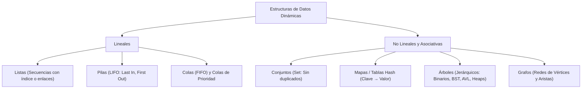
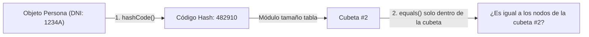
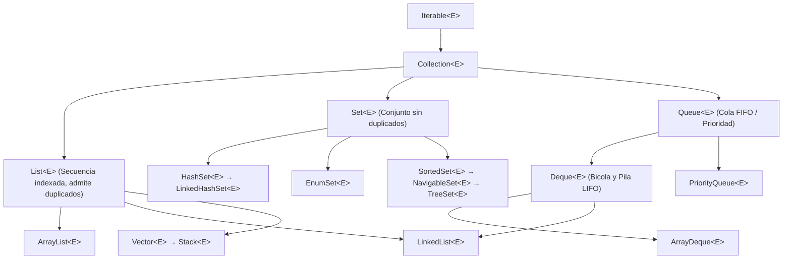
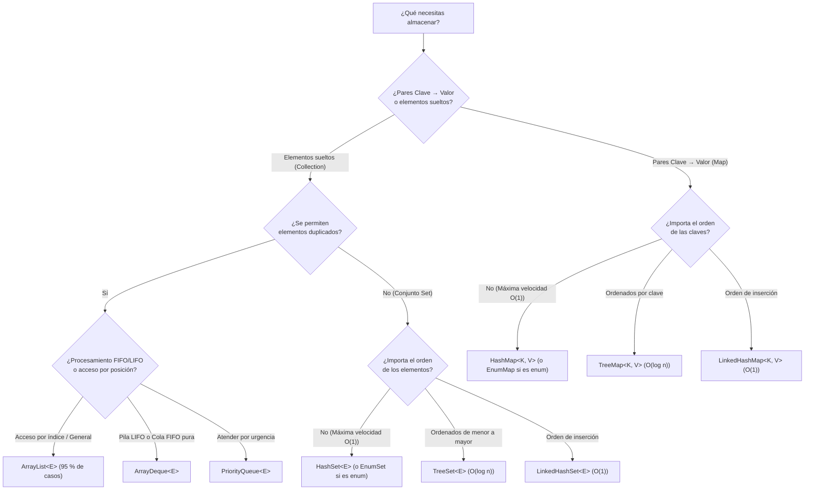

## Objetivos de Aprendizaje (RA6 y RA7 — 30 horas)

Al finalizar esta unidad didáctica serás capaz de:

* Diferenciar las **estructuras de datos estáticas** de las **dinámicas** (listas, pilas, colas, árboles, tablas hash y grafos) y analizar el coste de los algoritmos mediante la notación asintótica **Big-O (`O(1)`, `O(log n)`, `O(n)`, `O(n log n)`, `O(n²)`)**.
* Diseñar **clases, interfaces y métodos genéricos (`<T>`)** aplicando límites de tipo (**`extends`**), comodines (**`? extends`**, **`? super`**) y comprendiendo el **borrado de tipos (*Type Erasure*)** y sus restricciones.
* Recorrer y manipular colecciones de forma segura empleando **`Enumeration`**, **`Iterator`**, **`ListIterator`**, **`Spliterator`** y la interfaz **`Iterable<T>`**.
* Implementar correctamente el contrato entre **`equals(Object)`** y **`hashCode()`**, así como la ordenación natural (**`Comparable<T>`**) y externa multicriterio (**`Comparator<T>`**).
* Dominar la arquitectura completa del **Java Collections Framework (JCF)**: listas (**`ArrayList`**, **`LinkedList`**, **`Vector`**), conjuntos (**`HashSet`**, **`TreeSet`**, **`LinkedHashSet`**, **`EnumSet`**), colas y pilas (**`Queue`**, **`PriorityQueue`**, **`Deque`**, **`ArrayDeque`**, **`Stack`**) y mapas (**`HashMap`**, **`TreeMap`**, **`LinkedHashMap`**, **`EnumMap`**, **`Properties`**).
* Construir desde cero nuestros propios **Tipos de Datos Abstractos (TDA)**: listas enlazadas con reciclaje de memoria (*Freelists*), **Árboles Binarios (`ArbolB`)**, **Árboles Binarios de Búsqueda (`ArbolBB`)**, **Árboles Balanceados AVL (`ArbolBBB`)** y **Tablas Hash con Prueba Lineal (`TablaHashPL`)**.
* Aplicar **algoritmos clásicos** de ordenación (**Inserción, Burbuja, QuickSort, MergeSort**), búsqueda (**Secuencial y Binaria**) y técnicas avanzadas (**Divide y vencerás, Programación Dinámica con Memoización, Voraces, Backtracking, Dijkstra y Kruskal**).
* Comprender los fundamentos de la **programación concurrente con hilos (*Threads*)**, sincronización (**`synchronized`**, **`volatile`**, **`wait()`/`notifyAll()`**), el patrón **Productor-Consumidor**, **temporizadores (`Timer`)** y el uso de colecciones en entornos multihilo.

---

## 1. Estructuras de Datos Dinámicas y Complejidad Computacional

Hasta ahora, cuando necesitábamos almacenar un conjunto de elementos en memoria, recurríamos a los **arrays unidimensionales o multidimensionales** (`int[]`, `String[][]`). Sin embargo, en el desarrollo de aplicaciones reales los arrays presentan dos limitaciones estructurales importantes:

1. **Tamaño fijo (estático):** una vez creado un array con `new Persona[100]`, su longitud no puede crecer ni encogerse durante la vida del objeto. Si nos quedamos cortos, debemos reservar un array nuevo más grande y copiar todos los elementos; si reservamos por exceso, desperdiciamos memoria RAM.
2. **Rigidez operativa:** insertar o eliminar un elemento en una posición intermedia obliga a desplazar manualmente todos los elementos posteriores o anteriores, y operaciones frecuentes como buscar, ordenar o eliminar duplicados deben programarse a mano o apoyarse en utilidades externas.

### 1.1. Estructuras Estáticas frente a Estructuras Dinámicas

Las **estructuras de datos dinámicas** (denominadas en Java **colecciones**) son contenedores cuya capacidad crece y disminuye automáticamente en tiempo de ejecución a medida que añadimos o retiramos objetos.

| Característica | Estructura Estática (`Array`) | Estructura Dinámica (`Colección`) |
| :--- | :--- | :--- |
| **Tamaño en memoria** | Fijo desde su instanciación (`array.length`). | Variable dinámicamente (`coleccion.size()`). |
| **Disposición física** | Celdas contiguas en memoria RAM. | Bloques redimensionables o nodos enlazados dispersos en el *Heap*. |
| **Tipos admitidos** | Tipos primitivos (`int`, `double`) y referencias a objetos. | Exclusivamente referencias a objetos (usa *Wrappers* como `Integer` para primitivos). |
| **Acceso por índice** | Inmediato en tiempo constante `O(1)`. | Depende de la estructura (`O(1)` en `ArrayList`, `O(n)` en `LinkedList`). |
| **Inserción / Borrado** | Costoso en posiciones intermedias (requiere desplazar celdas). | Optimizado según la implementación (`O(1)` en listas enlazadas con cursor). |
| **Operaciones integradas** | Mínimas (requiere la clase `java.util.Arrays`). | Riquísimo repertorio de búsqueda, filtrado, conjuntos, colas y mapas. |

### 1.2. Panorama Conceptual de las Estructuras de Datos

Antes de entrar en las clases concretas de la biblioteca de Java, conviene distinguir conceptualmente las grandes familias de estructuras de datos que utilizaremos en ingeniería de software:



1. **Listas simples, doblemente enlazadas y circulares:** secuencias ordenadas de nodos donde cada nodo guarda un dato y una referencia al nodo siguiente (`sig`) y, en las doblemente enlazadas, también al nodo anterior (`ant`).
2. **Pilas (*Stacks* — LIFO):** estructuras donde el último elemento en entrar es el primero en salir (*Last In, First Out*), como una pila de platos o el historial de llamadas a métodos (*Call Stack*).
3. **Colas (*Queues* — FIFO) y Bicolas (*Deques*):** estructuras donde el primer elemento en llegar es el primero en ser atendido (*First In, First Out*), como la fila de un supermercado. Las **bicolas** permiten insertar y extraer por ambos extremos, y las **colas de prioridad** atienden antes al elemento más urgente.
4. **Conjuntos (*Sets*):** colecciones matemáticas que prohíben la existencia de elementos duplicados.
5. **Mapas, Diccionarios o Tablas Hash (*Maps*):** estructuras asociativas que almacenan pares **`Clave → Valor`** (`Key → Value`), permitiendo localizar un valor casi instantáneamente a partir de su clave única.
6. **Árboles (*Trees*):** estructuras jerárquicas formadas por un nodo **raíz** del que cuelgan subárboles de nodos **hijos**. Los nodos sin hijos se llaman **hojas**, los que comparten padre son **hermanos** y la secuencia de aristas entre dos nodos forma un **camino**. Destacan los **Árboles Binarios** (máximo 2 hijos por nodo), los **Árboles Binarios de Búsqueda (BST/ABB)**, los **Árboles Balanceados (AVL y Rojo-Negro)** y los **Montículos (*Heaps*)**.
7. **Grafos (*Graphs*):** estructuras compuestas por un conjunto de **vértices (nodos)** conectados por **aristas (arcos)**. Pueden ser **no dirigidos** (aristas bidireccionales), **dirigidos** (aristas con sentido de flecha) y **ponderados** (cada arista tiene un peso, coste o distancia, como un mapa de carreteras). Se representan en memoria mediante una **matriz de adyacencia** (`int[][]`) o una **lista de adyacencia** (`Map<Vertice, List<Arista>>`).

### 1.3. Complejidad Computacional y Notación Asintótica Big-O (`O`)

Para elegir con criterio profesional qué colección o algoritmo usar en cada problema, no medimos segundos con un cronómetro (pues dependen de la velocidad de la CPU de cada ordenador), sino que analizamos cómo crece el número de operaciones a medida que el tamaño de los datos de entrada (`n`) se hace grande. Esta medida matemática se denomina **complejidad temporal asintótica** y se expresa con la **notación Big-O**:

| Orden Big-O | Nombre | Comportamiento al crecer `n` | Ejemplo típico en Java |
| :--- | :--- | :--- | :--- |
| **`O(1)`** | **Constante** | ¡El ideal! El tiempo es idéntico haya 10 elementos o 10 millones. | `arrayList.get(i)`, `hashMap.get(clave)`, `stack.push(x)`. |
| **`O(log n)`** | **Logarítmica** | Enormemente rápida: en cada paso descarta la mitad del problema. Para `n = 1.000.000`, apenas da ~20 pasos. | Búsqueda binaria (`binarySearch`), inserción/búsqueda en `TreeSet`, `TreeMap` o árbol AVL. |
| **`O(n)`** | **Lineal** | El coste crece en proporción directa a `n`. Si se duplica `n`, tarda el doble. | Búsqueda secuencial en una lista desordenada, recorrer un array con un bucle `for`. |
| **`O(n log n)`** | **Lineal-logarítmica** | El límite óptimo para algoritmos generales de ordenación por comparación. | **QuickSort** (caso medio), **MergeSort**, `Arrays.sort()`, `Collections.sort()`. |
| **`O(n²)`** | **Cuadrática** | Dos bucles anidados recorriendo los `n` datos. Para `n = 10.000` realiza `100.000.000` de pasos. | Ordenación por **Burbuja**, **Inserción directa** o **Selección**. |
| **`O(2ⁿ)`** | **Exponencial** | Se duplica el trabajo con cada unidad que suma `n`. Inviable para `n > 40`. | Fibonacci recursivo ingenuo sin memoria, subconjuntos por fuerza bruta. |
| **`O(n!)`** | **Factorial** | Explosión combinatoria total; intratable incluso para `n = 15`. | Generar todas las permutaciones del Problema del Viajante (TSP) por fuerza bruta. |

:::tip[Regla de oro del desarrollador Java]
Si necesitas buscar elementos miles de veces dentro de un bucle, **nunca uses `ArrayList.contains()` (`O(n)`)**: el bucle global se convertirá en cuadrático `O(n²)`. Pasa los datos a un **`HashSet` (`O(1)`)** o a un **`TreeSet` (`O(log n)`)** y tu programa pasará de tardar minutos a ejecutarse en milisegundos.
:::

---

## 2. Programación Genérica en Java (`<T>`)

Introducidos en JDK 5, los **genéricos (*Generics*)** transformaron por completo el lenguaje Java. Permiten parametrizar tipos: es decir, diseñar clases, interfaces y métodos donde el tipo de los datos con los que operan se especifica como un **parámetro entre ángulos (`<T>`)** en el momento de usarlos.

### 2.1. El Problema Pre-Genérico vs. La Seguridad de Tipos

Antes de que existieran los genéricos, para crear una clase contenedor universal que sirviese para guardar cualquier objeto (`Integer`, `String`, `Factura`), la única alternativa era declarar el atributo interno de tipo `Object`:

```java
// ❌ ENFOQUE PRE-GENÉRICO (Peligroso y propenso a ClassCastException)
class CajaAntigua {
    private Object contenido;

    public CajaAntigua(Object contenido) { this.contenido = contenido; }
    public Object getContenido() { return contenido; }
}
```

Este diseño obligaba a realizar conversiones explícitas (*downcasting*) constantemente y —lo que es mucho peor— **impedía al compilador detectar errores de tipos**, haciendo que el programa estallase en tiempo de ejecución con un `ClassCastException`:

```java
CajaAntigua caja = new CajaAntigua("Hola Mundo");
// Obligados a hacer casting explícito:
String texto = (String) caja.getContenido();

// ¡Error humano! Guardamos un Integer pero intentamos leer un String:
CajaAntigua otraCaja = new CajaAntigua(Integer.valueOf(88));
// Compila sin avisar, pero EXPLOTA en ejecución con ClassCastException:
String fallo = (String) otraCaja.getContenido();
```

Con la **programación genérica**, definimos un parámetro de tipo formal `<T>` que el compilador sustituirá y vigilará estrictamente en tiempo de compilación:

```java
// ✅ ENFOQUE GENÉRICO: Seguro en compilación, limpio y sin castings manuales
public class Gen<T> {
    private T ob; // Declara una referencia de tipo T

    public Gen(T o) {
        this.ob = o;
    }

    public T getOb() {
        return ob;
    }

    public void mostrarTipo() {
        System.out.println("El tipo real de T es: " + ob.getClass().getName());
    }
}
```

Veamos cómo se utiliza nuestra clase `Gen<T>` con total seguridad:

```java
public class GenDemo {
    public static void main(String[] args) {
        // 1. Creamos una instancia parametrizada para Integer
        Gen<Integer> iOb = new Gen<Integer>(88);
        iOb.mostrarTipo();

        // No hace falta hacer casting: getOb() devuelve directamente un Integer
        int v = iOb.getOb();
        System.out.println("Valor entero: " + v);

        // 2. Reutilizamos la MISMA clase para manejar Strings
        Gen<String> strOb = new Gen<>("Prueba de genéricos");
        strOb.mostrarTipo();
        String str = strOb.getOb();
        System.out.println("Valor cadena: " + str);

        // 3. Seguridad de tipos en tiempo de compilación:
        // iOb = strOb; // ❌ ERROR DE COMPILACIÓN: Gen<String> no es convertible a Gen<Integer>
    }
}
```

### 2.2. Convenciones de Nombres y Clases con Múltiples Parámetros (`<T, V>`)

Por convención oficial en Java, los parámetros de tipo se escriben con **una única letra mayúscula** para distinguirlos de un vistazo de las clases reales:

* **`T`** (*Type*): tipo genérico de propósito general.
* **`E`** (*Element*): elemento de una colección (usado en `List<E>`, `Set<E>`).
* **`K`** (*Key*) y **`V`** (*Value*): clave y valor en estructuras asociativas (`Map<K, V>`).
* **`N`** (*Number*): tipo numérico.
* **`S`, `U`, `V`**: segundos, terceros y cuartos tipos genéricos cuando se necesita más de uno.

Una clase puede recibir dos o más parámetros de tipo separados por comas:

```java
public class DosGen<T, V> {
    private T ob1;
    private V ob2;

    public DosGen(T o1, V o2) {
        this.ob1 = o1;
        this.ob2 = o2;
    }

    public void mostrarTipos() {
        System.out.println("Tipo de T: " + ob1.getClass().getName());
        System.out.println("Tipo de V: " + ob2.getClass().getName());
    }

    public T getOb1() { return ob1; }
    public V getOb2() { return ob2; }
}
```

```java
// Ejemplo de uso con dos argumentos de tipo: Integer y String
DosGen<Integer, String> tgObj = new DosGen<>(88, "Genéricos");
tgObj.mostrarTipos();
int num = tgObj.getOb1();
String cad = tgObj.getOb2();
```

### 2.3. El Operador Diamante (`<>`) y el Peligro del Tipo *Raw*

A partir de Java 7 no es necesario repetir los tipos genéricos en el lado derecho del `new`. Basta con escribir el **operador diamante vacío (`<>`)** y el compilador inferirá los tipos automáticamente a partir de la declaración de la variable:

```java
// Antes de Java 7 (verboso):
DosGen<Integer, String> par1 = new DosGen<Integer, String>(42, "Respuesta");

// Desde Java 7 hasta Java 25 LTS (con operador diamante <>):
DosGen<Integer, String> par2 = new DosGen<>(42, "Respuesta");
```

:::caution[¡Nunca uses el tipo *Raw* (crudo)!]
Si instancias una clase genérica omitiendo por completo los ángulos (`Gen raw = new Gen(88);`), estás usando un **tipo crudo (*raw type*)**, permitido únicamente por compatibilidad con código anterior al año 2004. Al hacerlo, **desactivas toda la comprobación de tipos genéricos** y vuelves a exponerte a errores `ClassCastException` en ejecución.
:::

### 2.4. Interfaces Genéricas, Métodos Genéricos y Clases Anidadas

Además de clases, podemos parametrizar **interfaces** y **métodos individuales** (incluso dentro de clases que no sean genéricas):

```java
// 1. Interfaz genérica
public interface Contenedor<T> {
    void guardar(T elemento);
    T extraer();
}

// 2. Clase que contiene métodos genéricos estáticos y de instancia
public class UtilidadesGenericas {

    // El parámetro <T> se declara JUSTO ANTES del tipo de retorno del método
    public static <T> void intercambia(T[] array, int i, int j) {
        T temp = array[i];
        array[i] = array[j];
        array[j] = temp;
    }

    public static <T> boolean contiene(T[] array, T buscado) {
        for (T elem : array) {
            if (elem != null && elem.equals(buscado)) {
                return true;
            }
        }
        return false;
    }
}
```

#### Clases Anidadas Genéricas y Ocultación de Parámetros
Cuando una clase genérica `Externa<T>` contiene una clase interna, debemos tener mucho cuidado:
* Si la clase interna **reutiliza el mismo `<T>` de la externa**, no debe volver a declarar `<T>` en su cabecera (`class Interna { ... }`).
* Si declaramos `class Interna<T> { ... }`, esa nueva `<T>` **oculta (*shadows*)** el parámetro `<T>` de la clase externa, tratándose como dos tipos completamente independientes.

### 2.5. Tipos Limitados (*Bounded Types*: `<T extends ...>`)

A veces no queremos que `<T>` pueda ser *cualquier* clase como `String` o `Scanner`, sino únicamente tipos numéricos que hereden de `java.lang.Number` para poder invocar sobre ellos métodos como `doubleValue()` o `intValue()`. Para restringir los tipos permitidos usamos la palabra clave **`extends`** (que en genéricos significa tanto «hereda de la clase» como «implementa la interfaz»):

```java
// T solo puede ser Number o una subclase suya (Integer, Double, Long, Float...)
public class OperaMate<T extends Number> {
    private T num;

    public OperaMate(T n) {
        this.num = n;
    }

    // Gracias a "extends Number", el compilador sabe que num tiene doubleValue()
    public double reciproco() {
        return 1.0 / num.doubleValue();
    }

    public double fraccion() {
        return num.doubleValue() - num.intValue();
    }
}
```

```java
OperaMate<Integer> iOb = new OperaMate<>(5);
System.out.println("Recíproco de 5: " + iOb.reciproco()); // 0.2

OperaMate<Double> dOb = new OperaMate<>(5.25);
System.out.println("Parte fraccionaria de 5.25: " + dOb.fraccion()); // 0.25

// OperaMate<String> strOb = new OperaMate<>("Error"); // ❌ No compila: String no hereda de Number
```

También podemos:
1. **Vincular un parámetro de tipo con otro:** `class Pareja<T, V extends T>` exige que el tipo `V` sea igual a `T` o una subclase de `T` (por ejemplo, `Pareja<Number, Integer>` es válido, pero `Pareja<Number, String>` no compila).
2. **Establecer múltiples límites con `&`:** `class Analizador<T extends Number & Comparable<T> & Serializable>`. Si entre los límites hay una clase, **la clase debe figurar siempre en primer lugar** seguida de las interfaces.

### 2.6. Comodines (*Wildcards* `?`): Invarianza, Covarianza y Contravarianza

Uno de los conceptos que más sorprende al aprender genéricos es que **los tipos genéricos son invariantes**. Aunque `Deportista` herede de `Persona`, una `List<Deportista>` **NO** es subtipo de `List<Persona>`:

```java
class Persona {
    private String nombre;
    public Persona(String nombre) { this.nombre = nombre; }
    public String getNombre() { return nombre; }
}

class Deportista extends Persona {
    public Deportista(String nombre) { super(nombre); }
}

class Ingeniero extends Persona {
    public Ingeniero(String nombre) { super(nombre); }
}
```

Si escribimos un método `public static void imprimirPersonas(List<Persona> lista)` e intentamos pasarle un `List<Deportista>`, ¡el compilador lo rechazará! ¿Por qué? Porque si lo permitiera, dentro de `imprimirPersonas` alguien podría hacer `lista.add(new Ingeniero("Ana"))`, metiendo de contrabando un `Ingeniero` dentro de una lista que en realidad era solo de `Deportista`.

Para flexibilizar los métodos y permitir que trabajen con distintas parametrizaciones se utilizan los **comodines (*wildcards* `?`)**:

| Comodín | Sintaxis | Significado | Qué permite hacer (Regla **PECS**) |
| :--- | :--- | :--- | :--- |
| **Comodín ilimitado** | `List<?>` | Lista de cualquier tipo desconocido. | Solo lectura como `Object` (no permite añadir nada salvo `null`). |
| **Límite superior (*Covarianza*)** | `List<? extends Persona>` | Lista de `Persona` o de **cualquier subclase** de `Persona` (`Deportista`, `Ingeniero`). | **Lectura segura** como `Persona` (*Producer Extends*). Prohibido insertar elementos. |
| **Límite inferior (*Contravarianza*)** | `List<? super Deportista>` | Lista de `Deportista` o de **cualquier superclase** suya (`Persona`, `Object`). | **Escritura segura** de objetos `Deportista` (*Consumer Super*). Lectura solo como `Object`. |

```java
import java.util.List;

public class ComodinesDemo {

    // 1. Producer Extends (Lectura): acepta List<Persona>, List<Deportista> o List<Ingeniero>
    public static void mostrarNombres(List<? extends Persona> fuente) {
        for (Persona p : fuente) {
            System.out.println(p.getNombre());
        }
        // fuente.add(new Deportista("Rafa")); // ❌ Prohibido insertar en ? extends
    }

    // 2. Consumer Super (Escritura): acepta List<Deportista>, List<Persona> o List<Object>
    public static void registrarCampeon(List<? super Deportista> destino) {
        destino.add(new Deportista("Carlos Alcaraz")); // ✅ Seguro insertar un Deportista
    }
}
```

:::tip[Regla mnemotécnica PECS de Joshua Bloch]
**PECS** significa ***Producer Extends, Consumer Super***:
* Si la colección parametrizada solo va a **producir** datos para que tu método los lea, usa **`? extends T`**.
* Si la colección solo va a **consumir** datos que tu método inserta dentro de ella, usa **`? super T`**.
:::

### 2.7. Borrado de Tipos (*Type Erasure*) y las 8 Restricciones de los Genéricos

En Java, los genéricos son una característica de **tiempo de compilación**. Cuando el compilador genera el archivo `.class` (*bytecode*), aplica un proceso llamado **borrado de tipos (*Type Erasure*)**:

1. Reemplaza todos los parámetros de tipo ilimitados `<T>` por `Object` (o por su primer límite superior si se definió `<T extends Number>`).
2. Inserta automáticamente los *castings* necesarios en las lecturas para garantizar la seguridad de tipos.
3. Genera *métodos puente* (*bridge methods*) cuando es necesario preservar el polimorfismo en clases genéricas heredadas.

Debido al *Type Erasure*, **en tiempo de ejecución la JVM no distingue entre `ArrayList<String>` y `ArrayList<Integer>`** (ambos son simplemente `ArrayList`). Esto impone **8 restricciones fundamentales** que todo programador Java debe conocer y saber resolver:

#### 1. No se pueden usar tipos primitivos como argumentos de tipo
`Gen<int>` no compila porque tras el borrado `T` pasa a ser `Object`, y `int` no hereda de `Object`.
* **Solución:** usar siempre las clases envoltorio (*Wrappers*: `Integer`, `Double`, `Character`, `Boolean`), apoyándonos en el **autoboxing y auto-unboxing** automático de Java.

#### 2. Invarianza de tipos parametrizados
`Caja<Number>` no acepta directamente un `Caja<Integer>`, salvo que utilicemos comodines (`Caja<? extends Number>`).

#### 3. No se pueden instanciar parámetros de tipo (`new T()`)
Dentro de una clase `<E>`, escribir `E elem = new E();` es ilegal porque en ejecución la JVM no sabe qué constructor invocar para `E`.
* **Solución profesional mediante Reflexión (`Class<E>`):** pasar el objeto `Class<E>` al método e instanciarlo dinámicamente:

```java
public static <E> void anadirNuevaInstancia(List<E> lista, Class<E> clase) throws Exception {
    E elem = clase.getDeclaredConstructor().newInstance(); // ✅ Crea un nuevo E en ejecución
    lista.add(elem);
}
```

#### 4. No se pueden instanciar arrays del parámetro de tipo (`new T[capacidad]`)
Los arrays en Java sí necesitan conocer su tipo exacto en tiempo de ejecución para vigilar cada inserción, mientras que `T` ha sido borrado.
* **Solución 1 (con `Array.newInstance`):**
  ```java
  @SuppressWarnings("unchecked")
  T[] vector = (T[]) java.lang.reflect.Array.newInstance(clase, capacidad);
  ```
* **Solución 2 (interna, como hace `ArrayList`):** usar un `Object[]` interno o hacer un cast controlado `(T[]) new Object[capacidad]`.

#### 5. No se pueden declarar atributos estáticos de tipo genérico
`private static T instancia;` está prohibido porque los miembros `static` son compartidos por todas las instancias de la clase, y sería ambiguo qué tipo tendría si existen a la vez un `Gen<String>` y un `Gen<Integer>`. (Nota: los *métodos* estáticos sí pueden definir su propio `<T>`).

#### 6. No se puede usar `instanceof` con un tipo parametrizado concreto
`if (obj instanceof List<Integer>)` no compila porque en ejecución no queda rastro de `<Integer>`. Solo se permite comprobar con comodín ilimitado: `if (obj instanceof List<?>)`.

#### 7. No se pueden crear arrays de tipos parametrizados
`List<Integer>[] arrayDeListas = new List<Integer>[2];` produce un error de compilación (*generic array creation*). En su lugar, utiliza siempre una colección de colecciones: `List<List<Integer>>`.

#### 8. Restricciones con Excepciones y Sobrecarga de Métodos
* **Excepciones:** una clase genérica no puede heredar de `Exception` ni `Throwable`, ni se puede escribir `catch (T e)`. Sí es válido usar `throws T` en la cabecera de un método cuando `<T extends Exception>`.
* **Sobrecarga (*Overloading*):** no pueden coexistir en la misma clase `void print(Set<String> s)` y `void print(Set<Integer> i)` porque tras el borrado de tipos ambos métodos tendrían exactamente la misma firma `void print(Set s)`.

---

## 3. Iteradores y Recorrido de Colecciones

Un **iterador** es un objeto patrón de diseño cuyo propósito es permitirnos recorrer secuencialmente todos los elementos de una colección (sea una lista, un conjunto o un árbol) **sin necesidad de conocer cómo está implementada por dentro**.

### 3.1. De `Enumeration<E>` a `Iterator<E>`

En las primeras versiones de Java (JDK 1.0), el recorrido de clases como `Vector` o `Hashtable` se realizaba mediante la interfaz **`java.util.Enumeration<E>`**, que solo disponía de dos métodos de nombres largos y no permitía borrar elementos:

* `boolean hasMoreElements()`: devuelve `true` si quedan elementos por visitar.
* `E nextElement()`: devuelve el siguiente elemento.

Con la llegada del *Java Collections Framework*, `Enumeration` fue sustituida por la interfaz estándar **`java.util.Iterator<E>`**, mucho más concisa y potente:

| Método de `Iterator<E>` | Descripción y Comportamiento |
| :--- | :--- |
| **`boolean hasNext()`** | Devuelve `true` si la iteración tiene más elementos pendientes de recorrer. |
| **`E next()`** | Avanza el cursor y devuelve el siguiente elemento. Si no quedan más, lanza `NoSuchElementException`. |
| **`void remove()`** | Elimina de la colección subyacente el **último elemento devuelto por `next()`**. Si se llama sin haber invocado antes a `next()`, o dos veces seguidas para el mismo paso, lanza `IllegalStateException`. |
| **`default void forEachRemaining(Consumer<? super E> action)`** | Procesa funcionalmente todos los elementos restantes del iterador. |

:::warning[¡Peligro de `ConcurrentModificationException` al borrar en un bucle!]
Si mientras estás recorriendo una colección con un bucle `for-each` o un `Iterator` intentas borrar un elemento llamando directamente a `coleccion.remove(elem)`, Java lanzará inmediatamente una **`ConcurrentModificationException`** (comportamiento *fail-fast*) porque has alterado la estructura a espaldas del iterador.
Para borrar elementos durante un recorrido tienes **dos formas seguras**:
1. Usar el método **`it.remove()`** del propio `Iterator`.
2. Usar el método funcional **`coleccion.removeIf(condicion)`** (disponible desde Java 8).
:::

Veamos ambos enfoques en acción:

```java
import java.util.ArrayList;
import java.util.Iterator;
import java.util.List;

public class BorradoSeguroDemo {
    public static void main(String[] args) {
        List<String> lenguajes = new ArrayList<>(List.of("Java", "COBOL", "Python", "Ada", "Kotlin"));

        // Forma 1: Recorrido clásico y borrado seguro con Iterator.remove()
        Iterator<String> it = lenguajes.iterator();
        while (it.hasNext()) {
            String lang = it.next();
            if (lang.length() <= 3) {
                it.remove(); // ✅ Borra "Ada" de forma segura sin romper el cursor
            }
        }

        // Forma 2 (Moderna): Borrado declarativo con removeIf
        lenguajes.removeIf(lang -> lang.equals("COBOL"));
        System.out.println(lenguajes); // [Java, Python, Kotlin]
    }
}
```

### 3.2. `ListIterator<E>`: Iteración Bidireccional y Modificación en Listas

El `Iterator` estándar solo puede avanzar hacia delante y únicamente está pensado para leer o borrar. Para las listas (`List<E>`), Java proporciona una subinterfaz especializada llamada **`ListIterator<E>`** (obtenida mediante `lista.listIterator()` o `lista.listIterator(indiceInicial)`).

Un `ListIterator` no apunta a un elemento concreto, sino que su cursor se sitúa **entre dos elementos** (como el cursor de texto de un editor):

* **Avance hacia delante:** `hasNext()`, `next()` y `nextIndex()`.
* **Retroceso hacia atrás:** `hasPrevious()`, `previous()` y `previousIndex()`.
* **Modificación en vivo:**
  * `set(E o)`: reemplaza el último elemento devuelto por `next()` o `previous()`.
  * `add(E o)`: inserta un nuevo elemento inmediatamente antes del elemento que devolvería `next()`.
  * `remove()`: elimina el último elemento visitado.

Observa cómo podemos usar `ListIterator` para realizar una **inserción alfabética ordenada** sobre la marcha y recorrer la lista en ambos sentidos:

```java
import java.util.LinkedList;
import java.util.List;
import java.util.ListIterator;

public class ListIteratorDemo {

    // Inserta un elemento manteniendo la lista ordenada alfabéticamente
    public static void insertarOrdenado(List<String> lista, String nuevo) {
        ListIterator<String> it = lista.listIterator();
        while (it.hasNext()) {
            String actual = it.next();
            if (actual.compareToIgnoreCase(nuevo) > 0) {
                // Nos hemos pasado de su sitio: retrocedemos un paso e insertamos
                it.previous();
                it.add(nuevo);
                return;
            }
        }
        // Si llegamos al final, va en la última posición
        it.add(nuevo);
    }

    public static void main(String[] args) {
        List<String> ciudades = new LinkedList<>();
        insertarOrdenado(ciudades, "Valencia");
        insertarOrdenado(ciudades, "Alicante");
        insertarOrdenado(ciudades, "Castellón");
        insertarOrdenado(ciudades, "Madrid");

        System.out.println("Orden directo: " + ciudades); // [Alicante, Castellón, Madrid, Valencia]

        // Recorrido inverso empezando desde el final (ciudades.size())
        System.out.print("Orden inverso: ");
        ListIterator<String> inv = ciudades.listIterator(ciudades.size());
        while (inv.hasPrevious()) {
            System.out.print(inv.previous() + " ");
        }
        System.out.println();
    }
}
```

### 3.3. `Spliterator<T>`: Iteración Particionable y Funcional

Introducido en Java 8 en la interfaz `Iterable`, el **`Spliterator<T>`** (*Splitable Iterator*) combina el recorrido funcional con la capacidad de **dividir la colección en mitades independientes** para procesarla en paralelo:

* **`boolean tryAdvance(Consumer<? super T> action)`**: si queda algún elemento, ejecuta la acción sobre el siguiente y devuelve `true` (equivale a unificar `hasNext()` + `next()`).
* **`default void forEachRemaining(Consumer<? super T> action)`**: aplica la acción a todos los elementos restantes del bloque actual.
* **`Spliterator<T> trySplit()`**: intenta partir la colección en dos trozos; devuelve un nuevo `Spliterator` que cubre la primera mitad mientras el actual se queda con la segunda mitad (o devuelve `null` si ya no se puede dividir más).
* **`long estimateSize()`** y **`int characteristics()`**: informan del número estimado de elementos y de las propiedades de la colección (`ORDERED`, `DISTINCT`, `SORTED`, `SIZED`, `NONNULL`, `IMMUTABLE`, `CONCURRENT`, `SUBSIZED`).

```java
import java.util.ArrayList;
import java.util.List;
import java.util.Spliterator;

public class SpliteratorDemo {
    public static void main(String[] args) {
        List<Double> valores = new ArrayList<>(List.of(1.0, 4.0, 9.0, 16.0, 25.0, 36.0));

        // 1. Recorrer elemento a elemento con tryAdvance
        Spliterator<Double> spltItr = valores.spliterator();
        System.out.println("Raíces cuadradas con tryAdvance:");
        while (spltItr.tryAdvance(n -> System.out.println("  √" + n + " = " + Math.sqrt(n))));

        // 2. Dividir la colección en dos partes con trySplit y recorrer con forEachRemaining
        Spliterator<Double> parte2 = valores.spliterator();
        Spliterator<Double> parte1 = parte2.trySplit(); // parte1 se queda los primeros elementos

        if (parte1 != null) {
            System.out.print("Primera mitad: ");
            parte1.forEachRemaining(n -> System.out.print(n + " "));
            System.out.println();
        }
        System.out.print("Segunda mitad: ");
        parte2.forEachRemaining(n -> System.out.print(n + " "));
        System.out.println();
    }
}
```

### 3.4. La Interfaz `Iterable<T>` y Cómo Hacer Nuestras Clases Compatibles con `for-each`

¿Por qué cualquier colección de Java se puede recorrer con el bucle extendido `for (Elemento e : coleccion)`? Porque todas las colecciones implementan en la cúspide de su jerarquía la interfaz **`java.lang.Iterable<T>`**, cuyo único método abstracto es:

```java
public interface Iterable<T> {
    Iterator<T> iterator();
}
```

Cualquier clase propia que implemente `Iterable<T>` podrá usarse automáticamente dentro de un bucle `for-each`. Veamos cómo crear una clase `StringIterable` que permita recorrer una frase carácter a carácter en un `for-each`:

```java
import java.util.Iterator;
import java.util.NoSuchElementException;

public class StringIterable implements Iterable<Character> {
    private final String cadena;

    public StringIterable(String cadena) {
        this.cadena = cadena;
    }

    @Override
    public Iterator<Character> iterator() {
        return new Iterator<Character>() {
            private int indice = 0;

            @Override
            public boolean hasNext() {
                return indice < cadena.length();
            }

            @Override
            public Character next() {
                if (!hasNext()) {
                    throw new NoSuchElementException();
                }
                return cadena.charAt(indice++);
            }
        };
    }

    public static void main(String[] args) {
        StringIterable frase = new StringIterable("Hola DAM");
        for (char c : frase) {
            System.out.print("[" + c + "] ");
        }
        // Salida: [H] [o] [l] [a] [ ] [D] [A] [M]
    }
}
```

---

## 4. Igualdad y Ordenación de Objetos (`equals`, `hashCode`, `Comparable` y `Comparator`)

Para que las colecciones funcionen correctamente —encontrar un objeto con `contains()`, eliminarlo con `remove()`, evitar duplicados en un `Set` o mantener el orden en un `TreeSet`— nuestras clases de dominio deben definir dos mecanismos esenciales: **cuándo dos objetos son iguales** y **cómo se comparan para ordenarse**.

### 4.1. Identidad (`==`) frente a Igualdad Lógica (`equals(Object)`)

Como vimos en unidades anteriores, el operador `==` aplicado a referencias comprueba **identidad de memoria** (si ambas variables apuntan exactamente a la misma dirección del *Heap*). Por su parte, el método `equals(Object)` comprueba **igualdad lógica de contenido**.

El problema es que la implementación heredada por defecto de `Object.equals(Object)` hace simplemente `return (this == obj);`. Si creas una clase `Persona` y **olvidas sobrescribir `equals()`**, métodos de las colecciones como `lista.contains(new Persona("12345678Z"))`, `lista.indexOf(...)` o `lista.remove(...)` **fracasarán**, porque compararán direcciones de memoria y dirán que la persona buscada no está en la lista aunque tenga el mismo DNI.

### 4.2. El Contrato Inquebrantable entre `equals(Object)` y `hashCode()`

Las colecciones basadas en dispersión (*hashing*), como **`HashSet`**, **`LinkedHashSet`** y **`HashMap`**, no buscan elementos recorriendo una lista de principio a fin (`O(n)`). En su lugar, organizan su memoria interna en un array de **cubetas (*buckets*)** y siguen un proceso en **dos pasos**:

1. **Paso 1 (`hashCode()`):** cuando insertas o buscas un objeto, la colección invoca primero su método `int hashCode()`, que devuelve un número entero resumen de su contenido. A partir de ese número calcula en tiempo `O(1)` en qué cubeta debe estar el objeto.
2. **Paso 2 (`equals()`):** solo si en esa cubeta ya había algún objeto (colisión), la colección usa `equals()` para comprobar si es exactamente el mismo elemento.



De este funcionamiento nace el **Contrato Oficial de `hashCode()` en Java**:

1. **Consistencia interna:** invocar `hashCode()` varias veces sobre el mismo objeto durante una ejecución debe devolver siempre el mismo entero (siempre que no se hayan modificado los atributos que intervienen en `equals()`).
2. **Igualdad implica mismo Hash (¡CRÍTICO!):** **si dos objetos son iguales según `a.equals(b) == true`, entonces OBLIGATORIAMENTE deben devolver el mismo código hash (`a.hashCode() == b.hashCode()`)**.
   * *¿Qué pasa si violas esta regla?* Si sobrescribes `equals()` pero olvidas sobrescribir `hashCode()`, dos objetos con el mismo DNI tendrán distinto `hashCode()`, caerán en cubetas diferentes de un `HashSet` y **el conjunto permitirá duplicados** o será incapaz de encontrarlos con `contains()`.
3. **Colisiones permitidas:** dos objetos distintos (`!a.equals(b)`) *pueden* llegar a tener el mismo `hashCode()` (a esto se le llama **colisión hash**), aunque una buena función hash procura minimizar las colisiones para mantener el rendimiento en `O(1)`.

#### Cómo implementar `equals()` y `hashCode()` (Fórmula Clásica Primo 31 vs. `Objects.hash`)

La receta clásica recomendada por Joshua Bloch (*Effective Java*) combina el hash de cada atributo significativo multiplicando el acumulador por el número primo impar **`31`** (que el compilador optimiza a nivel de procesador como `(i << 5) - i`). Desde Java 7 disponemos además del método auxiliar **`Objects.hash(...)`**:

```java
import java.util.Objects;

public class Producto {
    private final String codigo;
    private final String nombre;
    private double precio;
    private boolean activo;

    public Producto(String codigo, String nombre, double precio, boolean activo) {
        this.codigo = codigo;
        this.nombre = nombre;
        this.precio = precio;
        this.activo = activo;
    }

    @Override
    public boolean equals(Object o) {
        // 1. ¿Es exactamente la misma dirección de memoria?
        if (this == o) return true;
        // 2. ¿Es nulo o de una clase distinta?
        if (o == null || getClass() != o.getClass()) return false;
        // 3. Casting seguro y comparación de los atributos clave
        Producto otro = (Producto) o;
        return Double.compare(otro.precio, precio) == 0
                && activo == otro.activo
                && Objects.equals(codigo, otro.codigo)
                && Objects.equals(nombre, otro.nombre);
    }

    // Opción A (Moderna y limpia): usando java.util.Objects.hash
    @Override
    public int hashCode() {
        return Objects.hash(codigo, nombre, precio, activo);
    }

    // Opción B (Clásica con el factor primo 31, equivalente por dentro):
    public int hashCodeClasico() {
        final int primo = 31;
        int resultado = 1;
        resultado = primo * resultado + (codigo == null ? 0 : codigo.hashCode());
        resultado = primo * resultado + (nombre == null ? 0 : nombre.hashCode());
        long bitsPrecio = Double.doubleToLongBits(precio);
        resultado = primo * resultado + (int) (bitsPrecio ^ (bitsPrecio >>> 32));
        resultado = primo * resultado + (activo ? 1231 : 1237);
        return resultado;
    }
}
```

### 4.3. Ordenación Natural (`Comparable<T>`) vs. Ordenación Externa (`Comparator<T>`)

Cuando usamos colecciones ordenadas (`TreeSet`, `TreeMap`, `PriorityQueue`) o invocamos `Collections.sort(lista)` y `lista.sort(...)`, Java necesita saber qué objeto va antes y cuál va después:

1. **`java.lang.Comparable<T>` (Orden natural intrínseco):** la propia clase implementa la interfaz y define su método **`int compareTo(T otro)`**, devolviendo:
   * Un número **negativo (`< 0`)** si `this` es menor (va antes) que `otro`.
   * **Cero (`0`)** si ambos son equivalentes en orden (debe ser coherente con `equals()`).
   * Un número **positivo (`> 0`)** si `this` es mayor (va después) que `otro`.
2. **`java.util.Comparator<T>` (Orden externo o a medida):** permite definir tantos criterios de ordenación adicionales como queramos (`int compare(T o1, T o2)`) sin tocar la clase original, o encadenar criterios con expresiones lambda (`Comparator.comparing(...).thenComparing(...)`).

Veamos un ejemplo completo con una clase `JugadorFutbol` que define su **orden natural por dorsal** (`Comparable`) y varios **comparadores externos** por nombre y edad:

```java
import java.util.ArrayList;
import java.util.Collections;
import java.util.Comparator;
import java.util.List;

public class JugadorFutbol implements Comparable<JugadorFutbol> {
    private String nombre;
    private int dorsal;
    private int edad;

    public JugadorFutbol(String nombre, int dorsal, int edad) {
        this.nombre = nombre;
        this.dorsal = dorsal;
        this.edad = edad;
    }

    public String getNombre() { return nombre; }
    public int getDorsal() { return dorsal; }
    public int getEdad() { return edad; }

    // Orden natural: por número de dorsal ascendente
    // ¡Usamos Integer.compare(a, b) en lugar de (a - b) para evitar desbordamientos!
    @Override
    public int compareTo(JugadorFutbol otro) {
        return Integer.compare(this.dorsal, otro.dorsal);
    }

    @Override
    public String toString() {
        return "#" + dorsal + " " + nombre + " (" + edad + " años)";
    }

    public static void main(String[] args) {
        List<JugadorFutbol> plantilla = new ArrayList<>(List.of(
            new JugadorFutbol("Pedri", 8, 22),
            new JugadorFutbol("Lamine", 19, 18),
            new JugadorFutbol("Gavi", 6, 21),
            new JugadorFutbol("Cubarsí", 2, 18)
        ));

        // 1. Orden natural (Comparable -> por dorsal)
        Collections.sort(plantilla);
        System.out.println("Por dorsal: " + plantilla);

        // 2. Orden externo multicriterio con Comparator (por edad ascendente y, en empate, por nombre)
        Comparator<JugadorFutbol> porEdadYNombre = Comparator
                .comparingInt(JugadorFutbol::getEdad)
                .thenComparing(JugadorFutbol::getNombre);

        plantilla.sort(porEdadYNombre);
        System.out.println("Por edad y nombre: " + plantilla);
    }
}
```

---

## 5. El Framework de Colecciones de Java (JCF): `Collection<E>`, Listas, Conjuntos, Colas y Pilas

El **Java Collections Framework (JCF)**, alojado en el paquete `java.util`, es una arquitectura unificada de interfaces, clases abstractas e implementaciones concretas diseñadas para almacenar y manipular grupos de objetos con altísima eficiencia.

### 5.1. Arquitectura General del JCF

El JCF se divide en dos grandes árboles jerárquicos:
1. **`Collection<E>`** (que hereda de `Iterable<E>`): agrupa colecciones de elementos individuales y se ramifica en tres grandes familias: **Listas (`List<E>`)**, **Conjuntos (`Set<E>`)** y **Colas/Bicolas (`Queue<E>` y `Deque<E>`)**.
2. **`Map<K, V>`**: jerarquía independiente para diccionarios de pares **`Clave → Valor`** (`HashMap`, `TreeMap`, `LinkedHashMap`, `EnumMap`).



### 5.2. Operaciones Comunes de la Interfaz `Collection<E>` y Factorías Inmutables

Toda clase que implemente `Collection<E>` comparte un núcleo de métodos universales:

| Categoría | Método | Descripción |
| :--- | :--- | :--- |
| **Consulta básica** | `int size()`, `boolean isEmpty()`, `boolean contains(Object o)` | Tamaño actual, comprobación de vacío y pertenencia de un elemento (usa `equals()`). |
| **Modificación individual** | `boolean add(E e)`, `boolean remove(Object o)`, `void clear()` | Añade un elemento, elimina la primera ocurrencia o vacía toda la colección. |
| **Operaciones masivas (*Bulk*)** | `boolean containsAll(Collection<?> c)` | Comprueba si contiene **todos** los elementos de `c` (subconjunto). |
| | `boolean addAll(Collection<? extends E> c)` | Añade todos los elementos de `c` (**Unión** en conjuntos). |
| | `boolean removeAll(Collection<?> c)` | Elimina todos los elementos que estén en `c` (**Diferencia** `A - B`). |
| | `boolean retainAll(Collection<?> c)` | Conserva **solo** los elementos que también estén en `c` (**Intersección** `A ∩ B`). |
| **Borrado funcional** | `boolean removeIf(Predicate<? super E> filter)` | Elimina todos los elementos que cumplan el predicado lambda. |
| **Conversión a Array** | `Object[] toArray()`, `<T> T[] toArray(T[] a)`, `<T> T[] toArray(IntFunction<T[]> g)` | Vuelca la colección a un array tipado (ej. `lista.toArray(String[]::new)`). |

#### Factorías de Colecciones Inmutables (`List.of`, `Set.of`, `Map.of`) frente a `Arrays.asList`

A partir de Java 9 disponemos de métodos factoría estáticos rapidísimos para crear colecciones **totalmente inmutables** en una sola línea:

```java
// 1. Colecciones INMUTABLES (Java 9+): no admiten add, remove, set ni elementos null
List<String> dias = List.of("Lunes", "Martes", "Miércoles");
Set<Integer> primos = Set.of(2, 3, 5, 7, 11); // Lanza IllegalArgumentException si pones duplicados

// 2. Vista de tamaño fijo sobre un array: Arrays.asList(...)
// Permite modificar elementos con set(i, valor), pero NO cambiar el tamaño (add/remove lanzan excepción)
List<String> vistaArray = java.util.Arrays.asList("A", "B", "C");
vistaArray.set(0, "Z"); // ✅ Válido

// 3. ¿Cómo crear un ArrayList 100% mutable inicializado con datos?
// Envolviendo List.of(...) en el constructor de ArrayList:
List<String> listaMutable = new java.util.ArrayList<>(List.of("Rojo", "Verde", "Azul"));
listaMutable.add("Amarillo"); // ✅ Totalmente mutable
```

### 5.3. Listas (`List<E>`): `ArrayList<E>`, `LinkedList<E>` y `Vector<E>`

Una **lista (`List<E>`)** es una secuencia ordenada donde cada elemento ocupa una posición entera (`0` a `size() - 1`), **admite elementos duplicados** y añade a `Collection<E>` métodos de acceso posicional: `get(int index)`, `set(int index, E element)`, `add(int index, E element)`, `remove(int index)`, `indexOf(Object o)`, `lastIndexOf(Object o)` y `subList(int fromIndex, int toIndex)`.

#### 1. `ArrayList<E>`: El Todoterreno Basado en Array Redimensionable
Internamente encapsula un array `Object[]` que crece automáticamente (incrementando su capacidad un 50 %) cuando se llena:
* **Acceso por índice (`get` y `set`):** instantáneo **`O(1)`**.
* **Inserción al final (`add(e)`):** tiempo constante amortizado **`O(1)`**.
* **Inserción o borrado en posición intermedia (`add(i, e)`, `remove(i)`):** costoso **`O(n)`** porque desplaza en bloque los elementos siguientes mediante `System.arraycopy`.
* **Optimización de memoria:** si sabemos de antemano que vamos a insertar 50.000 objetos, podemos reservar la capacidad de golpe en el constructor (`new ArrayList<>(50_000)`) o con **`ensureCapacity(50_000)`** para evitar realojamientos intermedios. Una vez terminada la carga, **`trimToSize()`** ajusta el array interno exactamente al número de elementos reales.

#### 2. `LinkedList<E>`: Lista Doblemente Enlazada y Bicola
Almacena cada elemento en un **nodo independiente** que mantiene referencias al nodo anterior (`prev`) y al siguiente (`next`), además de punteros directos al primer (`first`) y último (`last`) nodo de la lista:
* Implementa simultáneamente **`List<E>`** y **`Deque<E>`** (bicola).
* **Inserción y extracción en ambos extremos** (`addFirst`, `addLast`, `getFirst`, `getLast`, `removeFirst`, `removeLast`): tiempo constante **`O(1)`**.
* **Acceso por índice (`get(i)`):** lento **`O(n)`**, ya que debe caminar nodo a nodo desde el principio (o desde el final si `i > size() / 2`).

#### 3. `Vector<E>`: La Lista Sincronizada *Legacy*
Presente desde Java 1.0, funciona igual que `ArrayList` (permite incluso especificar un incremento fijo de capacidad `new Vector<>(capacidad, incremento)` y conserva métodos clásicos como `addElement`, `elementAt`, `firstElement`, `lastElement`), pero **todos sus métodos están sincronizados (`synchronized`)** para seguridad entre hilos. En código monohilo supone una penalización innecesaria de rendimiento, por lo que **siempre se prefiere `ArrayList<E>`**.

| Operación / Característica | `ArrayList<E>` | `LinkedList<E>` | `Vector<E>` |
| :--- | :--- | :--- | :--- |
| **Estructura interna** | Array dinámico contiguo | Nodos doblemente enlazados | Array dinámico sincronizado |
| **`get(indice)` / `set(indice, e)`** | **`O(1)`** (óptimo) | `O(n)` (recorrido secuencial) | `O(1)` (con bloqueo de hilo) |
| **`add(e)` al final** | **`O(1)`** amortizado | **`O(1)`** | `O(1)` amortizado |
| **`add(0, e)` al inicio** | `O(n)` (desplaza todo el array) | **`O(1)`** (óptimo) | `O(n)` |
| **Consumo de memoria RAM** | Bajo (solo el array de referencias) | Alto (cada nodo crea un objeto extra con 3 punteros) | Bajo |
| **Cuándo elegirlo** | **En el 95 % de los casos** (lecturas frecuentes e inserción al final). | Inserciones/borrados constantes al principio o mediante `ListIterator`. | Solo por compatibilidad con APIs antiguas. |

:::caution[Cuidado con las referencias a objetos mutables dentro de una colección]
Recuerda que una colección **no guarda copias de los objetos, sino referencias a ellos**. Si insertas un objeto `Persona p` en un `ArrayList` y acto seguido modificas `p.setNombre("Otro")` usando la variable externa `p` (o reutilizas el mismo objeto `p` dentro de un bucle cambiando sus atributos en cada vuelta en lugar de hacer `new Persona(...)`), **estarás modificando el objeto que ya está dentro de la lista**.
:::

### 5.4. Conjuntos (`Set<E>`): `HashSet<E>`, `TreeSet<E>`, `LinkedHashSet<E>` y `EnumSet<E>`

Un **conjunto (`Set<E>`)** modela el concepto matemático de conjunto: **no admite elementos duplicados** (`e1.equals(e2)`). Si intentas añadir un elemento que ya existe en el conjunto mediante `set.add(elem)`, el conjunto permanece intacto y el método devuelve `false`.

#### 1. `HashSet<E>` (El más rápido: `O(1)`, sin orden garantizado)
Respaldado internamente por una tabla hash (`HashMap`).
* Ofrece tiempo constante **`O(1)`** para `add`, `remove` y `contains`.
* **No garantiza ningún orden de recorrido:** el orden en que salen los elementos al iterar depende de su `hashCode()` y no coincide con el orden en que se insertaron.
* Parámetros de rendimiento: **capacidad inicial** (por defecto `16` cubetas) y **factor de carga o *load factor*** (por defecto `0.75`). Cuando el conjunto alcanza el 75 % de ocupación (`16 × 0.75 = 12` elementos), duplica automáticamente su tabla a `32` cubetas y redistribuye los elementos (*rehashing*).

#### 2. `LinkedHashSet<E>` (Velocidad `O(1)` + Orden de Inserción)
Hereda de `HashSet` pero añade una lista doblemente enlazada que atraviesa las entradas. Gracias a ello, ofrece la misma velocidad **`O(1)`** que `HashSet` pero **recuerda y respeta exactamente el orden en que se insertaron los elementos**.

#### 3. `TreeSet<E>` (Conjunto Ordenado en Árbol Rojo-Negro: `O(log n)`)
Implementa las interfaces `SortedSet<E>` y **`NavigableSet<E>`** almacenando los elementos en un **árbol binario de búsqueda balanceado (Rojo-Negro)**:
* Mantiene los elementos **automáticamente ordenados de menor a mayor** en todo momento (según su orden natural `Comparable` o el `Comparator` pasado al constructor).
* Las operaciones `add`, `remove` y `contains` tienen coste logarítmico **`O(log n)`**.
* No admite elementos `null` (lanzaría `NullPointerException` al intentar compararlos).
* **Métodos exclusivos de `SortedSet` y `NavigableSet`:**
  * Extremos: **`first()`** (el menor), **`last()`** (el mayor), **`pollFirst()`** (extrae y borra el menor), **`pollLast()`** (extrae y borra el mayor).
  * Búsqueda por proximidad:
    * **`lower(e)`**: el mayor elemento estrictamente menor (`< e`).
    * **`floor(e)`**: el mayor elemento menor o igual (`≤ e`).
    * **`ceiling(e)`**: el menor elemento mayor o igual (`≥ e`).
    * **`higher(e)`**: el menor elemento estrictamente mayor (`> e`).
  * Vistas de subconjuntos y orden inverso: **`subSet(desde, hasta)`**, **`headSet(hasta)`**, **`tailSet(desde)`** y **`descendingSet()`**.

```java
import java.util.HashSet;
import java.util.NavigableSet;
import java.util.Set;
import java.util.TreeSet;

public class ConjuntosDemo {
    public static void main(String[] args) {
        // 1. Operaciones algebraicas de conjuntos con HashSet
        Set<String> backend = new HashSet<>(Set.of("Java", "Python", "SQL", "Docker"));
        Set<String> datos = new HashSet<>(Set.of("Python", "SQL", "R", "Spark"));

        Set<String> union = new HashSet<>(backend);
        union.addAll(datos); // Unión (A ∪ B)
        System.out.println("Unión: " + union);

        Set<String> interseccion = new HashSet<>(backend);
        interseccion.retainAll(datos); // Intersección (A ∩ B)
        System.out.println("Comunes (Intersección): " + interseccion); // [Python, SQL]

        Set<String> exclusivosBackend = new HashSet<>(backend);
        exclusivosBackend.removeAll(datos); // Diferencia (A - B)
        System.out.println("Solo en Backend: " + exclusivosBackend); // [Java, Docker]

        // 2. Búsquedas de proximidad con TreeSet (NavigableSet)
        NavigableSet<Integer> horasTren = new TreeSet<>(Set.of(800, 1030, 1315, 1645, 2000));
        System.out.println("Primer tren a partir de las 12:00 (ceiling): " + horasTren.ceiling(1200)); // 1315
        System.out.println("Último tren antes de las 16:45 (lower): " + horasTren.lower(1645));       // 1315
        System.out.println("Trenes entre las 10:00 y las 17:00: " + horasTren.subSet(1000, true, 1700, true));
    }
}
```

#### 4. `EnumSet<E>` (Conjuntos Ultrarrápidos para Enumerados)
Si los elementos del conjunto pertenecen a un tipo `enum`, **`EnumSet`** es la implementación más rápida y compacta que existe en Java: internamente representa el conjunto como un simple vector de bits (`long` de 64 bits), ejecutando todas las operaciones a velocidad de nivel de hardware. Se instancia mediante métodos factoría: `EnumSet.allOf(Dia.class)`, `EnumSet.noneOf(Dia.class)`, `EnumSet.of(Dia.SABADO, Dia.DOMINGO)` o `EnumSet.range(Dia.LUNES, Dia.VIERNES)`.

### 5.5. Colas (`Queue<E>`), Colas de Prioridad (`PriorityQueue<E>`) y Simulación de Eventos

La interfaz **`Queue<E>`** modela colas de procesamiento (habitualmente **FIFO**: primero en entrar, primero en salir). Para cada operación básica define **dos variantes** según cómo queramos tratar las situaciones límite (cola llena o cola vacía):

| Operación | Lanza Excepción si falla | Devuelve Valor Especial (`false` o `null`) |
| :--- | :--- | :--- |
| **Insertar (Encolar)** | `boolean add(E e)` (lanza `IllegalStateException` si no cabe) | **`boolean offer(E e)`** (devuelve `false`) |
| **Extraer y borrar cabecera (Desencolar)** | `E remove()` (lanza `NoSuchElementException` si está vacía) | **`E poll()`** (devuelve `null` si está vacía) |
| **Inspeccionar cabecera sin borrar** | `E element()` (lanza `NoSuchElementException` si está vacía) | **`E peek()`** (devuelve `null` si está vacía) |

#### 1. `PriorityQueue<E>`: Colas de Prioridad Basadas en Montículo (*Binary Heap*)
En muchas aplicaciones reales (triaje de urgencias de un hospital, planificador de tareas del sistema operativo, gestión de averías en un taller) no se atiende por orden de llegada, sino **primero al elemento de mayor prioridad** (el menor según `Comparable` o `Comparator`).

`PriorityQueue<E>` organiza internamente sus elementos en un **montículo binario (*priority heap*)**:
* Encolar (`offer`) y desencolar el más prioritario (`poll`) cuestan **`O(log n)`**, y consultar quién va primero (`peek`) cuesta **`O(1)`**.
* **¡Detalles críticos de `PriorityQueue`!**
  1. **Iterar con un `for-each` sobre una `PriorityQueue` NO devuelve los elementos en orden de prioridad**, sino en el orden interno del array del montículo. Para procesarlos en estricto orden de prioridad debes extraerlos uno a uno en un bucle `while (!cola.isEmpty()) { var elem = cola.poll(); }`.
  2. **Nunca modifiques los atributos que determinan la prioridad de un objeto mientras ya está dentro de la `PriorityQueue`**, pues el montículo no se recalcula automáticamente al cambiar un atributo externo y su estructura interna quedaría corrupta.

```java
import java.util.PriorityQueue;
import java.util.Queue;

public class TallerPrioridadDemo {

    record Trabajo(String vehiculo, int urgencia) implements Comparable<Trabajo> {
        @Override
        public int compareTo(Trabajo otro) {
            // Prioridad 1 es más urgente que Prioridad 5
            return Integer.compare(this.urgencia, otro.urgencia);
        }
    }

    public static void main(String[] args) {
        Queue<Trabajo> taller = new PriorityQueue<>();
        taller.offer(new Trabajo("Cambio de aceite", 4));
        taller.offer(new Trabajo("Rotura de frenos", 1));
        taller.offer(new Trabajo("Revisión ITV", 3));
        taller.offer(new Trabajo("Fallo motor en ruta", 1));

        System.out.println("Orden de atención en el taller:");
        while (!taller.isEmpty()) {
            System.out.println(" -> Atendiendo: " + taller.poll());
        }
    }
}
```

#### 2. Caso Práctico Clásico: Simulación de un Cajero Automático con `Queue<Integer>`
Las colas son la herramienta fundamental en **simulación discreta de eventos**. Supongamos que queremos simular el funcionamiento de un cajero automático bancario durante **10 horas (600 minutos)** para averiguar cuántos clientes son atendidos, cuántos quedan en cola y cuál fue el tiempo máximo de espera:
* Un nuevo cliente llega a la cola cada `2` o `3` minutos aleatoriamente.
* Cada cliente tarda entre `2` y `4` minutos en realizar su operación en el cajero.

Observa cómo una simple `Queue<Integer>` (donde guardamos el minuto exacto en que llegó cada cliente) resuelve toda la simulación:

```java
import java.util.ArrayDeque;
import java.util.Queue;
import java.util.Random;

public class SimulacionCajero {
    public static void main(String[] args) {
        final int TIEMPO_SIMULACION = 600; // 10 horas = 600 minutos
        Random rnd = new Random(42);
        Queue<Integer> colaClientes = new ArrayDeque<>();

        int minutoSiguienteLlegada = 2 + rnd.nextInt(2); // Llega en el min 2 o 3
        int minutoFinOperacionActual = -1;               // -1 significa cajero libre
        int atendidos = 0;
        int sumaEspera = 0;
        int esperaMaxima = 0;

        for (int min = 0; min < TIEMPO_SIMULACION; min++) {
            // 1. ¿Llega un nuevo cliente en este minuto?
            if (min == minutoSiguienteLlegada) {
                colaClientes.offer(min);
                minutoSiguienteLlegada = min + 2 + rnd.nextInt(2); // Próxima llegada (+2 o +3 min)
            }

            // 2. ¿Termina su operación el cliente que estaba usando el cajero?
            if (min == minutoFinOperacionActual) {
                minutoFinOperacionActual = -1; // El cajero queda libre
            }

            // 3. Si el cajero está libre y hay gente esperando en la cola, pasa el primero
            if (minutoFinOperacionActual == -1 && !colaClientes.isEmpty()) {
                int minLlegada = colaClientes.poll();
                int espera = min - minLlegada;
                atendidos++;
                sumaEspera += espera;
                if (espera > esperaMaxima) {
                    esperaMaxima = espera;
                }
                // El cliente ocupará el cajero durante 2, 3 o 4 minutos
                minutoFinOperacionActual = min + 2 + rnd.nextInt(3);
            }
        }

        double esperaMedia = atendidos > 0 ? (double) sumaEspera / atendidos : 0;
        System.out.printf("Clientes atendidos en 10h: %d%n", atendidos);
        System.out.printf("Clientes que quedaron en cola al cerrar: %d%n", colaClientes.size());
        System.out.printf("Tiempo medio de espera: %.2f min (Máximo: %d min)%n", esperaMedia, esperaMaxima);
    }
}
```

### 5.6. Pilas y Bicolas (`Deque<E>`, `ArrayDeque<E>` y `Stack<E>`)

Una **pila (*Stack*)** aplica la política **LIFO (*Last In, First Out*)**: los elementos se apilan (`push`) y desapilan (`pop`) exclusivamente por la **cima (*top*)**.

En Java existen dos formas de trabajar con pilas:

1. **La clase histórica `java.util.Stack<E>`:** existe desde JDK 1.0 y ofrece los métodos clásicos **`push(E item)`** (apilar), **`pop()`** (desapilar y devolver la cima; lanza `EmptyStackException` si está vacía), **`peek()`** (consultar la cima sin sacarla), **`empty()`** (comprobar si está vacía) y **`search(Object o)`** (devuelve la distancia **en base 1** desde la cima, o `-1` si no está).
   * *¿Cuál es el defecto de diseño de `Stack<E>`?* Que hereda de `Vector<E>`, por lo que está sincronizada innecesariamente y, peor aún, ¡permite hacer `pila.get(2)` o `pila.add(0, elem)` rompiendo por completo la disciplina LIFO de una pila!
2. **La interfaz `Deque<E>` y la clase `ArrayDeque<E>` (Recomendación oficial en Java moderno):**
   **`Deque<E>`** (*Double Ended Queue* o bicola) permite insertar y extraer elementos en `O(1)` tanto por el principio como por el final, pudiendo actuar como **Cola FIFO** (`offerLast` / `pollFirst`) o como **Pila LIFO** (`push` / `pop` / `peek`). **`ArrayDeque<E>`** (implementada sobre un array circular sin nodos enlazados ni bloqueos de sincronización) es **más rápida que `Stack<E>` cuando se usa como pila y más rápida que `LinkedList<E>` cuando se usa como cola**.

---

## 6. Mapas, Diccionarios y Arrays Asociativos (`Map<K, V>`)

Un **mapa (`Map<K, V>`)** —también conocido en otros lenguajes como **diccionario**, **tabla hash** o **array asociativo**— almacena asociaciones **`Clave → Valor` (`Key → Value`)**:
* **Las claves (`K`) son únicas:** no puede haber dos entradas con la misma clave. Si haces `mapa.put(claveExistente, nuevoValor)`, el valor antiguo es sobrescrito por el nuevo (y `put` devuelve el valor antiguo que acaba de ser reemplazado, o `null` si la clave no existía).
* **Los valores (`V`) sí pueden repetirse** en distintas claves.

### 6.1. Operaciones Clásicas y Funcionales de `Map<K, V>`

Además de los métodos tradicionales (`put(k, v)`, `get(k)`, `remove(k)`, `containsKey(k)`, `containsValue(v)`, `size()`, `isEmpty()`, `clear()`), **Java 8 introdujo en `Map<K, V>` un conjunto de métodos funcionales imprescindibles** que eliminan decenas de líneas de comprobaciones `if (mapa.get(k) == null)`:

| Método de `Map<K, V>` | Qué hace y por qué es tan útil |
| :--- | :--- |
| **`getOrDefault(k, valorPorDefecto)`** | Devuelve el valor asociado a `k`, o `valorPorDefecto` si la clave no existe en el mapa (evita recibir `null`). |
| **`putIfAbsent(k, v)`** | Inserta `k → v` **únicamente si la clave `k` aún no existía** (o su valor era `null`). |
| **`replace(k, v)`** / **`replace(k, viejo, nuevo)`** | Reemplaza el valor de `k` solo si la clave ya está presente (o si además coincide con `viejo`). |
| **`forEach((k, v) -> ...)`** | Recorre de forma limpia todas las parejas clave-valor mediante una expresión `BiConsumer`. |
| **`computeIfAbsent(k, k -> crearValor())`** | Si la clave `k` no existe, ejecuta la función para crear el valor, **lo guarda en el mapa y lo devuelve**. ¡Ideal para **cachés** y para mapas de listas `Map<K, List<V>>`! |
| **`computeIfPresent(k, (k, v) -> nuevoV)`** | Si la clave `k` ya existe, recalcula su valor a partir del actual. (Si la función devuelve `null`, borra la clave). |
| **`merge(k, valorInicial, (vAntiguo, vNuevo) -> vCombinado)`** | Si `k` no existe, le asigna `valorInicial`. Si ya existe, combina el valor antiguo con el nuevo. ¡La forma más elegante de **contar frecuencias**! |

Veamos el poder de `getOrDefault`, `merge` y `computeIfAbsent` con tres patrones reales de programación:

```java
import java.util.ArrayList;
import java.util.HashMap;
import java.util.List;
import java.util.Map;

public class MapasModernosDemo {
    public static void main(String[] args) {
        // PATRÓN 1: Contar frecuencias de palabras con merge() en una sola línea
        String[] palabras = {"java", "codigo", "java", "colecciones", "java", "codigo"};
        Map<String, Integer> frecuencias = new HashMap<>();
        for (String p : palabras) {
            frecuencias.merge(p, 1, Integer::sum); // Si no está pone 1; si está, suma 1 al actual
        }
        System.out.println("Frecuencias: " + frecuencias); // {codigo=2, java=3, colecciones=1}

        // PATRÓN 2: Agrupar elementos en un Map<String, List<String>> con computeIfAbsent()
        Map<String, List<String>> alumnosPorCurso = new HashMap<>();
        // Si la lista del curso "1DAM" aún no existe, computeIfAbsent crea el ArrayList, lo mete al mapa y añade el alumno:
        alumnosPorCurso.computeIfAbsent("1DAM", k -> new ArrayList<>()).add("Lucía");
        alumnosPorCurso.computeIfAbsent("1DAM", k -> new ArrayList<>()).add("Marcos");
        alumnosPorCurso.computeIfAbsent("2DAM", k -> new ArrayList<>()).add("Elena");
        System.out.println("Agrupación: " + alumnosPorCurso);
    }
}
```

#### Patrón Caché en Memoria con `computeIfAbsent`
En aplicaciones empresariales es muy habitual mantener una **caché en memoria** con un `Map<String, Documento>` para no volver a leer del disco o de una base de datos un documento que ya ha sido cargado:

```java
import java.util.HashMap;
import java.util.Map;

public class GestorCache {
    record Documento(String id, String contenido) {}

    private final Map<String, Documento> cache = new HashMap<>();

    public Documento obtenerDocumento(String id) {
        // Si el documento ya está en caché, lo devuelve en O(1).
        // Solo si NO está, ejecuta cargarDesdeDisco(id), lo guarda en caché y lo devuelve.
        return cache.computeIfAbsent(id, this::cargarDesdeDisco);
    }

    private Documento cargarDesdeDisco(String id) {
        System.out.println("  [Disco] Leyendo documento pesado: " + id + "...");
        return new Documento(id, "Contenido del archivo " + id);
    }
}
```

### 6.2. Implementaciones de `Map<K, V>`: `HashMap`, `TreeMap`, `LinkedHashMap` y `EnumMap`

La correspondencia entre las implementaciones de `Map<K, V>` y las de `Set<E>` es total (de hecho, internamente cada `Set` utiliza su `Map` homónimo):

| Implementación | Estructura Interna | Complejidad (`get`/`put`) | Orden de las Claves | Admite clave `null` |
| :--- | :--- | :--- | :--- | :--- |
| **`HashMap<K, V>`** | Tabla Hash (array de cubetas + listas/árboles rojo-negro) | **`O(1)`** (caso medio) | Sin orden garantizado. | Sí (1 clave `null`). |
| **`LinkedHashMap<K, V>`** | Tabla Hash + Lista doblemente enlazada | **`O(1)`** | **Orden de inserción** (o de último acceso para cachés LRU). | Sí (1 clave `null`). |
| **`TreeMap<K, V>`** | Árbol Rojo-Negro balanceado (`NavigableMap`) | **`O(log n)`** | **Ordenado por clave** (`Comparable` o `Comparator`). | No (`NullPointerException`). |
| **`EnumMap<K, V>`** | Array interno indexado por el `ordinal()` del `enum` | **`O(1)`** (óptimo absoluto) | Orden natural de declaración de las constantes del `enum`. | No. |

:::note[¿Cómo resuelve las colisiones `HashMap` desde Java 8?]
Un `HashMap` nace por defecto con una capacidad de **`16` cubetas (*buckets*)** y un factor de carga de **`0.75`** (hace *rehashing* al llegar a `12` entradas). Si varias claves producen colisión y caen en la misma cubeta, se encadenan en una lista enlazada. Pero si una misma cubeta acumula **8 o más nodos** (y la tabla tiene al menos 64 cubetas), `HashMap` **transforma automáticamente esa lista en un Árbol Rojo-Negro balanceado**, garantizando que incluso en el peor escenario de colisiones la búsqueda sea **`O(log n)`** en lugar de degradarse a `O(n)`.
:::

### 6.3. Las 3 Vistas de un Mapa (`keySet`, `values`, `entrySet`) y las Vistas Respaldadas (*Backed Views*)

Aunque `Map<K, V>` no hereda de `Collection`, ofrece tres métodos que devuelven **vistas de colección** para poder recorrerlo:

1. **`Set<K> keySet()`**: devuelve el conjunto de todas las claves (sin duplicados).
2. **`Collection<V> values()`**: devuelve la colección de todos los valores (puede haber repetidos).
3. **`Set<Map.Entry<K, V>> entrySet()`**: devuelve el conjunto de parejas `Map.Entry<K, V>`. Es la forma más eficiente de recorrer un mapa en un bucle `for-each`, ya que cada `entry` nos da **`entry.getKey()`**, **`entry.getValue()`** y permite incluso modificar el valor al vuelo con **`entry.setValue(nuevoValor)`**.

```java
Map<String, Double> notas = new HashMap<>(Map.of("Ana", 8.5, "Luis", 4.2, "Marta", 9.1));

// Recorrido óptimo mediante entrySet()
for (Map.Entry<String, Double> entrada : notas.entrySet()) {
    System.out.println(entrada.getKey() + " -> " + entrada.getValue());
}
```

:::warning[¡Qué es una Vista Respaldada (*Backed View*)!]
Tanto `mapa.keySet()`, `mapa.values()` y `mapa.entrySet()`, como **`lista.subList(desde, hasta)`** en `List` o **`treeSet.subSet(a, b)`** / **`treeMap.subMap(a, b)`** **NO crean una copia independiente en memoria**, sino una **vista conectada en vivo (*backed view*)** a la colección original:
* Si haces `mapa.keySet().remove("Luis")`, **se borra la entrada completa de `"Luis"` en el `mapa` original**.
* Si haces `lista.subList(1, 4).clear()`, **habrás eliminado los elementos de las posiciones 1, 2 y 3 de la `lista` original**.
:::

### 6.4. Clases *Legacy* (`Hashtable`, `Dictionary`) y Persistencia de Configuración con `Properties`

En el paquete `java.util` conviven dos clases históricas de diccionarios:
* **`Hashtable<K, V>`** (subclase de la clase abstracta obsoleta `Dictionary<K, V>`): versión sincronizada de `HashMap` que no admite claves ni valores `null`. Hoy en día ha sido reemplazada por `HashMap` (en monohilo) y `ConcurrentHashMap` (en alta concurrencia).
* **`Properties`**: subclase de `Hashtable<Object, Object>` diseñada específicamente para gestionar **parámetros de configuración donde tanto la clave como el valor son `String`**, con soporte nativo para guardar y cargar desde ficheros `.properties` o `.xml`:
  * `String getProperty(String clave)` y `String getProperty(String clave, String valorPorDefecto)`.
  * `Object setProperty(String clave, String valor)`.
  * `Set<String> stringPropertyNames()`: conjunto de nombres de propiedades.
  * `store(Writer/OutputStream, comentario)` y `load(Reader/InputStream)`: guarda y carga en formato texto `clave=valor`.
  * `storeToXML(OutputStream, comentario)` y `loadFromXML(InputStream)`: guarda y carga en formato XML estándar.

```java
import java.io.StringReader;
import java.io.StringWriter;
import java.util.Properties;

public class PropertiesDemo {
    public static void main(String[] args) throws Exception {
        Properties config = new Properties();
        config.setProperty("db.host", "localhost");
        config.setProperty("db.port", "5432");
        config.setProperty("app.theme", "verde-calma");

        // Lectura con valor por defecto si la propiedad no existe
        String timeout = config.getProperty("db.timeout", "30");
        System.out.println("Host: " + config.getProperty("db.host") + " | Timeout: " + timeout + "s");

        // Volcado a formato fichero .properties
        StringWriter escritor = new StringWriter();
        config.store(escritor, "Configuración de la aplicación DAM");
        System.out.println("\nContenido generado:\n" + escritor);

        // Carga desde un flujo de texto
        Properties cargado = new Properties();
        cargado.load(new StringReader(escritor.toString()));
        System.out.println("Tema recuperado: " + cargado.getProperty("app.theme"));
    }
}
```

### 6.5. Guía de Decisión: ¿Qué Colección o Mapa Elegir en Cada Problema?



---

## 7. Creación de Nuestras Propias Colecciones y Tipos de Datos Abstractos (TDA)

Usar `ArrayList`, `TreeSet` o `HashMap` es comodísimo, pero un verdadero programador de aplicaciones multiplataforma debe comprender **cómo están construidas por dentro** estas estructuras y ser capaz de diseñar sus propios **Tipos de Datos Abstractos (TDA)**.

Un **TDA** es un modelo matemático de una estructura de datos definido formalmente por **las operaciones que ofrece** (su interfaz pública) y su comportamiento lógico, con total independencia de cómo se implemente internamente (con arrays contiguos o con nodos enlazados).

### 7.1. El Ladrillo Fundamental: Clases Autorreferenciadas y `Nodo<T>`

Una **clase autorreferenciada** es aquella que contiene al menos un atributo cuyo tipo es una referencia a su propia clase. Es la base de todas las listas enlazadas, pilas, colas, árboles y grafos:

```java
// Un nodo genérico simple que encadena un dato y una referencia al siguiente nodo
public class Nodo<T> {
    private T dato;
    private Nodo<T> sig;

    public Nodo(T dato, Nodo<T> sig) {
        this.dato = dato;
        this.sig = sig;
    }

    public T getDato() { return dato; }
    public void setDato(T dato) { this.dato = dato; }
    public Nodo<T> getSig() { return sig; }
    public void setSig(Nodo<T> sig) { this.sig = sig; }
}
```

Con esta sencilla clase podemos enlazar una ruta de ciudades (`"Santander" → "Vitoria" → "Pamplona" → null`) y recorrerla avanzando el puntero `aux = aux.getSig()` hasta que valga `null`:

```java
Nodo<String> n3 = new Nodo<>("Pamplona", null);
Nodo<String> n2 = new Nodo<>("Vitoria", n3);
Nodo<String> primero = new Nodo<>("Santander", n2);

for (Nodo<String> aux = primero; aux != null; aux = aux.getSig()) {
    System.out.print(aux.getDato() + " -> ");
}
System.out.println("null");
```

### 7.2. Especificación del TDA `Lista<E>` Basado en Cursor (Barrera)

Para comparar en igualdad de condiciones una lista implementada con un **array interno (`ListaA<E>`)** frente a una implementada con **nodos enlazados (`ListaE<E>`)**, definimos la interfaz `Lista<E>` apoyada en el concepto de **cursor o barrera** (que divide la lista en una parte izquierda y una parte derecha; el elemento actual es siempre el primero de la derecha):

```java
public interface Lista<E> {
    void vaciar();
    void inserta(E elem);    // Inserta en la posición actual del cursor
    void pega(E elem);       // Añade al final de la lista
    E borra();               // Elimina y devuelve el elemento actual
    void inicio();           // Sitúa el cursor al principio
    void fin();              // Sitúa el cursor al final
    void ant();              // Retrocede el cursor una posición
    void sig();              // Avanza el cursor una posición
    int longitud();          // Número de elementos en la lista
    int posicion();          // Índice de la posición actual del cursor
    boolean mueveA(int pos); // Mueve el cursor directamente a la posición pos
    E elemento();            // Devuelve el elemento bajo el cursor
}
```

#### 1. Implementación mediante Array (`ListaA<E>`)
En `ListaA<E>`, los elementos se guardan en un array contiguo `E[]`.
* Mover el cursor (`inicio`, `fin`, `ant`, `sig`, `mueveA`) y leer `elemento()` son instantáneos **`O(1)`**.
* Sin embargo, **`inserta(elem)`** y **`borra()`** en la posición `actual` tienen coste lineal **`O(n)`**, porque obligan a desplazar hacia la derecha o hacia la izquierda todos los elementos situados tras el cursor.

#### 2. Implementación mediante Enlaces con Nodo Cabecera (`ListaE<E>`)
En una lista simplemente enlazada ingenua, insertar o borrar en el nodo actual requiere conocer el **nodo anterior** para poder cambiar su puntero `sig`, y además insertar en la primera posición (`cabeza`) requiere código especial (`if`).

El diseño profesional (`ListaE<E>`) resuelve ambos problemas de un plumazo mediante dos técnicas brillantes:
1. **Nodo cabecera ficticio (*dummy head*):** la lista nace siempre con un nodo vacío inicial (`cabecera`) que no guarda ningún dato de usuario.
2. **Puntero `actual` adelantado:** el puntero `actual` apunta físicamente al **nodo anterior** al elemento lógico donde está el cursor. Así, el elemento lógico bajo el cursor es `actual.sig().elemento()`, y tanto **`inserta(elem)`** como **`borra()`** se ejecutan en tiempo constante **`O(1)`** sin ningún caso especial:

```java
public class ListaE<E> implements Lista<E> {

    private static class Nodo<E> {
        private E elem;
        private Nodo<E> sig;

        Nodo(E elem, Nodo<E> sig) {
            this.elem = elem;
            this.sig = sig;
        }
    }

    private Nodo<E> cabecera;
    private Nodo<E> cola;
    private Nodo<E> actual; // Apunta al nodo físico ANTERIOR al elemento lógico actual
    private int tam;

    public ListaE() {
        cabecera = cola = actual = new Nodo<>(null, null);
        tam = 0;
    }

    @Override
    public void vaciar() {
        cabecera.sig = null;
        cola = actual = cabecera;
        tam = 0;
    }

    // ¡Inserción en O(1)! Crea un nodo tras 'actual' y reajusta 'cola' si estábamos al final
    @Override
    public void inserta(E elem) {
        actual.sig = new Nodo<>(elem, actual.sig);
        if (cola == actual) {
            cola = actual.sig;
        }
        tam++;
    }

    @Override
    public void pega(E elem) {
        cola = cola.sig = new Nodo<>(elem, null);
        tam++;
    }

    // ¡Borrado en O(1)! Salta el nodo actual.sig
    @Override
    public E borra() {
        if (actual.sig == null) return null;
        E elem = actual.sig.elem;
        if (cola == actual.sig) {
            cola = actual;
        }
        actual.sig = actual.sig.sig;
        tam--;
        return elem;
    }

    @Override public void inicio() { actual = cabecera; }
    @Override public void fin() { actual = cola; }
    @Override public void sig() { if (actual != cola) actual = actual.sig; }

    @Override
    public void ant() {
        if (actual == cabecera) return;
        Nodo<E> temp = cabecera;
        while (temp.sig != actual) {
            temp = temp.sig;
        }
        actual = temp;
    }

    @Override public int longitud() { return tam; }

    @Override
    public int posicion() {
        Nodo<E> temp = cabecera;
        int i = 0;
        while (temp != actual) {
            temp = temp.sig;
            i++;
        }
        return i;
    }

    @Override
    public boolean mueveA(int pos) {
        if (pos < 0 || pos > tam) return false;
        actual = cabecera;
        for (int i = 0; i < pos; i++) {
            actual = actual.sig;
        }
        return true;
    }

    @Override
    public E elemento() {
        return (actual.sig == null) ? null : actual.sig.elem;
    }
}
```

#### 3. Optimización de Memoria con *Freelists* (Reciclaje de Nodos)
Si una lista enlazada inserta y borra millones de elementos por segundo, invocar continuamente `new Nodo(...)` y dejar nodos huérfanos satura al recolector de basura (*Garbage Collector*). La técnica de **lista de nodos libres (*Freelist*)** añade en la clase `Nodo` un puntero estático `freelist` que actúa como una pila de reciclaje:
* Cuando se borra un nodo, en lugar de abandonarlo se llama a `nodo.libera()`, que limpia su dato (`elem = null`) y lo apila en `freelist` en **`O(1)`**.
* Cuando se necesita un nodo nuevo, en lugar de hacer `new` directo se llama a `Nodo.getNodo(elem, sig)`, que reutiliza inmediatamente un nodo de `freelist` si hay alguno disponible y solo ejecuta `new` si la pila de reciclaje está vacía.

#### 4. Listas Doblemente Enlazadas y Listas Multinivel (*SkipLists*)
* **Lista Doblemente Enlazada:** en `ListaE<E>`, todos los métodos eran `O(1)` excepto `ant()` (retroceder), que costaba `O(n)` porque había que buscar el nodo previo desde `cabecera`. Añadiendo un puntero `ant` en cada `Nodo<E>`, el método `ant()` pasa también a ejecutarse en tiempo constante **`O(1)`**.
* **Listas por Saltos (*SkipLists*):** ¿cómo lograr búsquedas en **`O(log n)`** sobre una lista enlazada sin construir un árbol complejo? Una *SkipList* añade a los nodos un array de punteros hacia delante de distintos niveles (nivel 0 salta de 1 en 1, nivel 1 salta de 2 en 2, nivel 2 salta de 4 en 4...). Es la estructura que utiliza la biblioteca estándar de Java en `ConcurrentSkipListMap` y `ConcurrentSkipListSet`.

### 7.3. Árboles Binarios (`ArbolB<E>`) y Recorridos (Preorden, Inorden, Postorden y Anchura)

Un **Árbol Binario (`ArbolB<E>`)** es una estructura jerárquica donde cada nodo contiene un elemento `info`, una referencia a su `padre`, una referencia a su hijo izquierdo (`izq`), una referencia a su hijo derecho (`der`) y un contador `ne` con el número total de elementos del subárbol.

Para recorrer sistemáticamente todos los nodos de un árbol binario existen **cuatro recorridos clásicos**:

1. **Preorden (Raíz → Izquierdo → Derecho):** visita primero la raíz y luego desciende recursivamente por el subárbol izquierdo y el derecho.
2. **Inorden o Simétrico (Izquierdo → Raíz → Derecho):** visita primero todo el subárbol izquierdo, luego la raíz y finalmente el subárbol derecho. *(¡Propiedad clave!: en un Árbol Binario de Búsqueda, el recorrido Inorden devuelve todos los elementos ordenados de menor a mayor).*
3. **Postorden (Izquierdo → Derecho → Raíz):** visita primero ambos hijos y deja la raíz para el final (imprescindible para liberar nodos o calcular tamaños de carpetas de abajo hacia arriba).
4. **En Anchura (por niveles):** visita los nodos nivel por nivel de arriba abajo y de izquierda a derecha, apoyándose en una cola FIFO.

```java
import java.util.ArrayDeque;
import java.util.Queue;

public class ArbolB<E> {
    private E info;
    private ArbolB<E> padre, izq, der;
    private int ne; // Número de elementos en este subárbol

    public ArbolB() {
        this.ne = 0;
    }

    public ArbolB(E info) {
        this.info = info;
        this.ne = 1;
    }

    public E getInfo() { return info; }
    public ArbolB<E> getIzq() { return izq; }
    public ArbolB<E> getDer() { return der; }
    public int getNE() { return ne; }

    // Conecta un subárbol como hijo izquierdo actualizando el contador ne hacia los ancestros
    public boolean setIzq(ArbolB<E> hijoIzq) {
        if (this.ne == 0 || this == hijoIzq) return false;
        int delta = (hijoIzq != null ? hijoIzq.ne : 0) - (this.izq != null ? this.izq.ne : 0);
        if (this.izq != null) this.izq.padre = null;
        this.izq = hijoIzq;
        if (hijoIzq != null) hijoIzq.padre = this;
        actualizarNEAncestros(delta);
        return true;
    }

    public boolean setDer(ArbolB<E> hijoDer) {
        if (this.ne == 0 || this == hijoDer) return false;
        int delta = (hijoDer != null ? hijoDer.ne : 0) - (this.der != null ? this.der.ne : 0);
        if (this.der != null) this.der.padre = null;
        this.der = hijoDer;
        if (hijoDer != null) hijoDer.padre = this;
        actualizarNEAncestros(delta);
        return true;
    }

    private void actualizarNEAncestros(int delta) {
        for (ArbolB<E> p = this; p != null; p = p.padre) {
            p.ne += delta;
        }
    }

    // 1. Recorrido PREORDEN (Raíz - Izq - Der)
    public void preorden() {
        if (ne == 0) return;
        System.out.print(info + " ");
        if (izq != null) izq.preorden();
        if (der != null) der.preorden();
    }

    // 2. Recorrido INORDEN (Izq - Raíz - Der)
    public void inorden() {
        if (ne == 0) return;
        if (izq != null) izq.inorden();
        System.out.print(info + " ");
        if (der != null) der.inorden();
    }

    // 3. Recorrido POSTORDEN (Izq - Der - Raíz)
    public void postorden() {
        if (ne == 0) return;
        if (izq != null) izq.postorden();
        if (der != null) der.postorden();
        System.out.print(info + " ");
    }

    // 4. Recorrido EN ANCHURA (Por niveles usando una Cola FIFO)
    public void anchura() {
        if (ne == 0) return;
        Queue<ArbolB<E>> cola = new ArrayDeque<>();
        cola.offer(this);
        while (!cola.isEmpty()) {
            ArbolB<E> actual = cola.poll();
            System.out.print(actual.info + " ");
            if (actual.izq != null) cola.offer(actual.izq);
            if (actual.der != null) cola.offer(actual.der);
        }
    }
}
```

### 7.4. Árboles Binarios de Búsqueda (`ArbolBB<K extends Comparable<K>, E>`)

Un **Árbol Binario de Búsqueda (ABB / BST)** es un árbol binario donde cada nodo almacena un par `(clave, elem)` con `K extends Comparable<K>` y cumple en todo nodo la **propiedad fundamental de ordenación**:
* Todas las claves de su **subárbol izquierdo** son **estrictamente menores** que la clave del nodo (`kIzq < kActual`).
* Todas las claves de su **subárbol derecho** son **mayores o iguales** que la clave del nodo (`kDer ≥ kActual`).

Gracias a esta propiedad, buscar (`get`) o insertar (`put`) descarta la mitad del árbol en cada paso (`O(log n)` si el árbol está equilibrado).

#### ¿Cómo funciona el borrado (`delete`) en un Árbol Binario de Búsqueda?
Al borrar un nodo con clave `k` nos encontramos con tres casos:
1. **Caso 1 (Nodo hoja, sin hijos):** simplemente se desconecta devolviendo `null`.
2. **Caso 2 (Nodo con un solo hijo, izquierdo o derecho):** el único hijo sube a ocupar el lugar de su padre.
3. **Caso 3 (Nodo intermedio con DOS hijos):** no podemos borrarlo sin más porque dejaríamos dos subárboles huérfanos. La solución clásica consiste en **sustituir su clave y su valor por los del elemento máximo de su subárbol izquierdo** (`maxHelper(nodo.izq)`, o bien por el mínimo de su subárbol derecho) y, a continuación, borrar recursivamente ese nodo sustituto (que por ser el máximo del subárbol izquierdo nunca tendrá hijo derecho y caerá en el Caso 1 o 2):

```java
public class ArbolBB<K extends Comparable<K>, E> {

    private static class NodoBB<K, E> {
        K clave;
        E elem;
        NodoBB<K, E> izq, der;

        NodoBB(K clave, E elem) {
            this.clave = clave;
            this.elem = elem;
        }
    }

    private NodoBB<K, E> raiz;
    private int ne;

    public E get(K k) {
        return getHelper(raiz, k);
    }

    private E getHelper(NodoBB<K, E> nodo, K k) {
        if (nodo == null) return null;
        int cmp = k.compareTo(nodo.clave);
        if (cmp == 0) return nodo.elem;
        return (cmp < 0) ? getHelper(nodo.izq, k) : getHelper(nodo.der, k);
    }

    public void put(K k, E elem) {
        raiz = putHelper(raiz, k, elem);
        ne++;
    }

    private NodoBB<K, E> putHelper(NodoBB<K, E> nodo, K k, E elem) {
        if (nodo == null) return new NodoBB<>(k, elem);
        if (k.compareTo(nodo.clave) < 0) {
            nodo.izq = putHelper(nodo.izq, k, elem);
        } else {
            nodo.der = putHelper(nodo.der, k, elem);
        }
        return nodo;
    }

    public E delete(K k) {
        E borrado = get(k);
        if (borrado != null) {
            raiz = deleteHelper(raiz, k);
            ne--;
        }
        return borrado;
    }

    private NodoBB<K, E> deleteHelper(NodoBB<K, E> nodo, K k) {
        if (nodo == null) return null;
        int cmp = k.compareTo(nodo.clave);
        if (cmp < 0) {
            nodo.izq = deleteHelper(nodo.izq, k);
        } else if (cmp > 0) {
            nodo.der = deleteHelper(nodo.der, k);
        } else {
            // Hemos encontrado el nodo a borrar:
            if (nodo.izq == null) return nodo.der; // Caso 1 o Caso 2 (sin hijo izq)
            if (nodo.der == null) return nodo.izq; // Caso 2 (sin hijo der)

            // Caso 3: Tiene DOS hijos -> sustituimos por el máximo del subárbol izquierdo
            NodoBB<K, E> maxIzq = maxHelper(nodo.izq);
            nodo.clave = maxIzq.clave;
            nodo.elem = maxIzq.elem;
            nodo.izq = deleteMaxHelper(nodo.izq);
        }
        return nodo;
    }

    private NodoBB<K, E> maxHelper(NodoBB<K, E> nodo) {
        while (nodo.der != null) nodo = nodo.der;
        return nodo;
    }

    private NodoBB<K, E> deleteMaxHelper(NodoBB<K, E> nodo) {
        if (nodo.der == null) return nodo.izq;
        nodo.der = deleteMaxHelper(nodo.der);
        return nodo;
    }
}
```

### 7.5. Árboles Binarios de Búsqueda Balanceados (`ArbolBBB<K, E>` / AVL)

¿Qué ocurre en un `ArbolBB` normal si insertamos las claves ya ordenadas (`10, 20, 30, 40, 50`)? Que todos los nodos se van colgando a la derecha formando una fila india (un **árbol degenerado** de altura `n`), y las búsquedas pierden su ventaja logarítmica degradándose a **`O(n)`**.

Los **Árboles AVL (`ArbolBBB`)**, inventados por Adelson-Velskii y Landis, impiden esta degeneración exigiendo que en **todo nodo** del árbol su **Factor de Balanceo (`FB = altura(der) - altura(izq)`)** valga exclusivamente **`-1`, `0` o `+1`**.

Si tras insertar o borrar un nodo el factor de balanceo de algún ancestro pasa a valer **`-2`** (desequilibrado a la izquierda) o **`+2`** (desequilibrado a la derecha), el árbol se reequilibra localmente en **`O(1)`** aplicando una de las **4 rotaciones de punteros**:

| Desequilibrio | Causa | Rotación Aplicada |
| :--- | :--- | :--- |
| **Caso LL (`FB = -2` e hijo izq `≤ 0`)** | Inserción en el subárbol **Izquierdo** del hijo **Izquierdo**. | **Rotación Simple Derecha (LL)** sobre el nodo desequilibrado. |
| **Caso RR (`FB = +2` e hijo der `≥ 0`)** | Inserción en el subárbol **Derecho** del hijo **Derecho**. | **Rotación Simple Izquierda (RR)** sobre el nodo desequilibrado. |
| **Caso LR (`FB = -2` e hijo izq `> 0`)** | Inserción en el subárbol **Derecho** del hijo **Izquierdo**. | **Rotación Doble Izquierda-Derecha (LR)**: giro simple izquierdo en el hijo y derecho en la raíz. |
| **Caso RL (`FB = +2` e hijo der `< 0`)** | Inserción en el subárbol **Izquierdo** del hijo **Derecho**. | **Rotación Doble Derecha-Izquierda (RL)**: giro simple derecho en el hijo e izquierdo en la raíz. |

:::tip[El truco del contenedor genérico `PPV<T>` para simular paso por referencia]
En las llamadas recursivas de un árbol AVL (`putHelper` y `deleteHelper`), el método necesita devolver el `NodoBBB` resultante y, **al mismo tiempo**, avisar al padre mediante un booleano `cambiaAltura` de si la altura del subárbol ha cambiado. Como en Java los tipos `boolean` se pasan por valor, un patrón muy limpio consiste en envolver el booleano en una pequeña clase genérica **`PPV<T>`** (`class PPV<T> { T valor; }`) para que las llamadas recursivas puedan modificar `cambiaAltura.valor = false` al subir por el árbol.
:::

### 7.6. Implementación de una Tabla Hash Propia (`TablaHashPL<K, V>`)

Para comprender por qué `HashMap` alcanza complejidad **`O(1)`**, veamos cómo construir nuestra propia tabla hash desde cero:

#### 1. Funciones Hash y el Algoritmo PJW / ELF Hash
Una función hash transforma una clave en un índice entre `0` y `n - 1` (siendo recomendable que el tamaño `n` de la tabla sea un **número primo** para repartir uniformemente los restos de la división `% n`). Para cadenas de caracteres, un clásico de la ingeniería de compiladores y sistemas UNIX es el **algoritmo PJW (*Peter J. Weinberger*) / ELF Hash**, que desplaza bits y mezcla los 4 bits superiores mediante `XOR` (`^`) para evitar colisiones entre anagramas:

```java
public static int hashPJW(String clave, int tamTabla) {
    int h = 0;
    for (int i = 0; i < clave.length(); i++) {
        h = (h << 4) + clave.charAt(i);
        int g = h & 0xF0000000; // Extrae los 4 bits de mayor peso
        if (g != 0) {
            h ^= (g >>> 24);
            h ^= g;
        }
    }
    return (h & 0x7FFFFFFF) % tamTabla;
}
```

#### 2. Resolución de Colisiones y el Problema del Borrado en Prueba Lineal
Cuando dos claves distintas producen el mismo índice hash (`colisión`), existen dos grandes familias de soluciones:
1. **Esquemas cerrados (Encadenamiento):** cada casilla del array apunta a una lista enlazada o árbol de elementos (el enfoque de `java.util.HashMap`).
2. **Esquemas abiertos (Direccionamiento abierto / *Prueba Lineal*):** todos los elementos viven directamente en el array principal de casillas (`Slot`). Si la casilla `i` está ocupada por otra clave, avanzamos linealmente a `(i + 1) % n`, `(i + 2) % n`... hasta encontrar un hueco.

**¡El problema crítico del borrado en Prueba Lineal!**
Supongamos que `"Ana"` y `"Eva"` colisionan en la casilla `5`. `"Ana"` ocupa la `5` y `"Eva"` se desplaza a la `6`. Si más tarde borramos a `"Ana"` dejando la casilla `5` completamente vacía (`null`), ¡cuando busquemos a `"Eva"` miraremos la casilla `5`, la veremos vacía y concluiremos erróneamente que `"Eva"` no está en la tabla!
* **Solución (Marca Lápida / *Tombstone*):** cada `Slot` incluye un booleano **`boolean borrada`**. Al borrar una clave no se destruye el `Slot`, sino que se marca `borrada = true`. Así, las búsquedas siguen saltando por encima de las casillas borradas, mientras que las nuevas inserciones pueden reutilizarlas. Además, cuando el número de casillas ocupadas supera los **`2/3` de la capacidad**, la tabla invoca `extiende()` duplicando su tamaño al siguiente número primo y reinsertando los elementos activos.

---

## 8. Algoritmos Clásicos sobre Estructuras de Datos

El dominio de las estructuras de datos se completa con los **algoritmos clásicos de ordenación, búsqueda y optimización** que operan sobre ellas.

### 8.1. Algoritmos de Ordenación: Inserción, Burbuja, QuickSort y MergeSort

| Algoritmo | Complejidad Mejor Caso | Caso Medio | Peor Caso | Idea Clave del Algoritmo |
| :--- | :--- | :--- | :--- | :--- |
| **Inserción Directa** | `O(n)` (si ya está casi ordenado) | `O(n²)` | `O(n²)` | Toma cada elemento y lo inserta en su hueco correcto dentro de la parte izquierda ya ordenada (como al ordenar cartas en la mano). |
| **Burbuja (*Bubble Sort*)** | `O(n)` (con bandera de parada) | `O(n²)` | `O(n²)` | Compara parejas adyacentes (`v[j]` y `v[j+1]`) y las intercambia; los mayores «burbujean» hacia el final. |
| **QuickSort (Rápido)** | `O(n log n)` | **`O(n log n)`** | `O(n²)` | *Divide y vencerás*: elige un **pivote**, coloca a su izquierda los menores y a su derecha los mayores, y ordena recursivamente ambas mitades. |
| **MergeSort (Mezcla)** | `O(n log n)` | **`O(n log n)`** | **`O(n log n)`** | *Divide y vencerás*: divide el vector por la mitad hasta tener trozos de 1 elemento y luego los **fusiona (*merge*)** ordenadamente. |

:::note[¿Qué algoritmo usa Java por dentro cuando llamas a `Arrays.sort()`?]
* Si ordenas un array de **tipos primitivos** (`int[]`, `double[]`), Java utiliza **Dual-Pivot Quicksort** (una variante ultrarrápida de QuickSort con dos pivotes creada por Vladimir Yaroslavskiy que no necesita memoria adicional).
* Si ordenas un array de **objetos** (`Object[]`, `Persona[]`) o una lista (`Collections.sort`), Java utiliza **TimSort** (un híbrido avanzado de **MergeSort** e **Inserción**), porque para objetos es fundamental que la ordenación sea **estable** (es decir, que dos objetos empatados conserven exactamente el orden relativo que tenían antes de ordenar).
:::

Veamos la implementación limpia en Java de **Inserción Directa**, **Burbuja Optimizada** y **QuickSort**:

```java
public class AlgoritmosOrdenacion {

    // 1. Ordenación por INSERCIÓN DIRECTA — O(n²)
    public static void insercionDirecta(int[] v) {
        for (int i = 1; i < v.length; i++) {
            int actual = v[i];
            int j = i - 1;
            while (j >= 0 && v[j] > actual) {
                v[j + 1] = v[j];
                j--;
            }
            v[j + 1] = actual;
        }
    }

    // 2. Ordenación por BURBUJA con bandera de parada temprana — O(n²)
    public static void burbuja(int[] v) {
        boolean huboIntercambio = true;
        for (int i = 0; i < v.length - 1 && huboIntercambio; i++) {
            huboIntercambio = false;
            for (int j = 0; j < v.length - 1 - i; j++) {
                if (v[j] > v[j + 1]) {
                    int aux = v[j];
                    v[j] = v[j + 1];
                    v[j + 1] = aux;
                    huboIntercambio = true;
                }
            }
        }
    }

    // 3. Ordenación RÁPIDA (QUICKSORT) — O(n log n)
    public static void quickSort(int[] v, int izq, int der) {
        int i = izq;
        int j = der;
        int pivote = v[(izq + der) / 2];

        while (i <= j) {
            while (v[i] < pivote) i++;
            while (v[j] > pivote) j--;
            if (i <= j) {
                int aux = v[i];
                v[i] = v[j];
                v[j] = aux;
                i++;
                j--;
            }
        }
        if (izq < j) quickSort(v, izq, j);
        if (i < der) quickSort(v, i, der);
    }
}
```

### 8.2. Búsqueda Secuencial (`O(n)`) vs. Búsqueda Binaria o Dicotómica (`O(log n)`)

* **Búsqueda Secuencial (`O(n)`):** si la colección o el array están **desordenados**, no queda más remedio que examinar los elementos uno por uno desde el índice `0` hasta encontrar el buscado o llegar al final.
* **Búsqueda Binaria o Dicotómica (`O(log n)`):** si el array o la lista están **previamente ordenados**, comprobamos el elemento central (`medio = (inicio + fin) / 2`). Si el buscado es menor que el central, descartamos de golpe toda la mitad derecha; si es mayor, descartamos toda la mitad izquierda.
  * En la biblioteca estándar disponemos de `Arrays.binarySearch(array, clave)` y `Collections.binarySearch(lista, clave)`. Si encuentran el elemento devuelven su índice `≥ 0`; si no está, devuelven **`-(puntoDeInsercion) - 1`**.

```java
public static int busquedaBinaria(int[] vOrdenado, int buscado) {
    int inicio = 0;
    int fin = vOrdenado.length - 1;

    while (inicio <= fin) {
        int medio = inicio + (fin - inicio) / 2; // Evita desbordamiento de (inicio + fin)
        if (vOrdenado[medio] == buscado) {
            return medio; // ¡Encontrado!
        } else if (buscado < vOrdenado[medio]) {
            fin = medio - 1;    // Buscamos en la mitad izquierda
        } else {
            inicio = medio + 1; // Buscamos en la mitad derecha
        }
    }
    return -1; // No existe en el vector
}
```

### 8.3. Estrategias Avanzadas de Diseño de Algoritmos y Grafos

Cuando nos enfrentamos a problemas algorítmicos complejos, la informática aplica cinco grandes paradigmas de diseño:

1. **Divide y Vencerás (*Divide and Conquer*):** descompone un problema grande en subproblemas independientes más pequeños del mismo tipo, los resuelve recursivamente y combina sus soluciones (ejemplos: *QuickSort*, *MergeSort*, *Búsqueda Binaria*).
2. **Programación Dinámica y Memoización (*Dynamic Programming*):** cuando los subproblemas recursivos **se solapan y se repiten una y otra vez** (como al calcular `fibonacci(n)`), guardar los resultados ya calculados en una tabla o mapa (`Map<Integer, Long> memo`) reduce la complejidad de exponencial **`O(2ⁿ)`** a lineal **`O(n)`**:

```java
import java.util.HashMap;
import java.util.Map;

public class FibonacciMemoizacion {
    private static final Map<Integer, Long> memo = new HashMap<>();

    public static long fibonacci(int n) {
        if (n <= 1) return n;
        // Si ya lo calculamos antes, lo devolvemos en O(1) sin repetir la recursión
        if (memo.containsKey(n)) {
            return memo.get(n);
        }
        long resultado = fibonacci(n - 1) + fibonacci(n - 2);
        memo.put(n, resultado);
        return resultado;
    }

    public static void main(String[] args) {
        // Sin memoización tardaría minutos; con Map tarda menos de 1 milisegundo:
        System.out.println("Fibonacci(50) = " + fibonacci(50)); // 12586269025
    }
}
```

3. **Algoritmos Voraces (*Greedy*):** toman en cada paso la decisión localmente óptima esperando alcanzar el óptimo global sin volver atrás (ejemplo: devolver el cambio con el menor número de monedas en el sistema del euro).
4. **Vuelta Atrás (*Backtracking*) y Ramificación y Poda (*Branch and Bound*):** exploran sistemáticamente un árbol de decisiones retrocediendo cuando un camino no lleva a una solución válida (*Sudoku, 8 Reinas, Laberintos*) o podando ramas cuyo coste ya supera la mejor solución conocida.
5. **Algoritmos Clásicos sobre Grafos Ponderados:**
   * **Algoritmo de Dijkstra:** calcula el **camino más corto** desde un vértice origen hasta todos los demás vértices de un grafo con pesos positivos, apoyándose en una **`PriorityQueue`** para expandir siempre el vértice no visitado de menor distancia acumulada.
   * **Algoritmo de Kruskal:** construye el **Árbol de Recubrimiento Mínimo (*Minimum Spanning Tree*)** para conectar todos los nodos de una red (por ejemplo, tendido eléctrico o fibra óptica entre ciudades) con el menor coste total posible, ordenando las aristas de menor a mayor peso y añadiendo aquellas que no formen ciclos.

---

## 9. Introducción a la Concurrencia, Hilos (*Threads*) y Colecciones *Thread-Safe*

En el software actual es rarísimo que un programa ejecute una sola tarea secuencial de principio a fin. Los servidores web atienden miles de peticiones simultáneas, las interfaces gráficas responden al ratón mientras descargan datos en segundo plano y las colecciones suelen ser compartidas por múltiples flujos de ejecución.

### 9.1. Procesos frente a Hilos (*Threads*)

En un sistema operativo moderno conviven dos niveles de concurrencia:

| Característica | Proceso (*Process*) | Hilo / Hebra (*Thread*) |
| :--- | :--- | :--- |
| **Definición** | Programa independiente en ejecución (por ejemplo, una instancia de la JVM creada con `ProcessBuilder`). | Flujo ligero de ejecución que vive **dentro** de un proceso. |
| **Espacio de memoria** | **Aislado:** cada proceso tiene su propia memoria privada; se comunican mediante IPC (*pipes*, *sockets*, ficheros). | **Compartido:** todos los hilos de un mismo proceso comparten el mismo *Heap* (objetos y colecciones), aunque cada hilo tiene su propia pila de llamadas (*Call Stack*). |
| **Coste de creación** | Pesado en recursos del sistema operativo. | Muy ligero (y casi instantáneo con los **Hilos Virtuales** introducidos en Java 21/25 LTS). |

:::note[¿Cuándo usar hilos y cuándo NO usarlos?]
* **Cuándo SÍ usarlos:** para aprovechar los múltiples núcleos de la CPU en cálculos intensivos, atender múltiples clientes en red simultáneamente o evitar que una tarea lenta (lectura de disco, red o base de datos) congele la interfaz gráfica de usuario (como el hilo despachador de eventos de AWT/Swing).
* **Cuándo NO abusar de ellos:** crear hilos añade sobrecoste de planificación (*context switching*) y complejidad de sincronización; para tareas triviales y breves, el código secuencial es más simple, predecible y fácil de depurar.
:::

### 9.2. Creación de Hilos en Java (`Runnable`, `Thread`, `Callable` e Hilos Virtuales)

Existen dos formas clásicas de definir la tarea que ejecutará un hilo en Java (más los modernos hilos virtuales de Java 21/25 LTS):

1. **Implementar la interfaz funcional `java.lang.Runnable` (¡Recomendado!):** separa limpiamente la tarea (`void run()`) del mecanismo de control del hilo (`Thread`), permite usar expresiones lambda y deja libre la herencia de nuestra clase para extender otra superclase.
2. **Heredar directamente de `java.lang.Thread` (`extends Thread`):** sobrescribe el método `run()`, pero acopla la lógica de negocio a la clase `Thread` e impide heredar de otra clase.
3. **Implementar `java.util.concurrent.Callable<V>`:** similar a `Runnable`, pero su método `V call() throws Exception` **puede devolver un resultado tipado `V` y lanzar excepciones comprobadas**.

```java
public class CreacionHilosDemo {
    public static void main(String[] args) throws InterruptedException {
        // 1. Vía recomendada: implementar Runnable (con expresión lambda)
        Runnable tarea = () -> {
            String nombre = Thread.currentThread().getName();
            System.out.println("Ejecutando tarea en el hilo: " + nombre);
        };

        Thread hiloPlataforma = new Thread(tarea, "Trabajador-1");
        // ¡IMPORTANTE!: Siempre se invoca start(), NUNCA run() directamente.
        // Si llamas a run(), se ejecuta en el hilo actual sin crear concurrencia.
        hiloPlataforma.start();

        // 2. Novedad en Java 21 / 25 LTS: Hilos Virtuales ultraligeros (Project Loom)
        Thread hiloVirtual = Thread.ofVirtual().name("Virtual-1").start(tarea);

        // Esperamos a que ambos hilos terminen antes de finalizar main
        hiloPlataforma.join();
        hiloVirtual.join();
    }
}
```

### 9.3. Ciclo de Vida, Estados y Control de un `Thread`

Durante su vida, un hilo atraviesa los siguientes estados (`Thread.State`):
* **`NEW` (Nuevo):** el objeto `Thread` ha sido instanciado con `new`, pero aún no se ha llamado a `start()`.
* **`RUNNABLE` (Ejecutable):** el hilo está ejecutándose en la CPU o listo en la cola del planificador esperando su turno de procesador.
* **`BLOCKED` / `WAITING` / `TIMED_WAITING` (No ejecutable / En espera):** el hilo está pausado esperando adquirir un cerrojo `synchronized`, esperando una notificación con `wait()`/`join()`, o durmiendo un tiempo fijo con `Thread.sleep(ms)`.
* **`TERMINATED` (Terminado / Muerto):** el método `run()` ha finalizado su ejecución normal o por una excepción no capturada. Un hilo terminado no puede volver a arrancarse con `start()`.

#### Métodos Clave de Control de Hilos y Por Qué `stop()` está Prohibido
* **`Thread.sleep(long milisegundos)`**: pausa el hilo actual durante el tiempo indicado sin liberar los cerrojos que posea. Puede lanzar `InterruptedException`.
* **`interrupt()`, `isInterrupted()` e `interrupted()`**: mecanismo cooperativo para pedirle a un hilo que se detenga. `hilo.interrupt()` activa la bandera de interrupción del hilo (o despierta al hilo con `InterruptedException` si estaba en `sleep`/`wait`). `isInterrupted()` consulta la bandera sin borrarla, mientras que el método estático `Thread.interrupted()` consulta y limpia la bandera del hilo actual.
* **`join()` e `isAlive()`**: `hilo.isAlive()` devuelve `true` si el hilo ha arrancado y aún no ha muerto. `hilo.join()` hace que el hilo actual espere hasta que `hilo` termine su ejecución.
* **`setDaemon(boolean)`**: marca un hilo como **demonio** (hilo de servicio en segundo plano, como el *Garbage Collector*). La JVM se cierra automáticamente en cuanto terminan todos los hilos de usuario normales, sin esperar a los hilos demonio.

:::danger[¿Por qué `stop()`, `suspend()` y `resume()` fueron eliminados?]
Los antiguos métodos `Thread.stop()` y `Thread.suspend()` eran intrínsecamente inseguros: matar un hilo a mitad de una operación con `stop()` liberaba de golpe todos sus monitores dejando los objetos compartidos en un **estado corrupto e inconsistente**, y `suspend()` retenía los cerrojos provocando bloqueos mortales (*deadlocks*).
**Para detener un hilo de forma segura**, utiliza una bandera booleana **`volatile boolean ejecutando = true;`** o comprueba **`!Thread.currentThread().isInterrupted()`** en la condición del bucle `while` de su método `run()`.
:::

### 9.4. Problemas de Compartición de Memoria: Interferencia y Consistencia

Cuando dos o más hilos leen y modifican **el mismo objeto o colección compartida** al mismo tiempo sin coordinación, aparecen dos errores graves y difíciles de reproducir (conocidos como *condiciones de carrera* o *race conditions*):

1. **Interferencia de Hilos (*Thread Interference*):**
   Una operación aparentemente tan simple como incrementar un contador (`c++`) **NO es atómica** para el procesador; en realidad se descompone en **tres pasos en lenguaje máquina**:
   * **Paso 1:** leer el valor actual de `c` desde la memoria RAM a un registro de la CPU.
   * **Paso 2:** sumar `1` al registro de la CPU.
   * **Paso 3:** escribir el nuevo valor de vuelta en la memoria RAM.
   Si el *Hilo A* y el *Hilo B* leen a la vez `c = 0`, el *Hilo A* suma `1` y el *Hilo B* resta `1`, el resultado final en memoria dependerá de quién escriba el Paso 3 en último lugar (`1` o `-1`, perdiéndose por completo la operación del otro hilo).
2. **Errores de Consistencia de Memoria (*Memory Consistency Errors*):**
   Por razones de velocidad, cada núcleo de la CPU guarda variables en su propia caché local. Si el *Hilo A* modifica una variable, el *Hilo B* (ejecutándose en otro núcleo) puede seguir leyendo el valor antiguo de su caché salvo que establezcamos una **relación *happens-before* (ocurre-antes)** mediante sincronización (`synchronized`, `volatile`, `Thread.start()` o `Thread.join()`).

### 9.5. Sincronización: `synchronized`, Monitores Intrínsecos, `volatile` y Variables Atómicas

Java proporciona tres herramientas fundamentales para garantizar la exclusión mutua y la visibilidad de memoria:

#### 1. Métodos `synchronized` y Bloques `synchronized(cerrojo)`
Todo objeto en Java lleva asociado internamente un **cerrojo o monitor intrínseco**.
* Si declaramos un método como **`synchronized`**, un hilo debe adquirir el cerrojo del objeto (`this`) antes de entrar al método y lo libera al salir. Mientras un hilo está dentro, cualquier otro hilo que intente invocar un método `synchronized` del mismo objeto quedará en espera (`BLOCKED`).

```java
public class ContadorSincronizado {
    private int c = 0;

    public synchronized void incrementa() { c++; }
    public synchronized void decrementa() { c--; }
    public synchronized int valor() { return c; }
}
```

* **Sincronización de grano fino (*Fine-Grained Synchronization*):** si una clase tiene dos contadores totalmente independientes (`c1` y `c2`), sincronizar los métodos enteros impediría actualizar `c1` y `c2` a la vez. En ese caso, creamos dos objetos cerrojo privados independientes y usamos **bloques `synchronized`** solo sobre las líneas críticas:

```java
public class DosContadores {
    private long c1 = 0;
    private long c2 = 0;
    private final Object cerrojo1 = new Object();
    private final Object cerrojo2 = new Object();

    public void inc1() {
        synchronized (cerrojo1) { c1++; } // No bloquea a quien esté usando inc2()
    }

    public void inc2() {
        synchronized (cerrojo2) { c2++; }
    }
}
```

#### 2. La palabra clave `volatile` y `java.util.concurrent.atomic`
* **`volatile`**: aplicada a un atributo (`private volatile boolean activo = true;`), obliga a que toda lectura y escritura se realice directamente en la memoria principal (sin quedarse atrapada en cachés de CPU), garantizando visibilidad inmediata entre hilos para banderas de estado.
* **Variables atómicas (`AtomicInteger`, `AtomicLong`, `AtomicReference`)**: permiten realizar incrementos atómicos (`contador.incrementAndGet()`) a nivel de hardware sin necesidad de bloquear hilos con `synchronized`.

### 9.6. Problemas de Vitalidad: *Deadlock* (Interbloqueo), *Starvation* y *Livelock*

* **Interbloqueo (*Deadlock*):** ocurre cuando dos o más hilos quedan bloqueados para siempre porque cada uno retiene un cerrojo que el otro necesita para continuar.
  Imagina la regla de cortesía de dos amigos, **Kun** y **Fu**: cuando uno se inclina haciendo una reverencia (`inclinarse`, método `synchronized`), no puede volver a levantarse hasta que el otro le devuelva la reverencia (`levantarse`, método `synchronized`). Si ambos se inclinan exactamente en el mismo milisegundo, `Kun` tiene bloqueado su propio monitor y espera el de `Fu`, mientras que `Fu` tiene bloqueado el suyo y espera el de `Kun`: ¡ambos quedan congelados eternamente!
* **Inanición (*Starvation*):** un hilo nunca consigue avanzar porque otros hilos más «avariciosos» o de mayor prioridad acaparan continuamente la CPU o el cerrojo.
* **Bloqueo activo (*Livelock*):** dos hilos no están dormidos, sino respondiendo continuamente el uno a la acción del otro (como dos personas en un pasillo estrecho que se apartan hacia el mismo lado una y otra vez sin lograr avanzar).

### 9.7. Coordinación entre Hilos (`wait` / `notifyAll`), Patrón Productor-Consumidor e Inmutabilidad

Cuando un hilo necesita esperar a que se cumpla una condición lógica que otro hilo debe producir (por ejemplo, que haya datos disponibles en un almacén compartido), **nunca debemos programar una espera activa (`while (vacio) {}`)** que queme el 100 % de la CPU.

En su lugar, utilizamos **bloques con barrera (*Guarded Blocks*)** mediante los métodos de `Object` **`wait()`** y **`notifyAll()`** (que solo pueden invocarse dentro de un método o bloque `synchronized`):
* **`wait()`**: libera temporalmente el cerrojo del objeto y duerme al hilo actual hasta que otro hilo avise. **(¡Regla crítica!: invoca siempre `wait()` dentro de un bucle `while (!condicion) { wait(); }`, nunca con un simple `if`)**.
* **`notifyAll()`**: despierta a todos los hilos que estaban esperando en el monitor de ese objeto para que vuelvan a comprobar la condición del `while`.

Veamos la implementación canónica del **Patrón Productor-Consumidor** mediante una bandeja sincronizada (`Bandeja`):

```java
public class ProductorConsumidorDemo {

    static class Bandeja {
        private String mensaje;
        private boolean vacia = true;

        public synchronized String coger() {
            // El consumidor espera mientras la bandeja esté vacía
            while (vacia) {
                try {
                    wait();
                } catch (InterruptedException e) {
                    Thread.currentThread().interrupt();
                }
            }
            vacia = true;
            notifyAll(); // Avisa al productor de que ya hay hueco libre
            return mensaje;
        }

        public synchronized void poner(String nuevoMensaje) {
            // El productor espera mientras la bandeja siga ocupada
            while (!vacia) {
                try {
                    wait();
                } catch (InterruptedException e) {
                    Thread.currentThread().interrupt();
                }
            }
            vacia = false;
            this.mensaje = nuevoMensaje;
            notifyAll(); // Avisa al consumidor de que ya hay un dato listo
        }
    }
}
```

#### La Inmutabilidad como Defensa Definitiva en Concurrencia
Un objeto **inmutable** (aquel cuyos atributos son `private final`, no tiene métodos *setter* que alteren su estado y no expone referencias a objetos mutables internos, como un `record ColorRGB(int r, int g, int b)` o la clase `String`) **es automáticamente 100 % seguro frente a hilos (*thread-safe*) sin necesidad de usar `synchronized`**, porque ningún hilo puede corromper un estado que jamás cambia tras su construcción.

### 9.8. Temporizadores (`Timer` y `TimerTask`) y Colecciones Concurrentes

* **Planificación temporal con `java.util.Timer` y `TimerTask`:** permite programar tareas para que se ejecuten tras un retardo (`timer.schedule(tarea, retardoMs)`) o de forma periódica repetitiva (`schedule(tarea, retardo, periodo)` o `scheduleAtFixedRate(...)`). *(En aplicaciones modernas con múltiples tareas concurrentes también se utiliza `ScheduledExecutorService`)*.
* **Colecciones en entornos multihilo:**
  * Las colecciones habituales (`ArrayList`, `HashSet`, `HashMap`, `TreeMap`) **NO son *thread-safe*** por diseño para ofrecer la máxima velocidad en un solo hilo.
  * Si varios hilos van a modificarlas a la vez, nunca uses las viejas clases `Vector` o `Hashtable`. Utiliza los envoltorios sincronizados **`Collections.synchronizedList(new ArrayList<>())`** o, mejor aún, las colecciones de alto rendimiento del paquete `java.util.concurrent`: **`ConcurrentHashMap<K, V>`**, **`CopyOnWriteArrayList<E>`** y **`BlockingQueue<E>`**.

---

## 10. IntelliJ IDEA, «⭐ Be the Code», «¡No Hay Preguntas Tontas!» y Autoevaluación

### 10.1. Productividad y Depuración de Colecciones en IntelliJ IDEA

1. **Generación automática e impecable de `equals()` y `hashCode()` (`Alt + Insert`):**
   Nunca escribas `equals()` y `hashCode()` a mano arriesgándote a olvidar un atributo. Pulsa **`Alt + Insert`** dentro de tu clase → selecciona **`equals() and hashCode()`** → elige la plantilla *`java.util.Objects.equals() and hashCode()`* → marca los atributos clave (como el `dni` o `codigo`) y pulsa *Finish*.
2. **Inspección visual de Colecciones y Mapas en el *Debugger*:**
   Cuando detienes un programa en un *breakpoint* de IntelliJ IDEA, el panel **Variables** muestra automáticamente el tamaño (`size = N`) y despliega el contenido real de cualquier `ArrayList`, `HashSet`, `TreeSet` o `HashMap` filtrando los nodos vacíos internos de la tabla hash para que veas directamente las parejas `Clave → Valor`.

---

### ⭐ Be the Code: Pon a Prueba tu Mente de Compilador

#### Reto 1: La Trampa Mortal de Mutar una Clave en un `HashSet`
Analiza el siguiente fragmento de código. ¿Qué imprimirá exactamente por consola la última línea?

```java
import java.util.HashSet;
import java.util.Objects;
import java.util.Set;

class Usuario {
    String nick;
    Usuario(String nick) { this.nick = nick; }

    @Override
    public boolean equals(Object o) {
        return (o instanceof Usuario u) && Objects.equals(this.nick, u.nick);
    }

    @Override
    public int hashCode() {
        return Objects.hash(nick);
    }
}

public class RetoHashSet {
    public static void main(String[] args) {
        Set<Usuario> conjunto = new HashSet<>();
        Usuario u = new Usuario("admin");
        conjunto.add(u);

        u.nick = "superadmin"; // ¡Modificamos el atributo que participa en hashCode()!
        System.out.println("¿Está u en el conjunto?: " + conjunto.contains(u));
    }
}
```

<details>
<summary>👁️ Ver solución razonada paso a paso</summary>

¡Imprime **`¿Está u en el conjunto?: false`** aunque el objeto `u` sigue estando físicamente dentro del `HashSet`!
**Explicación:** Cuando hicimos `conjunto.add(u)`, el `HashSet` calculó el `hashCode()` de `"admin"` y guardó a `u` en la cubeta correspondiente a `"admin"` (digamos la cubeta #4). Al cambiar después `u.nick = "superadmin"`, el nuevo `hashCode()` de `u` apunta a otra cubeta distinta (digamos la cubeta #11). Cuando `conjunto.contains(u)` va a buscarlo en la cubeta #11, la encuentra vacía y responde `false`.
**Moraleja profesional:** Los atributos que intervienen en `equals()` y `hashCode()` (y las claves `K` de un `Map` o `Set`) **deben ser siempre inmutables (`final`)**.
</details>

---

#### Reto 2: Borrado Durante un Bucle `for-each`
¿Qué ocurre al ejecutar este método?

```java
List<Integer> numeros = new ArrayList<>(List.of(10, 20, 30, 40));
for (Integer n : numeros) {
    if (n == 20) {
        numeros.remove(n);
    }
}
System.out.println(numeros);
```

<details>
<summary>👁️ Ver solución razonada paso a paso</summary>

El programa lanza una excepción **`java.util.ConcurrentModificationException`** en la siguiente iteración del bucle tras borrar el `20`.
**Explicación:** El bucle `for-each` utiliza por debajo un `Iterator`. Al llamar directamente a `numeros.remove(n)` en lugar de usar `iterator.remove()` o `numeros.removeIf(n -> n == 20)`, el contador interno de modificaciones de la lista (`modCount`) cambia a espaldas del iterador, y este aborta inmediatamente por seguridad (*fail-fast*).
</details>

---

#### Reto 3: ¿Qué hacen juntos una Pila y una Cola?
Sigue la pista a los números que entran y salen:

```java
Deque<Integer> pila = new ArrayDeque<>();
Queue<Integer> cola = new ArrayDeque<>();

for (int i = 1; i <= 4; i++) {
    pila.push(i);
    cola.offer(i);
}

while (!pila.isEmpty()) {
    System.out.print((pila.pop() * 10 + cola.poll()) + " ");
}
```

<details>
<summary>👁️ Ver solución razonada paso a paso</summary>

Imprime: **`41 32 23 14 `**
**Explicación:**
* En la `pila` (LIFO), al meter `1, 2, 3, 4` con `push`, saldrán con `pop()` en orden inverso: **`4, 3, 2, 1`**.
* En la `cola` (FIFO), al meter `1, 2, 3, 4` con `offer`, saldrán con `poll()` en orden de llegada: **`1, 2, 3, 4`**.
* En cada vuelta calcula `(cimaPila * 10 + frenteCola)`: `4*10+1 = 41`, `3*10+2 = 32`, `2*10+3 = 23`, `1*10+4 = 14`.
</details>

---

### 🙋‍♂️ ¡No Hay Preguntas Tontas!

* **«¿Por qué no puedo escribir `ArrayList<int>` y tengo que escribir `ArrayList<Integer>`?»**
  Porque en Java los tipos genéricos se compilan mediante *borrado de tipos (Type Erasure)* convirtiéndose internamente en referencias `Object`. Como los tipos primitivos (`int`, `double`, `boolean`) no son objetos ni heredan de `Object`, debemos usar sus clases envoltorio (`Integer`, `Double`, `Boolean`). Gracias al *autoboxing*, puedes hacer `lista.add(5)` y Java lo convertirá en `Integer.valueOf(5)` automáticamente.

* **«Si `ArrayList` y `LinkedList` hacen lo mismo, ¿cuál debo usar por defecto?»**
  **Usa `ArrayList` por defecto en el 95 % de las situaciones.** En los procesadores modernos, la memoria contigua de un `ArrayList` aprovecha muchísimo mejor la caché L1/L2 de la CPU, gasta menos memoria RAM y permite acceder a cualquier posición en `O(1)`. Reserva `LinkedList` (o mejor aún, `ArrayDeque`) para cuando necesites una cola o bicola con inserciones y extracciones constantes al principio y al final.

* **«¿Qué diferencia hay entre `HashMap`, `LinkedHashMap` y `TreeMap`?»**
  * **`HashMap`:** el más rápido (`O(1)`), pero cuando lo recorres las claves salen en un orden aparentemente caótico.
  * **`LinkedHashMap`:** casi igual de rápido (`O(1)`), pero mantiene las claves en el **mismo orden exacto en que las insertaste**.
  * **`TreeMap`:** un poco más lento (`O(log n)`), pero mantiene las claves **ordenadas alfabética o numéricamente de menor a mayor** en todo momento.

* **«¿Qué pasa si meto un objeto de mi clase `Alumno` en un `TreeSet` sin haber implementado `Comparable`?»**
  Si no le pasaste un `Comparator` al constructor del `TreeSet`, compilará sin problemas, pero en cuanto intentes insertar el primer elemento en ejecución saltará una **`ClassCastException: Alumno cannot be cast to class java.lang.Comparable`**, porque el árbol necesita comparar los nodos para saber si van a la izquierda o a la derecha.

* **«¿Por qué al recorrer una `PriorityQueue` con un bucle `for (var x : cola)` no salen ordenados por prioridad?»**
  Porque el montículo binario (*heap*) de una `PriorityQueue` solo garantiza que el elemento de mayor prioridad está en la raíz (posición 0), no que todo el array interno esté ordenado de principio a fin. Para obtenerlos en orden de prioridad debes extraerlos con `while (!cola.isEmpty()) { System.out.println(cola.poll()); }`.

* **«¿Por qué cuando hago `List.of("A", "B").add("C")` mi programa lanza `UnsupportedOperationException`?»**
  Porque `List.of(...)`, `Set.of(...)` y `Map.of(...)` crean colecciones **inmutables** (de solo lectura). Si quieres inicializar una lista con valores rápidos pero poder añadir o borrar elementos después, pásala al constructor de `ArrayList`: `new ArrayList<>(List.of("A", "B"))`.

---

### 🧪 Autoevaluación Interactiva de la Unidad 6 (15 Preguntas de Examen)

Pon a prueba tus conocimientos teóricos antes de pasar a los boletines de ejercicios (incluye el bloque oficial de autoevaluación **EA1**):

1. **(EA1-1) ¿El interfaz `Collection` es la raíz de la jerarquía de colecciones e implementa una serie de métodos que heredan y utilizan todas las colecciones y mapas?**
   <details><summary>Ver respuesta</summary><b>Falso.</b> <code>Collection&lt;E&gt;</code> es la raíz de las listas, conjuntos y colas, pero los <b>mapas (<code>Map&lt;K, V&gt;</code>) forman una jerarquía independiente</b> y NO heredan de <code>Collection</code>.</details>

2. **(EA1-2) ¿Las listas son colecciones basadas en índices que sí admiten elementos duplicados?**
   <details><summary>Ver respuesta</summary><b>Verdadero.</b> <code>List&lt;E&gt;</code> mantiene una secuencia ordenada por índice entero (<code>0..size()-1</code>) y permite elementos repetidos.</details>

3. **(EA1-3) ¿El método `boolean retainAll(Collection<?> c)` elimina de la colección todos los elementos que están contenidos en `c`?**
   <details><summary>Ver respuesta</summary><b>Falso.</b> Eso lo hace <code>removeAll(c)</code> (diferencia). Por el contrario, <b><code>retainAll(c)</code> conserva únicamente</b> los elementos que también están en <code>c</code> (es decir, calcula la <b>intersección</b> y elimina todos los demás).</details>

4. **(EA1-4) ¿El método `Object set(int index, E elem)` inserta el elemento `elem` en la posición `index` desplazando los siguientes?**
   <details><summary>Ver respuesta</summary><b>Falso.</b> Quien inserta desplazando es <code>add(int index, E elem)</code>. El método <b><code>set(int index, E elem)</code> reemplaza (sobrescribe)</b> el elemento que había en <code>index</code> y devuelve el elemento antiguo sustituido.</details>

5. **(EA1-5) ¿Un objeto de tipo `Iterator` nos permite recorrer una colección en ambos sentidos, hacia adelante y hacia atrás?**
   <details><summary>Ver respuesta</summary><b>Falso.</b> <code>Iterator&lt;E&gt;</code> solo avanza hacia delante (<code>hasNext()</code> y <code>next()</code>). Para recorrer una lista hacia adelante y hacia atrás se necesita <b><code>ListIterator&lt;E&gt;</code></b> (que añade <code>hasPrevious()</code> y <code>previous()</code>).</details>

6. **(EA1-6) Al trabajar con objetos `SortedSet` (como `TreeSet`), ¿debemos asegurarnos de que la clase de los elementos almacenados implemente la interfaz `Comparable` (o proporcionar un `Comparator`)?**
   <details><summary>Ver respuesta</summary><b>Verdadero.</b> De lo contrario, el árbol no sabrá cómo ordenar los elementos y lanzará una <code>ClassCastException</code> en tiempo de ejecución.</details>

7. **(EA1-7) ¿Los mapas (`Map`) son un tipo de colección basada en índices numéricos pero que no admiten valores duplicados?**
   <details><summary>Ver respuesta</summary><b>Falso por partida doble.</b> Los mapas no se indexan por posición numérica sino por <b>Claves (<code>K</code>)</b>, y además <b>sí admiten valores (<code>V</code>) duplicados</b> (lo que no puede duplicarse son las claves).</details>

8. **(EA1-8) En una estructura `Map<K, V>`, ¿tanto la clave `K` como el valor `V` pueden ser objetos de cualquier clase?**
   <details><summary>Ver respuesta</summary><b>Verdadero.</b> Ambos parámetros genéricos <code>K</code> y <code>V</code> pueden ser cualquier tipo de referencia (siempre que la clase usada como clave <code>K</code> implemente correctamente <code>equals</code> y <code>hashCode</code>, o <code>Comparable</code> si es un <code>TreeMap</code>).</details>

9. **(EA1-9) ¿El método `Set<K> keySet()` de un `Map` devuelve una colección `Set` con todas las claves del mapa?**
   <details><summary>Ver respuesta</summary><b>Verdadero.</b> Como en un mapa no puede haber claves repetidas, el conjunto de todas sus claves forma naturalmente un <code>Set&lt;K&gt;</code> respaldado por el mapa.</details>

10. **(EA1-10) ¿Es la clase `ArrayList` siempre la estructura más eficiente cuando se realizan muchísimas inserciones y borrados en posiciones iniciales o intermedias de la lista?**
    <details><summary>Ver respuesta</summary><b>Falso.</b> Insertar o borrar al principio o en medio de un <code>ArrayList</code> tiene coste lineal <code>O(n)</code> porque obliga a desplazar todos los elementos posteriores en el array contiguo.</details>

11. **¿Qué complejidad computacional Big-O tiene buscar un elemento con `contains()` en un `ArrayList` frente a buscarlo en un `HashSet` y en un `TreeSet`?**
    <details><summary>Ver respuesta</summary>En <b><code>ArrayList</code> es <code>O(n)</code></b> (búsqueda secuencial); en <b><code>HashSet</code> es <code>O(1)</code></b> (tiempo constante mediante tabla hash); y en <b><code>TreeSet</code> es <code>O(log n)</code></b> (búsqueda logarítmica en árbol rojo-negro).</details>

12. **Dada la jerarquía `Deportista extends Persona`, ¿qué comodín (*wildcard*) debes usar en un parámetro si el método solo va a LEER objetos `Persona` de la lista, y cuál si el método va a INSERTAR objetos `Deportista` en ella?**
    <details><summary>Ver respuesta</summary>Aplicando la regla <b>PECS</b> (<i>Producer Extends, Consumer Super</i>): para <b>leer</b> usamos límite superior <b><code>List&lt;? extends Persona&gt;</code></b>; para <b>insertar</b> usamos límite inferior <b><code>List&lt;? super Deportista&gt;</code></b>.</details>

13. **En un Árbol Binario de Búsqueda (`ArbolBB`), ¿cuál de los recorridos en profundidad (Preorden, Inorden o Postorden) imprime todos los elementos ordenados de menor a mayor?**
    <details><summary>Ver respuesta</summary>El recorrido <b>Inorden (Izquierdo → Raíz → Derecho)</b>.</details>

14. **¿Por qué en una Tabla Hash con Prueba Lineal (`TablaHashPL`) no basta con poner `casilla[i] = null` al borrar un elemento, sino que debemos usar una marca booleana `borrada = true`?**
    <details><summary>Ver respuesta</summary>Porque si dejásemos un hueco <code>null</code>, cualquier búsqueda posterior de otra clave que hubiera colisionado antes y se hubiera desplazado más adelante se detendría prematuramente al toparse con el <code>null</code>, creyendo erróneamente que la clave no está en la tabla.</details>

15. **En programación concurrente en Java, ¿qué diferencia fundamental hay entre llamar a `hilo.run()` y llamar a `hilo.start()`?**
    <details><summary>Ver respuesta</summary>Llamar a <b><code>hilo.start()</code></b> solicita a la JVM la creación de un nuevo flujo de ejecución concurrente (nueva pila de llamadas) que invocará a <code>run()</code> en paralelo. Llamar a <b><code>hilo.run()</code></b> directamente es un error común: no crea ningún hilo nuevo, sino que ejecuta el método de forma secuencial y bloqueante dentro del mismo hilo actual.</details>

---

## 📝 Boletines Prácticos de la Unidad 6

Pon en práctica todo lo aprendido resolviendo los boletines graduados por nivel de dificultad:

* 🟢 [**Boletín 06 — Nivel Inicial (Propuestos)**](/ProgramacionDAM/ud06/boletin-06-inicial/): 12 ejercicios fundamentales sobre métodos y clases genéricas (`Caja<T>`, `Pareja<T, V>`), `ArrayList`, pilas `Stack` (**EA2**), colas `Queue` (**EA4**), `PriorityQueue` (**EA5**), `ListaPersonas` con iteradores (**EA6–EA8**), `Comparable` (**EA9**), factorías inmutables (**EA10**), conjuntos `HashSet`/`TreeSet` y diccionarios con `HashMap`.
* ✅ [**Boletín 06 — Nivel Inicial (Resuelto)**](/ProgramacionDAM/ud06/boletin-06-inicial-resuelto/): Soluciones completas paso a paso en Java 25 LTS.
* 🟡 [**Boletín 06 — Nivel Intermedio (Propuestos)**](/ProgramacionDAM/ud06/boletin-06-intermedio/): 12 problemas de nivel medio: validador de expresiones balanceadas `({[]})` (**EA3**), inserción ordenada en pilas, gestión de colas y diccionarios bidireccionales, `TablaEA11` (**EA11**), codificación ordinal (**EA13**), analizador de frecuencias literarias de Bécquer (**EA14**), agrupaciones multicriterio `Map<K, List<V>>` (**EA15 y EA16**) y programación dinámica con memoización.
* ✅ [**Boletín 06 — Nivel Intermedio (Resuelto)**](/ProgramacionDAM/ud06/boletin-06-intermedio-resuelto/): Soluciones completas y comentadas del nivel intermedio.
* 🔴 [**Boletín 06 — Retos Extras y Proyectos Avanzados**](/ProgramacionDAM/ud06/boletin-06-extras/): 6 grandes proyectos integradores (Motor de Hoja de Cálculo Genérica **EA12**, Simulador de Cajero Automático, Implementación de TDA propios `ListaE` + `ArbolBB` + `TablaHashPL`, Detective del Museo de Oro, Gestión de Caducidades de Supermercado y Evaluador Postfijo RPN + Productor-Consumidor) junto con retos de **Acepta el Reto** y **CodeWars**.
