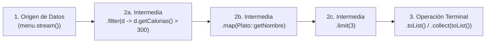
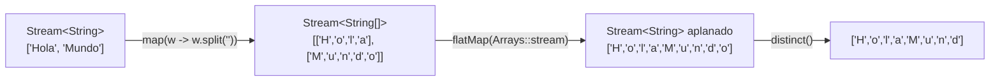
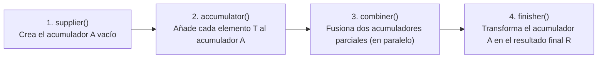

## Objetivos de Aprendizaje (RA6, RA7 y RA8 — 19 horas)

Al finalizar esta unidad didáctica serás capaz de:

* Comprender los principios de la **programación funcional y declarativa** (funciones puras, inmutabilidad, ausencia de efectos secundarios y composición de funciones) frente al enfoque imperativo tradicional, así como la clasificación de los **lenguajes multiparadigma y sistemas de tipos**.
* Distinguir conceptual y técnicamente una **Colección (`Collection<E>`)** de un **Flujo de datos (`Stream<T>`)**, dominando la arquitectura de un *pipeline* (origen, operaciones intermedias perezosas y operación terminal) y la iteración interna.
* Diseñar APIs robustas libres de `NullPointerException` utilizando la clase contenedora **`Optional<T>`** (`of`, `ofNullable`, ` empty`, `orElse`, `orElseGet`, `orElseThrow`, `filter`, `map` y `flatMap` en cascada).
* Generar flujos de datos desde colecciones, valores, arrays, ficheros (`Files.lines`) y generadores funcionales infinitos (**`Stream.iterate`** y **`Stream.generate`**).
* Encadenar operaciones de **filtrado y recorte** (`filter`, `distinct`, `limit`, `skip`, `takeWhile`, `dropWhile`), **transformación y aplanamiento** (`map`, `flatMap`), **ordenación** (`sorted`), **coincidencia en cortocircuito** (`anyMatch`, `allMatch`, `noneMatch`, `findFirst`, `findAny`) y **reducción** (`reduce`), aprovechando los **Streams numéricos especializados** (`IntStream`, `LongStream`, `DoubleStream`).
* Dominar la recolección avanzada de datos con **`Collectors`** (`toList`, `toSet`, `toMap`, `joining`, `summarizingInt`, agrupaciones multinivel con **`groupingBy`** y particiones con **`partitioningBy`**) e implementar tus propios colectores mediante la interfaz **`Collector<T, A, R>`**.
* Acelerar el procesamiento masivo en memoria mediante **Streams Paralelos (`parallelStream()`)** y construir aplicaciones concurrentes y asíncronas no bloqueantes con **`ExecutorService`**, **`Callable<V>`**, **`Future<V>`** y **`CompletableFuture<T>`**.

---

## 1. Introducción a la Programación Funcional y a la API Stream

La inmensa mayoría de las aplicaciones Java utilizan colecciones (`List`, `Set`, `Map`) de forma intensiva para almacenar los datos con los que trabaja el programa. Sin embargo, cuando procesamos esas colecciones con el enfoque imperativo clásico (bucles `for`, variables acumuladoras mutables y condicionales `if` anidados), nos topamos con dos grandes limitaciones:

1. **Complejidad accidental frente a consultas declarativas:** muy a menudo necesitamos realizar sobre una lista en memoria las mismas operaciones que hacemos en una base de datos relacional con **SQL**: filtrar filas (`WHERE`), ordenarlas (`ORDER BY`), proyectar columnas (`SELECT`), agruparlas (`GROUP BY`) o calcular totales (`SUM`, `AVG`). En SQL simplemente *declaramos qué queremos obtener* en una línea, mientras que con bucles e iteradores debemos programar *cómo recorrer y mutar estructuras auxiliares paso a paso*, escribiendo código verboso y propenso a errores.
2. **Dificultad para aprovechar los procesadores multinúcleo:** si tenemos que procesar millones de objetos, un bucle `for` tradicional se ejecuta en un único hilo de CPU. Reescribir ese bucle manualmente con múltiples `Thread`, particiones y bloques `synchronized` es complejo y difícil de depurar.

Para resolver ambos desafíos de raíz, **Java 8 introdujo la API Stream (`java.util.stream`)**: una herramienta que permite manipular secuencias de datos de forma **declarativa (funcional)**, **encadenable (*pipelining*)** y **paralelizable de forma transparente**.

### 1.1. Paradigma Imperativo vs. Paradigma Funcional Declarativo

La **Programación Funcional** es un subparadigma de la programación declarativa basado en el concepto de función matemática y sustentado en cinco pilares fundamentales:

* **Funciones puras (*Pure Functions*):** funciones deterministas que, ante la misma entrada, devuelven siempre exactamente la misma salida sin provocar cambios ocultos fuera de ellas.
* **Ausencia de efectos secundarios (*No Side Effects*):** una función pura no modifica variables globales ni altera el estado de los objetos que recibe como argumento.
* **Inmutabilidad (*Immutability*):** en lugar de modificar una lista existente desordenándola o borrando elementos in situ, las operaciones funcionales generan un nuevo flujo o una nueva colección con el resultado transformado, dejando intacta la fuente original.
* **Composición de funciones:** el resultado de una función `g(x)` se conecta directamente como entrada de la siguiente función `f(g(x))` formando una tubería de transformación (*pipeline*).
* **Evitación del estado compartido mutable:** al no haber variables externas modificadas a la vez por distintas funciones, el código puede ejecutarse en paralelo en varios núcleos de CPU sin condiciones de carrera.

:::note[Lenguajes Multiparadigma y Sistemas de Tipos en la Industria]
Hoy en día la mayoría de los lenguajes líderes (**Java, Python, C#, Kotlin, JavaScript, PHP**) son **multiparadigma**: combinan la Programación Orientada a Objetos con la Programación Funcional e Imperativa para aplicar el mejor enfoque a cada problema. Al compararlos, recuerda las dos dimensiones del **sistema de tipos**:
* **Fuerte vs. Débil:** en un lenguaje de **tipado fuerte** (**Java, C#, Python**) no se permiten violaciones implícitas entre tipos incompatibles (en Python `"3" + 4` lanza error a menos que conviertas explícitamente `int("3") + 4`), mientras que en uno de **tipado débil** (**JavaScript, PHP**) se realizan conversiones automáticas silenciosas (`"3" + 4` produce `"34"`).
* **Estático vs. Dinámico:** en el **tipado estático** (**Java, C#, C++, Haskell**) los tipos se asocian a las variables y se verifican en **tiempo de compilación**; en el **tipado dinámico** (**Python, JavaScript, Ruby**) los tipos se asocian a los valores en **tiempo de ejecución**. Así, **Java es un lenguaje de tipado fuerte y estático**, mientras que **Python es de tipado fuerte y dinámico**.
:::

### 1.2. Nuestro Dominio de Ejemplo: El Menú de un Catering (`Plato`)

Para comprobar de un vistazo la elegancia de la API Stream, definamos la clase inmutable `Plato` que nos acompañará a lo largo de la unidad:

```java
import java.util.Arrays;
import java.util.List;

public class Plato {
    public enum Tipo { CARNE, PESCADO, OTRO }

    private final String nombre;
    private final boolean vegano;
    private final int calorias;
    private final Tipo tipo;

    public Plato(String nombre, boolean vegano, int calorias, Tipo tipo) {
        this.nombre = nombre;
        this.vegano = vegano;
        this.calorias = calorias;
        this.tipo = tipo;
    }

    public String getNombre() { return nombre; }
    public boolean esVegano() { return vegano; }
    public int getCalorias() { return calorias; }
    public Tipo getTipo() { return tipo; }

    @Override
    public String toString() { return nombre; }

    public static final List<Plato> MENU = Arrays.asList(
        new Plato("cerdo", false, 800, Tipo.CARNE),
        new Plato("cordero", false, 700, Tipo.CARNE),
        new Plato("pollo", false, 400, Tipo.CARNE),
        new Plato("patatas fritas", true, 530, Tipo.OTRO),
        new Plato("arroz", true, 350, Tipo.OTRO),
        new Plato("fruta de temporada", true, 120, Tipo.OTRO),
        new Plato("pizza", true, 550, Tipo.OTRO),
        new Plato("trucha", false, 300, Tipo.PESCADO),
        new Plato("salmón", false, 450, Tipo.PESCADO)
    );
}
```

Supongamos que nos piden **obtener una lista con los nombres de los platos bajos en calorías (`< 400` calorías), ordenados de menor a mayor número de calorías**. Compara ambos mundos:

```java
// ❌ ENFOQUE IMPERATIVO CLÁSICO (Con bucles, lista temporal "basura" y mutación)
List<Plato> ligeros = new ArrayList<>();
for (Plato p : Plato.MENU) {
    if (p.getCalorias() < 400) {
        ligeros.add(p);
    }
}
Collections.sort(ligeros, new Comparator<Plato>() {
    @Override
    public int compare(Plato p1, Plato p2) {
        return Integer.compare(p1.getCalorias(), p2.getCalorias());
    }
});
List<String> nombresImperativo = new ArrayList<>();
for (Plato p : ligeros) {
    nombresImperativo.add(p.getNombre());
}

// ✅ ENFOQUE DECLARATIVO CON LA API STREAM (Limpio, expresivo y componible)
import static java.util.Comparator.comparingInt;

List<String> nombresStream = Plato.MENU.stream() // O .parallelStream() para multihilo
        .filter(p -> p.getCalorias() < 400)      // WHERE calorias < 400
        .sorted(comparingInt(Plato::getCalorias))// ORDER BY calorias ASC
        .map(Plato::getNombre)                   // SELECT nombre
        .toList();                               // Recolecta en una List<String>
// Resultado: [fruta de temporada, trucha, arroz]
```

### 1.3. ¿Qué es Exactamente un `Stream<T>` y En Qué se Diferencia de una Colección?

Un **Stream (`Stream<T>`)** es una **secuencia de elementos provenientes de un origen que soporta operaciones agregadas de procesamiento de datos**.

Para entender la diferencia entre una **Colección (`List`, `Set`)** y un **Stream**, piensa en la diferencia entre **una película en un disco DVD** y **ver esa misma película por *streaming* en Internet**:

| Característica | Colección (`Collection<E>`) — *El DVD* | Flujo (`Stream<T>`) — *El Streaming* |
| :--- | :--- | :--- |
| **Propósito principal** | **Almacenar y organizar** datos en memoria RAM para acceder a ellos o modificarlos. | **Calcular y transformar** datos mediante un *pipeline* declarativo de operaciones. |
| **Existencia de los datos** | Todos los elementos deben estar calculados y alojados en memoria **antes** de añadirlos a la colección (*datos dispersos en el espacio*). | Los elementos se calculan **bajo demanda (*lazy*)** a medida que fluyen (*datos dispersos en el tiempo*). ¡Un Stream puede ser incluso **infinito**! |
| **Mutabilidad del origen** | Permite añadir (`add`), borrar (`remove`) o modificar elementos. | **No almacena datos ni modifica el origen**: nunca altera la colección original de la que nació. |
| **Tipo de iteración** | **Iteración externa:** el programador escribe explícitamente el bucle `for` o `while (it.hasNext())`. | **Iteración interna:** la biblioteca gestiona el recorrido por dentro, pudiendo optimizarlo, fusionar pasos o paralelizarlo. |
| **Reutilización** | Se puede recorrer **tantas veces como se quiera**. | **Se consume una única vez:** una vez ejecutada una operación terminal, el stream queda cerrado. |

:::warning[Un Stream solo se puede recorrer una vez]
Al igual que un vaso de agua que bebes, un objeto `Stream<T>` solo puede ser consumido **una sola vez**. Si intentas reutilizar la misma variable `Stream` para una segunda operación terminal, Java lanzará inmediatamente una **`IllegalStateException: stream has already been operated upon or closed`**:
```java
Stream<Plato> flujo = Plato.MENU.stream();
flujo.forEach(System.out::println); // 1ª vez: consume y cierra el stream
flujo.forEach(System.out::println); // ❌ Lanza IllegalStateException en ejecución
```
Si necesitas hacer dos consultas distintas, llama de nuevo a `Plato.MENU.stream()`, que es una operación ligerísima.
:::

### 1.4. Anatomía de un Pipeline: Origen, Operaciones Intermedias y Operación Terminal

Todo procesamiento con Streams sigue una arquitectura en **tres etapas** conectadas en cadena (*pipeline*):



1. **Un Origen de datos:** una colección (`menu.stream()`), un array, un fichero o una función generadora.
2. **Cero o más Operaciones Intermedias:** (`filter`, `map`, `flatMap`, `distinct`, `sorted`, `limit`, `skip`, `peek`, `takeWhile`, `dropWhile`).
   * **Todas devuelven otro `Stream`**, lo que permite encadenarlas.
   * **Son perezosas (*Lazy*):** ¡no procesan ningún dato cuando se llaman! Solo anotan la «receta» de lo que habrá que hacer cuando alguien pida el resultado final. Además, el motor de Streams aplica optimizaciones como *loop fusion* (fusiona `filter` y `map` en una sola pasada) y *short-circuiting* (`limit(3)` detiene el flujo en cuanto consigue 3 platos válidos, sin mirar el resto del menú).
   * Se dividen en operaciones **sin estado (*stateless*)** como `filter` y `map` (procesan cada elemento de forma independiente) y operaciones **con estado (*stateful*)** como `distinct`, `sorted`, `limit` y `skip` (necesitan recordar elementos vistos anteriormente).
3. **Una única Operación Terminal:** (`collect`, `toList`, `forEach`, `count`, `reduce`, `min`, `max`, `anyMatch`, `allMatch`, `noneMatch`, `findFirst`, `findAny`, `toArray`).
   * **Dispara la ejecución real del *pipeline***, consume el stream y produce un resultado concreto (`List`, `long`, `Optional`, `boolean`, `void`...).

#### Tablas de Referencia Rápida de la Interfaz `Stream<T>`

| Operación Intermedia | Argumento Funcional | Descriptor Lambda | Descripción |
| :--- | :--- | :--- | :--- |
| **`filter`** | `Predicate<? super T>` | `T -> boolean` | Conserva solo los elementos que cumplen el predicado. |
| **`map`** | `Function<? super T, ? extends R>` | `T -> R` | Transforma cada elemento `T` en un nuevo elemento `R` (1 a 1). |
| **`flatMap`** | `Function<? super T, ? extends Stream<? extends R>>` | `T -> Stream<R>` | Transforma cada elemento en un stream y los aplana en uno solo (1 a N). |
| **`distinct`** | *(ninguno)* | — | Elimina duplicados apoyándose en `equals()` y `hashCode()`. |
| **`sorted`** | *(ninguno)* o `Comparator<? super T>` | `(T, T) -> int` | Ordena el flujo por orden natural o con el comparador indicado. |
| **`limit` / `skip`** | `long n` | — | Trunca a los primeros `n` elementos / salta los primeros `n` elementos. |
| **`takeWhile` / `dropWhile`** | `Predicate<? super T>` | `T -> boolean` | Toma / descarta elementos mientras se cumpla la condición (Java 9+). |
| **`peek`** | `Consumer<? super T>` | `T -> void` | Ejecuta una acción lateral sobre cada elemento (útil para depurar). |

| Operación Terminal | Retorno | Descripción |
| :--- | :--- | :--- |
| **`forEach` / `forEachOrdered`** | `void` | Aplica un `Consumer<T>` a cada elemento (en `forEachOrdered` respeta el orden en paralelo). |
| **`count`** | `long` | Devuelve el número total de elementos que llegan al final del flujo. |
| **`collect` / `toList`** | `R` / `List<T>` | Recolecta los elementos en una estructura (`List`, `Set`, `Map`, `String`...). |
| **`reduce`** | `T` u `Optional<T>` | Combina todos los elementos repetidamente mediante un `BinaryOperator<T>`. |
| **`min` / `max`** | `Optional<T>` | Devuelve el mínimo o máximo según el `Comparator<T>` entregado. |
| **`anyMatch` / `allMatch` / `noneMatch`** | `boolean` | Comprueba en cortocircuito si alguno, todos o ninguno cumplen un `Predicate<T>`. |
| **`findFirst` / `findAny`** | `Optional<T>` | Devuelve en cortocircuito el primer elemento o cualquiera del flujo. |
| **`toArray`** | `Object[]` o `A[]` | Vuelca los elementos del flujo a un array (ej. `.toArray(String[]::new)`). |

Además, `Stream<T>` hereda de `BaseStream` métodos de control del ciclo de vida y modo de ejecución: **`parallel()`**, **`sequential()`**, **`isParallel()`**, **`unordered()`**, **`iterator()`**, **`spliterator()`**, **`onClose(Runnable)`** y **`close()`**.

---

## 2. La Clase `Optional<T>`: Diseño de APIs Seguras frente a `NullPointerException`

Muchas operaciones terminales de la API Stream (`findFirst()`, `findAny()`, `max()`, `min()`, `reduce()`) tienen algo en común: **¿qué deben devolver si el stream estaba vacío porque ningún elemento superó el filtro previo?**

Devolver `null` fue durante décadas la práctica habitual, pero obliga al programador a recordar poner comprobaciones `if (resultado != null)` en todas partes; si se le olvida una sola vez, el programa estalla en producción con la temida **`NullPointerException`**.

### 2.1. El Problema de las Referencias `null` Anidadas

Imagina una estructura de clases donde un ordenador (`Computer`) puede tener o no una tarjeta de sonido (`Soundcard`), que a su vez puede tener o no un puerto `USB` con un número de versión:

```java
// ¿Qué ocurre si ejecutamos esta línea en una Raspberry Pi sin tarjeta de sonido?
String version = computer.getSoundcard().getUSB().getVersion(); // 💥 ¡NullPointerException!
```

Para evitar el estallido en Java tradicional, nos veíamos obligados a escribir «pirámides de comprobaciones defensivas» difíciles de leer:

```java
String version = "DESCONOCIDA";
if (computer != null) {
    Soundcard sc = computer.getSoundcard();
    if (sc != null) {
        USB usb = sc.getUSB();
        if (usb != null) {
            version = usb.getVersion();
        }
    }
}
```

Mientras que lenguajes como Groovy, Kotlin o C# incorporaron el operador de navegación segura `?.` y el operador Elvis `?:` (`computer?.getSoundcard()?.getUSB()?.getVersion() ?: "DESCONOCIDA"`), **Java 8 adoptó el enfoque de los lenguajes funcionales tipados (como `Maybe` en Haskell u `Option[T]` en Scala) creando la clase contenedora `java.util.Optional<T>`**.

### 2.2. Creación y Consumo Seguro de Objetos `Optional<T>`

Un **`Optional<T>`** es una «caja» inmutable que puede encontrarse en uno de dos estados: **contener un valor no nulo de tipo `T` (presente)** o **estar vacía (`Optional.empty()`)**. Al devolver `Optional<Soundcard>` en la firma de un método, declaramos explícitamente en el contrato de nuestra API que ese valor puede no existir y obligamos al compilador a que quien nos llame gestione esa posibilidad.

```java
import java.util.Optional;

public class CreacionOptionalDemo {
    public static void main(String[] args) {
        // 1. Crear un Optional explícitamente vacío
        Optional<String> vacio = Optional.empty();

        // 2. Crear un Optional con un valor que SABEMOS que NO es null
        // (¡Cuidado!: si pasas null a Optional.of(null), lanza NullPointerException en el acto)
        Optional<String> presente = Optional.of("USB 3.2");

        // 3. Crear un Optional a partir de una referencia que PUEDE ser null
        // Si es null, devuelve Optional.empty(); si no es null, lo envuelve como Optional.of()
        String posibleNulo = obtenerDatoExterno();
        Optional<String> seguro = Optional.ofNullable(posibleNulo);

        // --- FORMAS DE CONSUMIR Y EXTRAER EL VALOR ---

        // A) Ejecutar una acción solo si hay valor presente: ifPresent / ifPresentOrElse (Java 9+)
        seguro.ifPresent(v -> System.out.println("Detectado: " + v));
        seguro.ifPresentOrElse(
            v -> System.out.println("Valor: " + v),
            () -> System.out.println("No se detectó ningún dispositivo.")
        );

        // B) Obtener el valor o un valor por defecto inmediato: orElse(T)
        String v1 = seguro.orElse("DESCONOCIDO");

        // C) Obtener el valor o calcular el alternativo perezosamente solo si hace falta: orElseGet(Supplier)
        String v2 = seguro.orElseGet(() -> calcularValorPorDefectoCostoso());

        // D) Obtener el valor o lanzar una excepción a medida si está vacío: orElseThrow(...)
        String v3 = presente.orElseThrow(() -> new IllegalStateException("Falta el puerto USB"));
    }

    private static String obtenerDatoExterno() { return null; }
    private static String calcularValorPorDefectoCostoso() { return "USB Estándar"; }
}
```

:::tip[Diferencia clave entre `orElse(...)` y `orElseGet(...)`]
* `opt.orElse(crearObjetoPorDefecto())` **evalúa y ejecuta siempre** la llamada a `crearObjetoPorDefecto()`, incluso aunque el `Optional` sí tenga valor dentro.
* `opt.orElseGet(() -> crearObjetoPorDefecto())` recibe un `Supplier` y **solo ejecuta la función si el `Optional` está vacío**. Si crear el valor por defecto es costoso (consultar BD, crear objetos pesados), usa siempre **`orElseGet`**.
:::

### 2.3. Transformación Funcional con `filter()`, `map()` y `flatMap()` en `Optional<T>`

La verdadera potencia de `Optional<T>` es que **no necesitas abrir la caja con `isPresent()` y `get()`**: puedes filtrarla y transformarla como si fuera un mini-stream de 0 o 1 elementos:

* **`filter(Predicate<T>)`**: si el `Optional` tiene valor y cumple el predicado, devuelve el mismo `Optional`; si no lo cumple (o estaba vacío), devuelve `Optional.empty()`.
* **`map(Function<T, U>)`**: si hay valor presente, le aplica la función y devuelve un `Optional<U>`; si estaba vacío, devuelve `Optional.empty()`.
* **`flatMap(Function<T, Optional<U>>)`**: cuando el método que invocamos **ya devuelve a su vez un `Optional`** (como `computer.getSoundcard()` que devuelve `Optional<Soundcard>`), si usáramos `map` obtendríamos una caja dentro de otra caja: `Optional<Optional<Soundcard>>`. El método **`flatMap`** aplana ambos niveles en un único `Optional<Soundcard>`:

```java
import java.util.Optional;

public class OrdenadorOptionalDemo {

    record USB(String version) {}
    record Soundcard(Optional<USB> usb) {}
    record Computer(Optional<Soundcard> soundcard) {}

    public static String obtenerVersionUSB3(Optional<Computer> computer) {
        return computer
                .flatMap(Computer::soundcard)               // Evita Optional<Optional<Soundcard>>
                .flatMap(Soundcard::usb)                    // Evita Optional<Optional<USB>>
                .map(USB::version)                          // USB::version devuelve String normal -> usamos map()
                .filter(ver -> ver.startsWith("3."))        // Solo nos interesan puertos USB 3.x
                .orElse("Puerto no compatible o inexistente");
    }

    public static void main(String[] args) {
        Computer pcGaming = new Computer(Optional.of(new Soundcard(Optional.of(new USB("3.1")))));
        Computer raspberryPi = new Computer(Optional.empty()); // Sin tarjeta de sonido

        System.out.println("PC Gaming:    " + obtenerVersionUSB3(Optional.of(pcGaming)));    // 3.1
        System.out.println("Raspberry Pi: " + obtenerVersionUSB3(Optional.of(raspberryPi))); // Puerto no compatible...
    }
}
```

---

## 3. Cómo Generar Streams desde Cualquier Origen

Además de invocar `.stream()` sobre cualquier `List` o `Set` (o `.entrySet().stream()` sobre un `Map`), la API de Java permite construir flujos desde valores sueltos, arrays, ficheros de texto y funciones matemáticas infinitas:

### 3.1. Streams desde Valores, Arrays y Ficheros (`Files.lines`)

```java
import java.io.IOException;
import java.nio.charset.StandardCharsets;
import java.nio.file.Files;
import java.nio.file.Path;
import java.util.Arrays;
import java.util.stream.Stream;

public class GeneracionStreamsDemo {
    public static void main(String[] args) {
        // 1. Desde valores explícitos con Stream.of(...) y Stream.empty()
        Stream<String> s1 = Stream.of("Java 25", "Lambdas", "Streams");
        Stream<String> vacio = Stream.empty();

        // Concatenar dos streams en uno solo con Stream.concat(a, b)
        Stream<String> unido = Stream.concat(s1, Stream.of("Collectors", "Optional"));
        unido.map(String::toUpperCase).forEach(s -> System.out.print(s + " | "));
        System.out.println();

        // 2. Desde un Array (convierte automáticamente int[] en un IntStream eficiente)
        int[] numeros = {10, 20, 30, 40, 50};
        int suma = Arrays.stream(numeros).sum();
        System.out.println("Suma del array: " + suma); // 150

        // 3. Desde un Fichero de texto con Files.lines (Java NIO.2)
        // ¡Importante!: usamos try-with-resources para que el fichero se cierre al terminar el stream
        Path ruta = Path.of("datos.txt");
        if (Files.exists(ruta)) {
            try (Stream<String> lineas = Files.lines(ruta, StandardCharsets.UTF_8)) {
                long palabrasDistintas = lineas
                        .flatMap(linea -> Arrays.stream(linea.trim().split("\\s+")))
                        .filter(p -> !p.isEmpty())
                        .distinct()
                        .count();
                System.out.println("Palabras únicas en el fichero: " + palabrasDistintas);
            } catch (IOException e) {
                System.err.println("Error leyendo el fichero: " + e.getMessage());
            }
        }
    }
}
```

### 3.2. Streams Infinitos desde Funciones: `Stream.iterate()` y `Stream.generate()`

Como los elementos de un `Stream` no tienen por qué existir todos en memoria de antemano, podemos crear **flujos potencialmente infinitos** que van fabricando cada elemento en el instante en que se necesita, acotándolos con `.limit(n)` o `.takeWhile(...)`:

1. **`Stream.iterate(semillaInicial, UnaryOperator<T> f)`**: produce una sucesión matemática `s, f(s), f(f(s))...` donde cada nuevo elemento se calcula a partir del anterior. *(Desde Java 9 existe también la versión de 3 argumentos `Stream.iterate(semilla, condicionContinuidad, pasoSiguiente)` idéntica a la cabecera de un bucle `for`)*.
2. **`Stream.generate(Supplier<T> s)`**: produce un flujo infinito invocando repetidamente una función sin parámetros (ideal para números aleatorios o constantes).

```java
import java.util.stream.Stream;

public class StreamsInfinitosDemo {
    public static void main(String[] args) {
        // 1. Stream.iterate: primeros 10 números pares (0, 2, 4, ..., 18)
        System.out.print("Pares con iterate: ");
        Stream.iterate(0, n -> n + 2)
              .limit(10)
              .forEach(n -> System.out.print(n + " "));
        System.out.println();

        // 2. Stream.iterate con predicado de parada (Java 9+): potencias de 2 menores que 1000
        System.out.print("Potencias de 2 (< 1000): ");
        Stream.iterate(1, n -> n < 1000, n -> n * 2)
              .forEach(n -> System.out.print(n + " "));
        System.out.println();

        // 3. Caso clásico (Ejercicio 1 del tema): Sucesión de Fibonacci con tuplas int[]{a, b}
        // En cada paso la pareja (t[0], t[1]) se transforma en la siguiente pareja (t[1], t[0] + t[1])
        System.out.print("Primeros 12 números de Fibonacci: ");
        Stream.iterate(new long[]{0, 1}, t -> new long[]{t[1], t[0] + t[1]})
              .limit(12)
              .map(t -> t[0]) //Nos quedamos con el primer elemento de cada tupla
              .forEach(n -> System.out.print(n + " "));
        System.out.println();

        // 4. Stream.generate: 5 números aleatorios entre 0.0 y 1.0
        System.out.println("5 números aleatorios con Stream.generate(Math::random):");
        Stream.generate(Math::random)
              .limit(5)
              .forEach(r -> System.out.printf("  %.4f%n", r));
    }
}
```

---

## 4. Operaciones Intermedias: Filtrado, Recorte, Mapeo y Aplanamiento (`flatMap`)

Analicemos en detalle cómo funcionan las operaciones intermedias que transforman un flujo en otro.

### 4.1. Filtrados y Recortes: `filter`, `distinct`, `limit`, `skip`, `takeWhile` y `dropWhile`

* **`filter(Predicate<T>)`**: evalúa una condición booleana sobre cada elemento y solo deja pasar a los que devuelven `true`. Puedes combinar predicados reutilizables con los métodos por defecto de `Predicate`: **`.and(p2)`**, **`.or(p2)`**, **`.negate()`** y **`Predicate.not(Plato::esVegano)`**.
* **`distinct()`**: elimina elementos duplicados del flujo comprobando su `hashCode()` y `equals()`.
* **`limit(n)` y `skip(n)`**: `limit(n)` trunca el stream tras dejar pasar `n` elementos; `skip(n)` descarta los primeros `n` elementos y deja pasar los restantes (combinar `.skip(pagina * tam).limit(tam)` es la forma estándar de implementar **paginación** en memoria).
* **`takeWhile(Predicate)` y `dropWhile(Predicate)` (Java 9+)**: cuando los datos de entrada **ya están ordenados** (por ejemplo, platos ordenados de menor a mayor calorías), un `filter(p -> p.getCalorias() < 400)` seguiría examinando todos los platos restantes aunque ya hayamos superado las 400 calorías. En cambio:
  * **`takeWhile`** toma elementos **mientras se cumpla la condición** y, en cuanto encuentra el primero que falla, **corta inmediatamente el stream** sin mirar el resto.
  * **`dropWhile`** descarta elementos mientras se cumpla la condición y, en cuanto encuentra el primero que falla, **deja pasar todos los restantes**.

```java
import java.util.List;

public class FiltradoYRecorteDemo {
    public static void main(String[] args) {
        // Ejercicio 4 del tema: primeros 2 platos de CARNE del menú
        List<Plato> dosDeCarne = Plato.MENU.stream()
                .filter(p -> p.getTipo() == Plato.Tipo.CARNE)
                .limit(2)
                .toList();
        System.out.println("Primeros 2 platos de carne: " + dosDeCarne); // [cerdo, cordero]

        // Demostración de takeWhile y dropWhile sobre una lista ordenada de calorías
        List<Integer> caloriasOrdenadas = List.of(120, 300, 350, 400, 450, 530, 550, 700, 800);

        List<Integer> menoresDe450 = caloriasOrdenadas.stream()
                .takeWhile(c -> c < 450) // Corta al llegar al 450
                .toList();
        System.out.println("takeWhile (< 450): " + menoresDe450); // [120, 300, 350, 400]

        List<Integer> desde450 = caloriasOrdenadas.stream()
                .dropWhile(c -> c < 450) // Salta hasta el 450 y toma el resto
                .toList();
        System.out.println("dropWhile (< 450): " + desde450);     // [450, 530, 550, 700, 800]
    }
}
```

### 4.2. Transformación (`map`) frente a Aplanamiento (`flatMap`)

La diferencia entre **`map()`** y **`flatMap()`** es uno de los conceptos más importantes de la programación funcional:

* **`map(Function<T, R>)` — Relación `1 → 1`:** toma cada elemento del stream y lo transforma en **exactamente un elemento** de salida. Si el stream tenía 9 objetos `Plato`, `map(Plato::getNombre)` produce un `Stream<String>` con 9 nombres, y encadenar otro `.map(String::length)` produce un `Stream<Integer>` con las 9 longitudes.
* **`flatMap(Function<T, Stream<R>>)` — Relación `1 → N` (Mapear y Aplanar):** ¿qué pasa cuando a partir de **cada elemento** generamos una lista o un array de varios subelementos (por ejemplo, las letras de una palabra o la lista de libros de un `Escritor`)?

Imagina que tenemos la lista de palabras `["Hola", "Mundo"]` y queremos obtener las **letras únicas** sin repetir: `["H", "o", "l", "a", "M", "u", "n", "d"]`:
1. Si hacemos `.map(palabra -> palabra.split(""))`, cada palabra se convierte en un `String[]`, por lo que obtenemos un `Stream<String[]>` (un flujo de dos arrays, no de letras sueltas).
2. Si añadimos `.map(Arrays::stream)`, cada array se convierte en un `Stream<String>`, por lo que obtenemos un **`Stream<Stream<String>>`** (dos flujos separados dentro de otro flujo).
3. Al usar **`flatMap(Arrays::stream)`**, el método toma todos esos pequeños `Stream<String>` individuales y **los funde (aplana) en un único `Stream<String>` continuo** con todas las letras juntas:



Veamos en código tanto el ejemplo de las letras únicas como el **Ejercicio 5 del tema** (generar todas las parejas cartesianas `(a, b)` de dos listas de números y filtrar aquellas cuya suma sea divisible por 3):

```java
import java.util.Arrays;
import java.util.List;

public class MapVsFlatMapDemo {
    public static void main(String[] args) {
        // 1. Obtener todas las letras únicas de una lista de palabras
        List<String> palabras = List.of("Hola", "Mundo");
        List<String> letrasUnicas = palabras.stream()
                .map(w -> w.split(""))     // Stream<String[]>
                .flatMap(Arrays::stream)   // Aplana en un único Stream<String>
                .distinct()
                .toList();
        System.out.println("Letras únicas: " + letrasUnicas); // [H, o, l, a, M, u, n, d]

        // 2. Ejercicio 5a: Cuadrado de cada número de una lista
        List<Integer> nums = List.of(1, 2, 3, 4, 5);
        List<Integer> cuadrados = nums.stream()
                .map(n -> n * n)
                .toList();
        System.out.println("Cuadrados: " + cuadrados); // [1, 4, 9, 16, 25]

        // 3. Ejercicio 5b y 5c: Producto cartesiano de dos listas con flatMap
        // Dadas [1, 2, 3] y [3, 4], generar todas las parejas (a, b) cuya suma sea múltiplo de 3
        List<Integer> lista1 = List.of(1, 2, 3);
        List<Integer> lista2 = List.of(3, 4);

        List<int[]> parejasMultiploDe3 = lista1.stream()
                .flatMap(a -> lista2.stream()
                        .filter(b -> (a + b) % 3 == 0)
                        .map(b -> new int[]{a, b})
                )
                .toList();

        System.out.print("Parejas cuya suma es divisible por 3: ");
        parejasMultiploDe3.forEach(par -> System.out.print("(" + par[0] + "," + par[1] + ") "));
        System.out.println(); // (2,4) (3,3)
    }
}
```

---

## 5. Operaciones Terminales de Coincidencia (*Matching*), Búsqueda y Reducción (*Fold*)

Cuando hemos filtrado y transformado los elementos del flujo, necesitamos cerrar la tubería con una **operación terminal** que responda a una pregunta booleana, localice un elemento concreto o combine todos los elementos en un único resultado resumen.

### 5.1. Coincidencia (`anyMatch`, `allMatch`, `noneMatch`) y Búsqueda (`findFirst`, `findAny`)

Estos cinco métodos aplican **evaluación en cortocircuito (*short-circuiting*)**: igual que los operadores lógicos `&&` y `||`, **detienen el recorrido del stream en el mismo instante en que ya conocen la respuesta**, sin procesar los elementos restantes:

1. **`boolean anyMatch(Predicate<T>)`**: devuelve `true` en cuanto encuentra **al menos un** elemento que cumple el predicado. Si el stream está vacío, devuelve `false`.
2. **`boolean allMatch(Predicate<T>)`**: devuelve `true` si **todos** los elementos cumplen el predicado (se detiene con `false` en cuanto halla el primer elemento que lo incumple). **¡Ojo!: si el stream está vacío, devuelve `true`** (propiedad lógica de *verdad vacua*).
3. **`boolean noneMatch(Predicate<T>)`**: opuesto de `allMatch`; devuelve `true` si **ningún** elemento cumple la condición (y `true` si el stream está vacío).
4. **`Optional<T> findFirst()`**: devuelve el **primer elemento** del stream envuelto en un `Optional<T>` (respetando el orden de encuentro).
5. **`Optional<T> findAny()`**: devuelve un elemento arbitrario que cumpla el flujo. En streams secuenciales suele devolver también el primero, pero en **streams paralelos (`parallelStream()`) es mucho más rápido que `findFirst()`** porque devuelve el primer resultado que encuentre cualquiera de los hilos del procesador sin esperar a sincronizar el orden.

```java
import java.util.List;
import java.util.Optional;

public class MatchingYBusquedaDemo {
    public static void main(String[] args) {
        // 1. ¿Hay algún plato vegano en el menú? (anyMatch)
        if (Plato.MENU.stream().anyMatch(Plato::esVegano)) {
            System.out.println("🌱 El menú incluye opciones veganas.");
        }

        // 2. ¿Son todos los platos saludables (< 1000 calorías)? (allMatch y noneMatch equivalentes)
        boolean saludable1 = Plato.MENU.stream().allMatch(p -> p.getCalorias() < 1000);
        boolean saludable2 = Plato.MENU.stream().noneMatch(p -> p.getCalorias() >= 1000);
        System.out.println("¿Menú saludable?: " + saludable1 + " / " + saludable2);

        // 3. Buscar cualquier plato vegano e imprimir su nombre si existe (findAny + ifPresent)
        Plato.MENU.stream()
                .filter(Plato::esVegano)
                .findAny()
                .ifPresent(p -> System.out.println("Sugerencia vegana: " + p.getNombre()));

        // 4. Dada una lista de números, encontrar el primer cuadrado que sea divisible por 3 (findFirst)
        List<Integer> nums = List.of(1, 2, 3, 4, 5);
        Optional<Integer> primerCuadradoDiv3 = nums.stream()
                .map(x -> x * x)
                .filter(cuad -> cuad % 3 == 0)
                .findFirst();
        System.out.println("Primer cuadrado múltiplo de 3: " + primerCuadradoDiv3.orElse(-1)); // 9
    }
}
```

:::caution[Cuidado con la verdad vacua de `allMatch` tras un `filter`]
Observa la diferencia sutil entre estas dos consultas sobre una colección de vuelos:
* `vuelos.stream().filter(v -> v.getFecha().equals(hoy)).allMatch(Vuelo::estaCompleto)` → Si hoy **no hay ningún vuelo programado**, `filter` deja el stream vacío y `allMatch` devuelve **`true`** («todos los 0 vuelos de hoy están completos»).
* Si necesitas que además exista al menos un vuelo en esa fecha, comprueba primero que no esté vacío o combínalo con `anyMatch`.
:::

### 5.2. Reducciones Inmutables con `reduce()` (Operación *Fold*)

En programación funcional, una operación de **reducción (o plegado, *fold*)** toma todos los elementos de un flujo y los combina repetidamente mediante un operador binario asociativo (`BinaryOperator<T>`) hasta plegarlos en **un único valor final** (una suma, un producto, el máximo o un objeto acumulado).

La interfaz `Stream<T>` ofrece **tres variantes sobrecargadas** del método `reduce`:

#### 1. `T reduce(T valorInicial, BinaryOperator<T> acumulador)`
Recibe un **valor identidad inicial** (por ejemplo, `0` para la suma o `1` para la multiplicación) y una función `(subtotal, elementoActual) -> nuevoSubtotal`. Como siempre parte del valor inicial, **devuelve directamente un `T`** (nunca un `Optional`):

```java
List<Integer> numeros = List.of(4, 5, 3, 9);

// Equivalente funcional de: int suma = 0; for (int x : numeros) suma = suma + x;
int suma1 = numeros.stream().reduce(0, (a, b) -> a + b);

// Más limpio aún con referencia al método estático Integer::sum:
int suma2 = numeros.stream().reduce(0, Integer::sum); // 21

// Producto de todos los números mayores que 4 (5 * 9 = 45):
int producto = numeros.stream()
        .filter(n -> n > 4)
        .reduce(1, (a, b) -> a * b);
```

#### 2. `Optional<T> reduce(BinaryOperator<T> acumulador)` (Sin valor inicial)
Si no proporcionamos valor inicial, el primer elemento del stream actúa como acumulador inicial. Pero ¿y si el stream estaba vacío? Por seguridad, esta variante devuelve un **`Optional<T>`**:

```java
Optional<Integer> max = numeros.stream().reduce(Integer::max); // Optional[9]
Optional<Integer> min = numeros.stream().reduce(Integer::min); // Optional[3]

// Ejercicio 6 del tema: Contar el número de platos del menú usando el patrón Map-Reduce
// Transformamos cada plato en un 1 y sumamos todos los unos con reduce:
int totalPlatos = Plato.MENU.stream()
        .map(p -> 1)
        .reduce(0, Integer::sum); // 9
```

#### 3. Reducción de Objetos de Nuestro Propio Dominio (`Duracion` o `Punto`)
`reduce` no solo sirve para `Integer` o `Double`: podemos reducir **cualquier clase propia** siempre que definamos su elemento neutro y un método que sume o combine dos instancias:

```java
import java.util.List;

public class ReduceObjetosDominioDemo {

    record Duracion(int horas, int minutos) {
        public Duracion sumar(Duracion otra) {
            int totalMin = this.minutos + otra.minutos;
            int totalHor = this.horas + otra.horas + (totalMin / 60);
            return new Duracion(totalHor, totalMin % 60);
        }

        @Override
        public String toString() {
            return String.format("%dh %02dmin", horas, minutos);
        }
    }

    public static void main(String[] args) {
        List<Duracion> escalasVuelo = List.of(
            new Duracion(1, 45),
            new Duracion(2, 30),
            new Duracion(0, 50)
        );

        // Elemento neutro: Duracion(0, 0) | Operador binario: Duracion::sumar
        Duracion tiempoTotal = escalasVuelo.stream()
                .reduce(new Duracion(0, 0), Duracion::sumar);

        System.out.println("Duración total acumulada: " + tiempoTotal); // 5h 05min
    }
}
```

*(Nota: la tercera sobrecarga `reduce(U identidad, BiFunction<U, ? super T, U> acumulador, BinaryOperator<U> combinador)` permite acumular elementos de tipo `T` en un resultado de distinto tipo `U` combinando subtotales en streams paralelos).*

---

## 6. Streams Numéricos Especializados (`IntStream`, `LongStream`, `DoubleStream`)

Observa de nuevo cómo calculábamos la suma de calorías del menú con un `Stream<Plato>` genérico:

```java
// ⚠️ Ineficiente: map() devuelve Stream<Integer>, provocando autoboxing/unboxing en cada suma
int calorias = Plato.MENU.stream()
        .map(Plato::getCalorias)
        .reduce(0, Integer::sum);
```

Además del coste oculto de convertir cada `int` primitivo en un objeto `Integer` (*boxing*) y volver a desenvolverlo para sumarlo (*unboxing*), la interfaz genérica `Stream<T>` no puede tener un método `.sum()` ni `.average()`, porque no tendría sentido llamar a `.sum()` sobre un `Stream<Plato>` o un `Stream<Scanner>`.

Para solucionar ambos problemas, la API Stream proporciona **tres interfaces especializadas para tipos primitivos** que operan directamente con `int`, `long` y `double` sin ningún *autoboxing*:

* **`IntStream`** (para `int`, `short`, `byte`, `char`)
* **`LongStream`** (para `long`)
* **`DoubleStream`** (para `double` y `float`)

### 6.1. Conversión entre Streams Genéricos y Primitivos (`mapToInt`, `boxed`, `mapToObj`)

1. **De `Stream<T>` a Stream primitivo:** usamos **`mapToInt(ToIntFunction)`**, **`mapToLong(ToLongFunction)`** o **`mapToDouble(ToDoubleFunction)`**.
2. **Operaciones aritméticas directas:** una vez en un `IntStream`, disponemos de **`.sum()`** (devuelve `0` si está vacío), **`.average()`** (devuelve `OptionalDouble`), **`.max()`** y **`.min()`** (devuelven **`OptionalInt`**, **`OptionalLong`** u **`OptionalDouble`**) y **`.summaryStatistics()`**.
3. **De Stream primitivo de vuelta a `Stream<T>` de objetos:** usamos **`.boxed()`** (convierte `IntStream` en `Stream<Integer>`) o **`.mapToObj(IntFunction)`** (transforma cada `int` directamente en cualquier objeto o array).

```java
import java.util.OptionalDouble;
import java.util.OptionalInt;
import java.util.stream.IntStream;
import java.util.stream.Stream;

public class StreamsPrimitivosDemo {
    public static void main(String[] args) {
        // 1. Suma directa y sin boxing con mapToInt().sum()
        int totalCalorias = Plato.MENU.stream()
                .mapToInt(Plato::getCalorias)
                .sum();
        System.out.println("Total calorías del menú: " + totalCalorias); // 4200

        // 2. Máximo con OptionalInt y media con OptionalDouble
        OptionalInt maxCal = Plato.MENU.stream()
                .mapToInt(Plato::getCalorias)
                .max();
        System.out.println("Máximo de calorías: " + maxCal.orElse(0)); // 800

        OptionalDouble mediaCal = Plato.MENU.stream()
                .mapToInt(Plato::getCalorias)
                .average();
        System.out.printf("Media de calorías: %.2f%n", mediaCal.orElse(0.0));

        // 3. Rangos numéricos con range(inicio, finExclusivo) y rangeClosed(inicio, finInclusivo)
        long totalPares1a100 = IntStream.rangeClosed(1, 100)
                .filter(n -> n % 2 == 0)
                .count();
        System.out.println("Cantidad de números pares en [1, 100]: " + totalPares1a100); // 50

        // 4. De IntStream a Stream<Integer> con boxed()
        Stream<Integer> flujoObjetos = IntStream.range(1, 5).boxed();
    }
}
```

### 6.2. Caso Práctico: Generador Funcional de Tripletas Pitagóricas `(a, b, c)`

El teorema de Pitágoras establece que en un triángulo rectángulo los catetos `a`, `b` y la hipotenusa `c` cumplen `a² + b² = c²` (por ejemplo, `(3, 4, 5)` porque `9 + 16 = 25`). ¿Cómo podemos generar con Streams todas las tripletas de números enteros `(a, b, c)` con `a, b ∈ [1, 100]` sin escribir ni un solo bucle `for` anidado?

Observa cómo combinamos `IntStream.rangeClosed`, `boxed()`, `flatMap` y `mapToObj` calculando una única vez la raíz cuadrada `Math.sqrt(a * a + b * b)` y comprobando que no tenga decimales (`t[2] % 1 == 0`):

```java
import java.util.stream.IntStream;
import java.util.stream.Stream;

public class TripletasPitagoricasDemo {
    public static void main(String[] args) {
        Stream<int[]> tripletas = IntStream.rangeClosed(1, 100)
                .boxed()
                .flatMap(a -> IntStream.rangeClosed(a, 100) // Empezamos en 'a' para no repetir (3,4,5) y (4,3,5)
                        .mapToObj(b -> new double[]{a, b, Math.sqrt(a * a + b * b)})
                        .filter(t -> t[2] % 1 == 0)         // La hipotenusa debe ser un entero exacto
                        .map(t -> new int[]{(int) t[0], (int) t[1], (int) t[2]})
                );

        System.out.println("Primeras 6 tripletas pitagóricas:");
        tripletas.limit(6)
                 .forEach(t -> System.out.printf("  (%d, %d, %d) -> %d² + %d² = %d²%n",
                         t[0], t[1], t[2], t[0], t[1], t[2]));
    }
}
```

---

## 7. Recolección Avanzada con `collect()`, `Collectors` y Colectores Personalizados

La operación terminal **`collect()`** es la navaja suiza de la API Stream: permite transformar los elementos de un flujo en listas, conjuntos, mapas a medida, cadenas concatenadas, informes estadísticos, agrupaciones multinivel o particiones.

### 7.1. Diferencia Crítica entre `reduce()` y `collect()`

A primera vista podría parecer que `reduce()` y `collect()` sirven para lo mismo, pero existe una diferencia semántica y técnica fundamental:
* **`reduce()` realiza una reducción INMUTABLE:** está diseñada para combinar dos valores y producir en cada paso un **nuevo valor inmutable** (como sumar enteros o combinar objetos `Duracion`). Si intentas usar `reduce()` mutando una misma `ArrayList` compartida (`l.add(e)`), en cuanto actives `.parallelStream()` varios hilos modificarán la misma lista a la vez corrompiéndola o lanzando excepciones.
* **`collect()` realiza una reducción MUTABLE segura:** está diseñada específicamente para acumular elementos dentro de un **contenedor mutable** (`ArrayList`, `HashSet`, `HashMap`, `StringBuilder`), y sabe cómo crear contenedores separados para cada hilo en paralelo y fusionarlos al final mediante su función `combiner`.

### 7.2. Colectores de Colecciones, Resumen Estadístico y Cadenas (`java.util.stream.Collectors`)

Importando estáticamente los métodos de `java.util.stream.Collectors.*`, disponemos de un catálogo completísimo de colectores prefabricados:

| Método Factoría de `Collectors` | Tipo Devuelto | Uso Principal y Ejemplo |
| :--- | :--- | :--- |
| **`toList()`** / **`toUnmodifiableList()`** | `List<T>` | Vuelca a una `List` mutable (`collect(toList())`) o inmutable (igual a `stream.toList()` en Java 16+). |
| **`toSet()`** / **`toUnmodifiableSet()`** | `Set<T>` | Vuelca a un conjunto eliminando duplicados. |
| **`toCollection(Supplier)`** | `Collection<T>` | Vuelca a la colección concreta elegida: `collect(toCollection(TreeSet::new))`. |
| **`counting()`** | `Long` | Cuenta elementos (útil como segundo argumento dentro de `groupingBy`). |
| **`summingInt` / `Long` / `Double`** | `Integer` / `Long` / `Double` | Suma una propiedad numérica: `collect(summingInt(Plato::getCalorias))`. |
| **`averagingInt` / `Long` / `Double`** | `Double` | Calcula la media aritmética: `collect(averagingInt(Plato::getCalorias))`. |
| **`summarizingInt` / `Long` / `Double`** | `IntSummaryStatistics`... | Calcula en **una sola pasada** `count`, `sum`, `min`, `average` y `max`. |
| **`maxBy(Comparator)` / `minBy(...)`** | `Optional<T>` | Halla el elemento máximo o mínimo según un comparador. |
| **`joining()` / `joining(delim, pref, suf)`** | `String` | Concatena eficientemente con `StringBuilder`: `collect(joining(", ", "[", "]"))`. |
| **`reducing(ini, mapper, op)`** | `U` / `Optional<T>` | Reducción generalizada dentro de un colector. |

Veamos cómo obtener en una sola pasada todas las estadísticas del menú con **`IntSummaryStatistics`** y cómo concatenar textos con **`joining`**:

```java
import java.util.IntSummaryStatistics;
import static java.util.stream.Collectors.*;

public class ColectoresResumenDemo {
    public static void main(String[] args) {
        // 1. Estadísticas completas en una única pasada con summarizingInt
        IntSummaryStatistics stats = Plato.MENU.stream()
                .collect(summarizingInt(Plato::getCalorias));

        System.out.println("Resumen estadístico: " + stats);
        System.out.printf("Platos: %d | Suma: %d | Mín: %d | Media: %.2f | Máx: %d%n",
                stats.getCount(), stats.getSum(), stats.getMin(), stats.getAverage(), stats.getMax());

        // 2. Concatenar los nombres de todos los platos separados por coma y espacio
        String carta = Plato.MENU.stream()
                .map(Plato::getNombre)
                .collect(joining(", ", "Carta de hoy: [", "]."));
        System.out.println(carta);
    }
}
```

### 7.3. Recolección a Mapas (`Collectors.toMap`) e Inversión de Mapas

Cuando queremos construir un diccionario `Map<K, V>` a medida eligiendo qué propiedad será la clave y qué propiedad será el valor, usamos **`Collectors.toMap`**:

1. **`toMap(keyMapper, valueMapper)`**: úsalo solo cuando estés 100 % seguro de que **no hay claves repetidas** (por ejemplo, mapear el nombre único de cada plato con sus calorías). Si aparecen dos elementos con la misma clave, lanza `IllegalStateException: Duplicate key`.
2. **`toMap(keyMapper, valueMapper, mergeFunction)`**: el tercer argumento es un `BinaryOperator<V>` que decide **cómo resolver las colisiones** cuando dos elementos tienen la misma clave (quedarse con el primero, sumar ambos valores, concatenarlos o quedarse con el máximo/mínimo).
3. **`toMap(keyMapper, valueMapper, mergeFunction, mapSupplier)`**: el cuarto argumento permite elegir la implementación concreta del mapa, como **`TreeMap::new`** o **`LinkedHashMap::new`**.

```java
import java.util.Comparator;
import java.util.Map;
import java.util.SortedMap;
import java.util.TreeMap;
import java.util.function.BinaryOperator;
import java.util.function.Function;
import static java.util.stream.Collectors.*;

public class ColectorToMapDemo {
    public static void main(String[] args) {
        // 1. Claves únicas: Nombre del plato -> Calorías
        Map<String, Integer> caloriasPorNombre = Plato.MENU.stream()
                .collect(toMap(Plato::getNombre, Plato::getCalorias));

        // 2. Claves repetidas con función de fusión (mergeFunction):
        // Obtener un mapa (Tipo -> Nombres de platos concatenados separados por coma)
        Map<Plato.Tipo, String> nombresPorTipo = Plato.MENU.stream()
                .collect(toMap(
                        Plato::getTipo,
                        Plato::getNombre,
                        (nom1, nom2) -> nom1 + ", " + nom2
                ));
        System.out.println("Platos por tipo: " + nombresPorTipo);

        // 3. Quedarnos con el plato MENOS calórico de cada tipo en un TreeMap ordenado
        SortedMap<Plato.Tipo, Plato> masLigeroPorTipo = Plato.MENU.stream()
                .collect(toMap(
                        Plato::getTipo,
                        Function.identity(), // equivale a p -> p
                        BinaryOperator.minBy(Comparator.comparingInt(Plato::getCalorias)),
                        TreeMap::new
                ));
        System.out.println("Más ligero por tipo: " + masLigeroPorTipo);
    }
}
```

#### Patrón Avanzado: Cómo Invertir un `Map<K, V>` en un `SortedMap<V, List<K>>`
Si tenemos un mapa `Map<String, Long>` que asocia cada destino de vuelo con su número de vuelos y queremos **invertir el mapa** (que la clave pase a ser el número de vuelos y el valor la lista de destinos que tienen ese número de vuelos), basta con abrir un stream sobre `mapa.entrySet()` y agrupar por `Map.Entry::getValue`:

```java
public static <K, V> SortedMap<V, java.util.List<K>> invertirMapa(Map<K, V> mapaOriginal) {
    return mapaOriginal.entrySet().stream()
            .collect(groupingBy(
                    Map.Entry::getValue, // El antiguo valor pasa a ser la nueva clave
                    TreeMap::new,        // Ordenado por la nueva clave
                    mapping(Map.Entry::getKey, toList()) // Las antiguas claves se agrupan en una lista
            ));
}
```

### 7.4. Agrupaciones Simples, Multinivel y *Downstream Collectors* (`groupingBy`)

El colector **`Collectors.groupingBy(...)`** es el equivalente directo del **`GROUP BY` de SQL**. Existen tres versiones sobrecargadas:

1. **Agrupación simple (`groupingBy(clasificador)`):** agrupa los elementos en un `Map<K, List<T>>`. Si la propiedad por la que queremos agrupar no existe como método en la clase (por ejemplo, clasificar los platos en `DIETA` `≤ 400`, `NORMAL` `≤ 700` y `PESADO` `> 700`), le pasamos una expresión lambda.
2. **Agrupación con colector *downstream* (`groupingBy(clasificador, colectorHijo)`):** permite cambiar qué hacemos con los elementos de cada grupo:
   * Anidar otro **`groupingBy(...)`** para lograr una **agrupación multinivel (`Map<K1, Map<K2, List<T>>>`)**.
   * Contar elementos por grupo con **`counting()`**, sumarlos con **`summingInt(...)`** o hallar el máximo de cada grupo con **`maxBy(...)`**.
   * Desenvolver el `Optional` de `maxBy` o transformar el resultado final del grupo con **`collectingAndThen(colector, transformacionFinal)`**.
   * Proyectar los elementos de cada grupo a otro tipo antes de coleccionarlos con **`mapping(funcion, colector)`**.
3. **Agrupación especificando el tipo de Mapa (`groupingBy(clasificador, TreeMap::new, colectorHijo)`):** permite que el mapa resultante sea, por ejemplo, un `TreeMap` ordenado.

```java
import java.util.Comparator;
import java.util.List;
import java.util.Map;
import java.util.Optional;
import java.util.Set;
import static java.util.stream.Collectors.*;

public class AgrupacionesGroupingByDemo {

    public enum NivelCal { DIETA, NORMAL, PESADO }

    private static NivelCal clasificarCalorias(Plato p) {
        if (p.getCalorias() <= 400) return NivelCal.DIETA;
        if (p.getCalorias() <= 700) return NivelCal.NORMAL;
        return NivelCal.PESADO;
    }

    public static void main(String[] args) {
        // 1. Agrupación de 1 nivel por Tipo de plato
        Map<Plato.Tipo, List<Plato>> porTipo = Plato.MENU.stream()
                .collect(groupingBy(Plato::getTipo));
        System.out.println("1. Por tipo: " + porTipo);

        // 2. Agrupación MULTINIVEL (1º por Tipo, 2º por Nivel Calórico)
        Map<Plato.Tipo, Map<NivelCal, List<Plato>>> multinivel = Plato.MENU.stream()
                .collect(groupingBy(
                        Plato::getTipo,
                        groupingBy(AgrupacionesGroupingByDemo::clasificarCalorias)
                ));
        System.out.println("2. Multinivel: " + multinivel);

        // 3. Contar cuántos platos hay de cada tipo
        Map<Plato.Tipo, Long> conteoPorTipo = Plato.MENU.stream()
                .collect(groupingBy(Plato::getTipo, counting()));
        System.out.println("3. Conteo por tipo: " + conteoPorTipo); // {CARNE=3, PESCADO=2, OTRO=4}

        // 4. Obtener directamente el Plato más calórico de cada tipo (sin Optional) con collectingAndThen
        Map<Plato.Tipo, Plato> masCaloricoPorTipo = Plato.MENU.stream()
                .collect(groupingBy(
                        Plato::getTipo,
                        collectingAndThen(
                                maxBy(Comparator.comparingInt(Plato::getCalorias)),
                                Optional::orElseThrow
                        )
                ));
        System.out.println("4. Más calórico por tipo: " + masCaloricoPorTipo);

        // 5. ¿Qué niveles calóricos existen dentro de cada Tipo de plato? (groupingBy + mapping)
        Map<Plato.Tipo, Set<NivelCal>> nivelesPorTipo = Plato.MENU.stream()
                .collect(groupingBy(
                        Plato::getTipo,
                        mapping(AgrupacionesGroupingByDemo::clasificarCalorias, toSet())
                ));
        System.out.println("5. Niveles por tipo: " + nivelesPorTipo);
    }
}
```

### 7.5. Particionamiento Binario (`partitioningBy`)

El colector **`Collectors.partitioningBy(Predicate<T>)`** es un caso especializado y optimizado de agrupación donde la función de clasificación es un **predicado booleano**. Divide el stream en un **`Map<Boolean, List<T>>`** que garantiza tener siempre las dos claves **`true`** (los que cumplen la condición) y **`false`** (los que no la cumplen) en una sola pasada:

```java
import java.util.List;
import java.util.Map;
import java.util.stream.IntStream;
import static java.util.stream.Collectors.*;

public class ParticionamientoDemo {

    // Comprueba de forma funcional si un número es primo probando divisores hasta su raíz cuadrada
    public static boolean esPrimo(int candidato) {
        int raiz = (int) Math.sqrt(candidato);
        return IntStream.rangeClosed(2, raiz)
                .noneMatch(divisor -> candidato % divisor == 0);
    }

    public static void main(String[] args) {
        // 1. Particionar el menú en platos veganos (true) y no veganos (false) y agrupar cada mitad por Tipo
        Map<Boolean, Map<Plato.Tipo, List<Plato>>> menuParticionado = Plato.MENU.stream()
                .collect(partitioningBy(
                        Plato::esVegano,
                        groupingBy(Plato::getTipo)
                ));
        System.out.println("Veganos por tipo:    " + menuParticionado.get(true));
        System.out.println("No veganos por tipo: " + menuParticionado.get(false));

        // 2. Particionar los números del 2 al 30 en Primos (true) y Compuestos (false)
        Map<Boolean, List<Integer>> primosYNoPrimos = IntStream.rangeClosed(2, 30)
                .boxed()
                .collect(partitioningBy(ParticionamientoDemo::esPrimo));
        System.out.println("Primos hasta 30:     " + primosYNoPrimos.get(true));
        System.out.println("No primos hasta 30:  " + primosYNoPrimos.get(false));
    }
}
```

### 7.6. Creación de Colectores Personalizados: La Interfaz `Collector<T, A, R>`

¿Cómo funcionan `toList()` o `partitioningBy()` por dentro, y cómo podemos construir nuestro propio colector de alto rendimiento? Implementando la interfaz **`java.util.stream.Collector<T, A, R>`**, cuyos tres parámetros genéricos significan:
* **`T`**: el tipo de los elementos de entrada del `Stream<T>`.
* **`A`**: el tipo del **acumulador mutable** intermedio donde se van guardando los datos durante el recorrido.
* **`R`**: el tipo del **resultado final** devuelto por `collect()`.

Para implementar `Collector<T, A, R>` debemos definir **5 métodos**:



1. **`Supplier<A> supplier()`**: devuelve una función que construye un contenedor acumulador vacío (por ejemplo, `ArrayList::new`).
2. **`BiConsumer<A, T> accumulator()`**: devuelve la función que incorpora cada nuevo elemento `T` del stream dentro del acumulador `A` (por ejemplo, `List::add`).
3. **`BinaryOperator<A> combiner()`**: indica cómo fusionar dos acumuladores parciales cuando el stream se ejecuta en paralelo con *Fork/Join* (por ejemplo, `(lista1, lista2) -> { lista1.addAll(lista2); return lista1; }`).
4. **`Function<A, R> finisher()`**: transforma el acumulador `A` en el resultado final `R` tras recorrer todo el flujo. Si `A` y `R` son del mismo tipo y no hace falta transformar nada, devuelve **`Function.identity()`**.
5. **`Set<Characteristics> characteristics()`**: devuelve un conjunto inmutable con las pistas de optimización del colector:
   * **`IDENTITY_FINISH`**: indica que `finisher()` es la función identidad y la JVM puede ahorrarse llamarla haciendo un *cast* directo de `A` a `R`.
   * **`UNORDERED`**: el resultado no depende del orden de llegada de los elementos (como en un `HashSet`).
   * **`CONCURRENT`**: varios hilos pueden llamar a `accumulator()` simultáneamente sobre el **mismo** contenedor compartido (solo si el contenedor es *thread-safe*).

#### Ejemplo 1: Nuestro propio `ToListCollector<T>`
```java
import java.util.*;
import java.util.function.*;
import java.util.stream.Collector;
import static java.util.stream.Collector.Characteristics.*;

public class ToListCollector<T> implements Collector<T, List<T>, List<T>> {

    @Override
    public Supplier<List<T>> supplier() {
        return ArrayList::new;
    }

    @Override
    public BiConsumer<List<T>, T> accumulator() {
        return List::add;
    }

    @Override
    public BinaryOperator<List<T>> combiner() {
        return (lista1, lista2) -> {
            lista1.addAll(lista2);
            return lista1;
        };
    }

    @Override
    public Function<List<T>, List<T>> finisher() {
        return Function.identity();
    }

    @Override
    public Set<Characteristics> characteristics() {
        return Collections.unmodifiableSet(EnumSet.of(IDENTITY_FINISH, CONCURRENT));
    }
}
```

#### Ejemplo 2: Optimización Algorítmica Real con `ColectorPrimos`
En la sección anterior, `esPrimo(candidato)` probaba a dividir el candidato entre *todos* los números enteros desde `2` hasta `√candidato`. Sin embargo, la matemática nos dice que **basta con probar a dividir únicamente entre los números primos ya encontrados que sean menores o iguales que `√candidato`**.

Con `partitioningBy` no teníamos acceso a la lista parcial de primos que se iba generando durante el proceso. ¡Pero creando nuestro propio **`ColectorPrimos`** sí tenemos acceso en `accumulator()` al mapa acumulador `acu.get(true)` (que contiene exactamente todos los primos descubiertos hasta ese instante)!

```java
import java.util.*;
import java.util.function.*;
import java.util.stream.Collector;
import java.util.stream.IntStream;
import static java.util.stream.Collector.Characteristics.IDENTITY_FINISH;

public class ColectorPrimos implements Collector<Integer, Map<Boolean, List<Integer>>, Map<Boolean, List<Integer>>> {

    // Comprueba si 'candidato' es primo dividiendo SOLO entre los primos ya descubiertos <= √candidato
    public static boolean esPrimoOptimizado(List<Integer> primosDescubiertos, int candidato) {
        int raiz = (int) Math.sqrt(candidato);
        return primosDescubiertos.stream()
                .takeWhile(p -> p <= raiz) // Se detiene en cuanto el primo supera la raíz cuadrada
                .noneMatch(p -> candidato % p == 0);
    }

    @Override
    public Supplier<Map<Boolean, List<Integer>>> supplier() {
        return () -> {
            Map<Boolean, List<Integer>> mapa = new HashMap<>();
            mapa.put(true, new ArrayList<>());
            mapa.put(false, new ArrayList<>());
            return mapa;
        };
    }

    @Override
    public BiConsumer<Map<Boolean, List<Integer>>, Integer> accumulator() {
        return (Map<Boolean, List<Integer>> acu, Integer candidato) -> {
            // Pasamos a esPrimoOptimizado la lista acu.get(true) con los primos hallados hasta ahora:
            boolean resultado = esPrimoOptimizado(acu.get(true), candidato);
            acu.get(resultado).add(candidato);
        };
    }

    @Override
    public BinaryOperator<Map<Boolean, List<Integer>>> combiner() {
        return (m1, m2) -> {
            m1.get(true).addAll(m2.get(true));
            m1.get(false).addAll(m2.get(false));
            return m1;
        };
    }

    @Override
    public Function<Map<Boolean, List<Integer>>, Map<Boolean, List<Integer>>> finisher() {
        return Function.identity();
    }

    @Override
    public Set<Characteristics> characteristics() {
        return Collections.unmodifiableSet(EnumSet.of(IDENTITY_FINISH));
    }

    public static void main(String[] args) {
        Map<Boolean, List<Integer>> resultado = IntStream.rangeClosed(2, 100)
                .boxed()
                .collect(new ColectorPrimos());
        System.out.println("Primos hasta 100 con ColectorPrimos (" + resultado.get(true).size() + "): "
                + resultado.get(true));
    }
}
```

---

## 8. Streams Paralelos, Ejecutores (`ExecutorService`) y Programación Asíncrona (`CompletableFuture`)

Una de las mayores promesas de la programación funcional es que, al evitar el estado compartido mutable, **dividir el trabajo entre todos los núcleos del procesador (paralelismo) y ejecutar tareas en segundo plano sin bloquear el hilo principal (asincronía)** resulta enormemente más sencillo y seguro.

### 8.1. Streams Paralelos (`parallelStream()` y `parallel()`)

En Java existen dos formas directas de convertir un flujo secuencial en un **Stream Paralelo**:
1. Invocar **`coleccion.parallelStream()`** directamente sobre la colección de origen.
2. Invocar el método intermedio **`.parallel()`** sobre un `Stream` ya existente (y **`.sequential()`** si queremos volver a modo secuencial).

Por debajo, un stream paralelo utiliza un **`Spliterator`** para partir recursivamente los datos en trozos independientes y los reparte entre los hilos del pool global **`ForkJoinPool.commonPool()`** (que por defecto dispone de tantos hilos como núcleos lógicos tenga tu procesador, configurable mediante la propiedad del sistema `java.util.concurrent.ForkJoinPool.common.parallelism`).

```java
import java.util.stream.LongStream;

public class StreamParaleloBenchmark {
    public static void main(String[] args) {
        final long N = 50_000_000L;

        // 1. Suma secuencial en un solo núcleo
        long t0 = System.nanoTime();
        long sumaSec = LongStream.rangeClosed(1, N).sum();
        long msSec = (System.nanoTime() - t0) / 1_000_000;

        // 2. Suma paralela repartida entre todos los núcleos de la CPU
        t0 = System.nanoTime();
        long sumaPar = LongStream.rangeClosed(1, N).parallel().sum();
        long msPar = (System.nanoTime() - t0) / 1_000_000;

        System.out.printf("Secuencial: %d (%d ms) | Paralelo: %d (%d ms)%n",
                sumaSec, msSec, sumaPar, msPar);
    }
}
```

:::warning[Las 7 Reglas de Oro: ¿Cuándo usar y cuándo NO usar `parallelStream()`?]
Paralelizar no es «magia gratis»; coordinar hilos y fusionar resultados tiene un coste. Sigue siempre estas 7 recomendaciones:
1. **Volumen de datos o coste por elemento elevado:** si la lista tiene pocos cientos de elementos, el stream secuencial será más rápido que el paralelo.
2. **Elige orígenes fácilmente divisibles (`Spliterator`):** **`ArrayList`**, **arrays** y **`IntStream.range` / `LongStream.range`** se parten por la mitad en `O(1)` (excelente paralelismo). En cambio, **`LinkedList`** o `Stream.iterate` son pésimos para paralelizar porque hay que recorrerlos secuencialmente para partirlos.
3. **Evita el *autoboxing*:** usa siempre `IntStream`, `LongStream` y `DoubleStream` en cálculos numéricos paralelos.
4. **Cuidado con operaciones dependientes del orden:** `limit(n)` y `findFirst()` pierden rendimiento en paralelo porque obligan a sincronizar el orden de los hilos. Si no te importa qué elemento recibir, usa **`findAny()`** o invoca `.unordered()`.
5. **Las operaciones asociativas son obligatorias:** la función pasada a `reduce` o `combiner` debe ser asociativa `(a op b) op c == a op (b op c)`.
6. **¡PROHIBIDO mutar estado externo compartido!:** nunca hagas `listaExterna.add(x)` dentro de un `.forEach(...)` paralelo; usa siempre `.collect(toList())`.
7. **No ejecutes operaciones bloqueantes de E/S** (red o disco lentos) dentro de `parallelStream()`, ya que todos los streams paralelos de la aplicación comparten el mismo `ForkJoinPool.commonPool()` y bloquearías al resto del programa.
:::

### 8.2. De Hilos Manuales (`Cajera` y `Bolsa`) a `ExecutorService`, `Callable<V>` y `Future<V>`

Para comprender por qué Java evolucionó desde la clase `Thread` hacia los ejecutores y futuros, repasemos primero el problema clásico de las **Cajeras de un Supermercado**:

* Supón que un `Cliente` lleva un carro con tiempos de escaneo por producto `int[] carroCompra = {2, 2, 1, 5}` (total: 10 segundos).
* Si en el método `main` creamos dos objetos `Cajera` normales e invocamos `cajera1.procesarCompra(cliente1)` seguido de `cajera2.procesarCompra(cliente2)`, como todo ocurre en el único hilo `main`, la segunda cajera no empezará hasta que termine la primera (tardando `10 + 10 = 20` segundos).
* Para que ambas cajeras cobren **simultáneamente en paralelo** (tardando solo `10` segundos en total), convertimos la tarea en un **`Runnable`** (o extendemos `Thread`).

Del mismo modo, cuando un hilo productor llena una **`Bolsa`** de productos (máximo 5 elementos) y un **`HiloEnvio`** debe esperar a que la bolsa esté llena para enviarla, podemos coordinarlos con un bloque `synchronized (bolsa)` usando **`bolsa.wait()`** en el hilo de envío y **`bolsa.notify()`** cuando la bolsa alcanza los 5 productos.

#### Gestión Profesional de Hilos con `ExecutorService`, `Callable<V>` y `Future<V>`
Crear objetos `new Thread(...)` a mano tiene dos grandes inconvenientes: crear y destruir hilos del sistema operativo es costoso, y el método `void run()` de `Runnable` **no puede devolver ningún resultado ni lanzar excepciones comprobadas**.

Por ello, el paquete `java.util.concurrent` introduce tres piezas fundamentales:
1. **`ExecutorService` (Pool de Hilos):** gestiona y reutiliza un grupo de hilos trabajadores (`Executors.newFixedThreadPool(n)`, `Executors.newCachedThreadPool()`, o el moderno `Executors.newVirtualThreadPerTaskExecutor()` de Java 21/25 LTS). Podemos incluso alimentar un `ExecutorService` directamente desde un `Stream`:
   ```java
   ExecutorService pool = Executors.newCachedThreadPool();
   Stream.of("Tarea-1", "Tarea-2", "Tarea-3")
         .map(nombre -> (Runnable) () -> System.out.println("Ejecutando " + nombre + " en " + Thread.currentThread().getName()))
         .forEach(pool::execute);
   pool.shutdown();
   ```
2. **`Callable<V>`:** interfaz funcional cuyo método **`V call() throws Exception`** ejecuta la tarea en segundo plano y **devuelve un valor de tipo `V`**.
3. **`Future<V>`:** al enviar un `Callable<V>` al ejecutor mediante `Future<V> futuro = pool.submit(miCallable)`, recibimos en el acto un «resguardo» `Future<V>` que contendrá el valor en el futuro:
   * `futuro.isDone()`: comprueba sin bloquear si la tarea ya ha terminado.
   * `futuro.get()`: **bloquea el hilo actual** esperando hasta que el cálculo termine y devuelve el resultado `V` (existe también `get(tiempo, TimeUnit)` con tiempo máximo de espera).
   * `futuro.cancel( boolean)`: intenta cancelar la ejecución de la tarea.

```java
import java.util.concurrent.Callable;
import java.util.concurrent.ExecutorService;
import java.util.concurrent.Executors;
import java.util.concurrent.Future;

public class CallableYFutureDemo {
    public static void main(String[] args) throws Exception {
        ExecutorService pool = Executors.newFixedThreadPool(2);

        Callable<Integer> sumaCostosa = () -> {
            int total = 0;
            for (int i = 1; i <= 5; i++) {
                total += i;
                Thread.sleep(100);
            }
            return total; // Devuelve 15
        };

        // Lanzamos la tarea en segundo plano y recibimos inmediatamente el Future
        Future<Integer> resguardo = pool.submit(sumaCostosa);
        System.out.println("Mientras el hilo secundario calcula, main sigue trabajando...");

        // Cuando necesitamos el valor, get() espera a que esté listo y lo recoge
        Integer resultado = resguardo.get();
        System.out.println("Resultado recibido del Future: " + resultado);

        pool.shutdown();
    }
}
```

### 8.3. El Patrón Futuro-Promesa y Programación Asíncrona con `CompletableFuture<T>`

Aunque `Future<V>` supuso un gran avance en Java 5, tenía una limitación importante: **para obtener el resultado con `futuro.get()` teníamos que bloquear nuestro hilo esperando**, y no existía una forma declarativa de encadenar varios futuros (*«cuando termine de descargar la página web, extrae sus enlaces en otro hilo y, cuando termine, guárdalos»*) ni de gestionar errores sin bloques `try-catch` bloqueantes.

#### La Filosofía del Patrón Futuro-Promesa (Ana, Bartolo y Carlos)
Imagina tres protagonistas colaborando de forma asíncrona:
1. **Ana (el Hilo Principal):** le pide a Bartolo que haga la colada. Ana no se queda parada mirando la lavadora; recibe una nota (**el Futuro**) donde apunta qué función (*callback*) quiere que se ejecute cuando la ropa esté limpia (por ejemplo: *«planchar la ropa»*).
2. **Bartolo (el Hilo Secundario / La Promesa):** lava la ropa en segundo plano. Cuando termina, utiliza su **Promesa** para depositar el resultado final dentro del Futuro de Ana:
   * Por el **camino de éxito (`onSuccess`)** si la colada salió bien (entregando el valor `T`).
   * Por el **camino de error (`onFailure`)** si se rompió la lavadora (entregando la excepción `Throwable`).
3. **Carlos (el Contexto de Ejecución / Pool de Hilos):** en cuanto existen tanto el valor como la función *callback*, un hilo del pool ejecuta automáticamente la acción de planchar sin haber bloqueado a Ana ni un solo milisegundo.

En Java 8+, este patrón completo (implementando las interfaces `Future<T>` y `CompletionStage<T>` como una **mónada asíncrona**) se materializa en la clase **`java.util.concurrent.CompletableFuture<T>`**.

#### 1. Creación de Tareas Asíncronas (`runAsync` y `supplyAsync`)
* **`CompletableFuture.runAsync(Runnable)`**: lanza una tarea asíncrona que no devuelve valor (`CompletableFuture<Void>`).
* **`CompletableFuture.supplyAsync(Supplier<U>)`**: lanza una tarea asíncrona que **devuelve un resultado `U`** (`CompletableFuture<U>`).
*(Ambos métodos admiten un segundo parámetro opcional `Executor` para usar nuestro propio pool de hilos en lugar de `ForkJoinPool.commonPool()`).*

#### 2. Encadenamiento de Etapas (Pipeline de Futuros)
Igual que encadenamos operaciones en un `Stream`, podemos encadenar etapas no bloqueantes sobre un `CompletableFuture` (y cada método tiene su variante terminada en **`Async`** para ejecutarse en otro hilo del pool):

| Método de `CompletableFuture<T>` | Argumento Funcional | Qué Hace |
| :--- | :--- | :--- |
| **`thenApply` / `thenApplyAsync`** | `Function<T, U>` | Equivalente a `map`: recibe el resultado `T` de la etapa anterior, lo transforma en `U` y devuelve `CompletableFuture<U>`. |
| **`thenCompose` / `thenComposeAsync`** | `Function<T, CompletionStage<U>>` | Equivalente a `flatMap`: encadena dos métodos asíncronos donde el segundo devuelve otro `CompletableFuture<U>`. |
| **`thenAccept` / `thenAcceptAsync`** | `Consumer<T>` | Equivalente a `forEach`: consume el resultado final `T` sin devolver nada (`CompletableFuture<Void>`). |
| **`thenRun` / `thenRunAsync`** | `Runnable` | Ejecuta una acción final cuando termina la etapa previa, sin recibir el dato. |

#### 3. Gestión Declarativa de Errores (`whenComplete`, `exceptionally` y `handle`)
* **`whenComplete((resultado, excepcion) -> ...)`**: observa tanto el resultado exitoso como la posible excepción (como un *listener*), sin cambiar el valor que sigue por la tubería.
* **`exceptionally(excepcion -> valorDeRecuperacion)`**: se activa **únicamente si ocurrió un error** en alguna etapa previa, permitiendo devolver un valor por defecto para que el *pipeline* se recupere.
* **`handle((resultado, excepcion) -> nuevoValor)`**: se ejecuta siempre (haya éxito o error) y permite transformar el resultado o recuperarse del fallo devolviendo un nuevo valor.

#### 4. Combinación de Dos o Más Futuros en Paralelo
* **Esperar a que AMBOS futuros terminen:**
  * **`f1.thenCombine(f2, (res1, res2) -> resultadoCombinado)`**: ejecuta `f1` y `f2` en paralelo y, cuando ambos están listos, combina sus dos resultados.
  * **`f1.thenAcceptBoth(f2, (res1, res2) -> ...)`** y **`f1.runAfterBoth(f2, () -> ...)`**.
* **Reaccionar al PRIMERO de los dos que termine (carrera):**
  * **`f1.applyToEither(f2, resGanador -> ...)`**: toma el resultado del futuro más rápido e ignora el otro (ideal para consultar dos servidores espejo y quedarse con el primero que responda).
  * **`f1.acceptEither(f2, ...)`** y **`f1.runAfterEither(f2, ...)`**.
* **Coordinar `N` futuros simultáneos:**
  * **`CompletableFuture.allOf(f1, f2, f3)`**: espera a que se completen todos.
  * **`CompletableFuture.anyOf(f1, f2, f3)`**: se completa en cuanto termina cualquiera de ellos.

Veamos un ejemplo completo que combina creación con `supplyAsync`, transformación con `thenApply`, combinación en paralelo con `thenCombine` y recuperación ante fallos con `exceptionally`:

```java
import java.util.concurrent.CompletableFuture;

public class CompletableFuturePipelineDemo {
    public static void main(String[] args) {
        // Futuro 1: obtiene el precio base de un producto en segundo plano
        CompletableFuture<Double> futuroPrecio = CompletableFuture.supplyAsync(() -> {
            System.out.println("[" + Thread.currentThread().getName() + "] Consultando precio en catálogo...");
            return 100.0;
        }).thenApply(precio -> precio * 0.90); // Aplicamos un 10 % de descuento -> 90.0

        // Futuro 2: consulta en paralelo el tipo de cambio o impuestos aplicable
        CompletableFuture<Double> futuroImpuesto = CompletableFuture.supplyAsync(() -> {
            System.out.println("[" + Thread.currentThread().getName() + "] Consultando IVA aplicable...");
            return 1.21; // 21 % de IVA
        });

        // Combinamos ambos futuros cuando los dos hayan terminado (thenCombine)
        CompletableFuture<Double> futuroTotal = futuroPrecio
                .thenCombine(futuroImpuesto, (precioConDescuento, factorIva) -> precioConDescuento * factorIva)
                .whenComplete((res, ex) -> {
                    if (ex == null) {
                        System.out.printf("✅ Cálculo completado con éxito: %.2f €%n", res);
                    }
                })
                .exceptionally(ex -> {
                    System.err.println("⚠️ Error en el cálculo asíncrono: " + ex.getMessage());
                    return 0.0; // Valor de respaldo en caso de fallo
                });

        // join() espera el resultado al final del main (similar a get(), pero sin checked exceptions)
        double importeFinal = futuroTotal.join();
        System.out.printf("Importe final facturado: %.2f €%n", importeFinal); // 108.90 €
    }
}
```

---

## 9. IntelliJ IDEA, «⭐ Be the Code», «¡No Hay Preguntas Tontas!» y Autoevaluación

### 9.1. Depuración Visual de Streams en IntelliJ IDEA (*Java Stream Debugger*)

Uno de los motivos por los que a veces cuesta depurar un *pipeline* con 5 operaciones encadenadas (`filter`, `map`, `flatMap`, `sorted`, `collect`) es que todo ocurre en una sola sentencia. **IntelliJ IDEA incluye una herramienta visual extraordinaria para ver qué ocurre dentro de cada etapa de un Stream:**

1. Coloca un punto de ruptura (*breakpoint*) en la línea donde comienza tu `.stream()` y lanza el programa en modo **Debug (`Shift + F9`)**.
2. Cuando la ejecución se detenga en esa línea, pulsa el icono **«Trace Current Stream Chain»** situado en la barra superior de la pestaña *Debugger*.
3. Se abrirá una ventana gráfica interactiva que muestra columna por columna qué elementos entraron en el origen, cuáles fueron descartados por `filter()`, cómo se transformó cada objeto en `map()` o `flatMap()`, cómo cambiaron de posición en `sorted()` y qué estructura final construyó `collect()`.
4. Además, si colocas el cursor sobre un bucle `for` clásico que filtra y acumula en una lista y pulsas **`Alt + Enter` → *Replace with collect() / stream()***, IntelliJ IDEA refactorizará automáticamente tu bucle imperativo en un pipeline funcional de la API Stream.

---

### ⭐ Be the Code: Pon a Prueba tu Mente Funcional

#### Reto 1: Identificar Operaciones Intermedias y Terminales y la Evaluación Perezosa (Ejercicio 3 del Tema)
Observa los dos fragmentos siguientes. En el **Fragmento A**, ¿cuáles son las operaciones intermedias y cuál la terminal? Y en el **Fragmento B**, ¿qué imprimirá exactamente por consola al ejecutarse?

```java
// Fragmento A:
long contador = Plato.MENU.stream()
        .filter(d -> d.getCalorias() > 300)
        .distinct()
        .limit(3)
        .count();

// Fragmento B:
Plato.MENU.stream()
        .filter(p -> {
            System.out.println("Filtrando: " + p.getNombre());
            return p.getCalorias() < 400;
        })
        .map(Plato::getNombre);
System.out.println("Fin del programa.");
```

<details>
<summary>👁️ Ver solución razonada paso a paso</summary>

* **En el Fragmento A:**
  * **Operaciones intermedias:** `filter`, `distinct` y `limit` (todas devuelven un `Stream`).
  * **Operación terminal:** `count()` (cierra el stream y devuelve un `long`).
* **En el Fragmento B:**
  ¡Imprime **únicamente** `"Fin del programa."` y **no imprime ni un solo `"Filtrando: ..."`**!
  **Explicación:** Tanto `filter` como `map` son operaciones **intermedias perezosas (*lazy*)**. Como el Fragmento B no termina con ninguna operación terminal (`toList()`, `forEach()`, `count()`...), el *pipeline* jamás llega a ejecutarse.
</details>

---

#### Reto 2: `Collectors.joining()` frente a `Collectors.reducing()` (Ejercicio 7 del Tema)
Dada la sentencia original que concatena todos los nombres de los platos:
```java
String original = Plato.MENU.stream().map(Plato::getNombre).collect(joining());
```
¿Cuáles de estas **3 alternativas** con `Collectors.reducing` compilan y son equivalentes a `original`?
```java
// Opción 1:
String s1 = Plato.MENU.stream()
        .map(Plato::getNombre)
        .collect(reducing((a, b) -> a + b))
        .get();

// Opción 2:
String s2 = Plato.MENU.stream()
        .collect(reducing((d1, d2) -> d1.getNombre() + d2.getNombre()))
        .get();

// Opción 3:
String s3 = Plato.MENU.stream()
        .collect(reducing("", Plato::getNombre, (a, b) -> a + b));
```

<details>
<summary>👁️ Ver solución razonada paso a paso</summary>

* **La Opción 1 y la Opción 3 son CORRECTAS** (aunque `joining()` es más eficiente porque usa `StringBuilder` internamente):
  * En la **Opción 1**, `map` transforma el flujo en `Stream<String>` y `reducing((a, b) -> a + b)` concatena dos `String` devolviendo un `Optional<String>`.
  * En la **Opción 3**, usamos la versión de 3 argumentos de `reducing`: valor inicial `""`, función extractora `Plato::getNombre` (`Plato -> String`) y operador binario `(a, b) -> a + b`.
* **La Opción 2 NO COMPILA:** `reducing` con 1 solo parámetro exige un `BinaryOperator<T>`, es decir, una función que reciba dos objetos `Plato` y **devuelva otro objeto `Plato`**, pero `d1.getNombre() + d2.getNombre()` devuelve un `String`.
</details>

---

#### Reto 3: Particionamientos Multinivel con `partitioningBy` (Ejercicio 8 del Tema)
Analiza estas tres sentencias sobre `Plato.MENU`. ¿Qué devuelve cada una (o cuál da error de compilación)?

```java
// Sentencia 1:
var r1 = Plato.MENU.stream().collect(
        partitioningBy(Plato::esVegano,
                partitioningBy(p -> p.getCalorias() > 500)));

// Sentencia 2:
var r2 = Plato.MENU.stream().collect(
        partitioningBy(Plato::esVegano,
                partitioningBy(Plato::getTipo)));

// Sentencia 3:
var r3 = Plato.MENU.stream().collect(
        partitioningBy(Plato::esVegano, counting()));
```

<details>
<summary>👁️ Ver solución razonada paso a paso</summary>

1. **Sentencia 1 (Compila y ejecuta):** devuelve un `Map<Boolean, Map<Boolean, List<Plato>>>` a dos niveles:
   `{false={false=[pollo, trucha, salmón], true=[cerdo, cordero]}, true={false=[arroz, fruta de temporada], true=[patatas fritas, pizza]}}`.
2. **Sentencia 2 (❌ ERROR DE COMPILACIÓN):** `partitioningBy` exige siempre un **`Predicate<T>`** (que devuelva `boolean`), pero `Plato::getTipo` devuelve un `Plato.Tipo` (habría que haber usado `groupingBy(Plato::getTipo)`).
3. **Sentencia 3 (Compila y ejecuta):** devuelve un `Map<Boolean, Long>` con cuántos platos no veganos y cuántos veganos hay: `{false=5, true=4}`.
</details>

---

### 🙋‍♂️ ¡No Hay Preguntas Tontas!

* **«¿Si uso `menu.stream().filter(...).sorted(...)`, se desordena o se borran elementos de mi lista `menu` original?»**
  **¡Jamás!** Un `Stream` nunca modifica la colección de origen. Todas las operaciones intermedias crean vistas en tránsito y la operación terminal `collect(toList())` crea una lista nueva con el resultado. Tu lista `menu` original permanece intacta.

* **«¿Qué diferencia hay en Java moderno entre escribir `.collect(Collectors.toList())` y escribir simplemente `.toList()` al final de un Stream?»**
  * `.collect(Collectors.toList())` (desde Java 8) devuelve una `List<T>` **mutable** (un `ArrayList` al que luego puedes hacer `.add(...)` o `.sort(...)`).
  * `.toList()` directo sobre el stream (introducido en Java 16 y presente en Java 25 LTS) es más corto y eficiente en memoria, pero devuelve una **lista inmutable** (no permite añadir ni modificar elementos después).

* **«¿Cuándo debo usar `map()` y cuándo `flatMap()`?»**
  * Usa **`map()`** cuando cada elemento de entrada produce **un único objeto** de salida (por ejemplo, de un `Escritor` obtienes su `nombre`).
  * Usa **`flatMap()`** cuando cada elemento de entrada contiene **una colección o array de varios elementos** (o un `Optional`) y quieres fundirlos todos en un único flujo plano (por ejemplo, de una lista de objetos `Escritor`, cada uno con su `List<String> titulos`, obtener un único `Stream<String>` con todos los títulos de todos los escritores).

* **«¿Por qué `Optional<T>` no debe usarse como atributo de una entidad ni como parámetro de un método normal?»**
  La clase `Optional<T>` fue diseñada por los arquitectos de Java **como tipo de retorno de métodos** para indicar explícitamente que una consulta puede no devolver resultado (y como contenedor navegable con `flatMap`). No implementa `Serializable` y usarla como parámetro de métodos obliga al llamador a envolver valores innecesariamente.

---

### 🧪 Autoevaluación Interactiva de la Unidad 7 (15 Preguntas de Examen)

Comprueba tu dominio de la unidad antes de comenzar los boletines prácticos:

1. **¿Qué diferencia fundamental hay entre la iteración que realizamos sobre una colección (`List`) y la que realiza un `Stream`?**
   <details><summary>Ver respuesta</summary>Las colecciones utilizan <b>iteración externa</b> (el programador controla el bucle <code>for</code> o <code>Iterator</code>), mientras que los Streams utilizan <b>iteración interna</b> (la biblioteca gestiona el recorrido internamente, permitiendo optimizar y paralelizar el flujo de forma transparente).</details>

2. **¿Qué ocurre si intentas ejecutar dos operaciones terminales (por ejemplo, `.count()` y luego `.toList()`) sobre la misma variable `Stream`?**
   <details><summary>Ver respuesta</summary>Se lanza en tiempo de ejecución una excepción <b><code>IllegalStateException</code></b> indicando que el stream ya ha sido operado o cerrado. Un stream solo puede consumirse una única vez.</details>

3. **¿Por qué se dice que las operaciones intermedias de un Stream (`filter`, `map`, `sorted`) son perezosas (*lazy*)?**
   <details><summary>Ver respuesta</summary>Porque no realizan ningún procesamiento cuando se invocan; únicamente construyen la definición del <i>pipeline</i> y esperan a que se invoque una <b>operación terminal</b> para empezar a procesar elementos.</details>

4. **¿Qué método de `Optional<T>` debes usar para crear un `Optional` a partir de una variable que podría valer `null` sin que salte `NullPointerException`?**
   <details><summary>Ver respuesta</summary><b><code>Optional.ofNullable(valor)</code></b>. Si <code>valor</code> es <code>null</code> devuelve <code>Optional.empty()</code>; si no lo es, devuelve el <code>Optional</code> con el valor dentro. (Por el contrario, <code>Optional.of(null)</code> lanza <code>NullPointerException</code>).</details>

5. **En la clase `Optional<T>`, ¿qué diferencia de comportamiento hay entre `opt.orElse(crearPorDefecto())` y `opt.orElseGet(() -> crearPorDefecto())`?**
   <details><summary>Ver respuesta</summary><b><code>orElse(...)</code></b> evalúa siempre su argumento aunque el <code>Optional</code> sí tenga valor presente; en cambio, <b><code>orElseGet(Supplier)</code></b> es perezoso y solo ejecuta el <code>Supplier</code> cuando el <code>Optional</code> está vacío.</details>

6. **¿Cuáles son los dos métodos estáticos de `Stream` que permiten generar streams potencialmente infinitos a partir de funciones?**
   <details><summary>Ver respuesta</summary><b><code>Stream.iterate(semilla, UnaryOperator)</code></b> (donde cada elemento se calcula a partir del anterior) y <b><code>Stream.generate(Supplier)</code></b> (donde cada elemento se genera de forma independiente).</details>

7. **¿En qué métodos de los objetos del flujo se apoya la operación intermedia `distinct()` para detectar y eliminar elementos duplicados?**
   <details><summary>Ver respuesta</summary>En los métodos <b><code>hashCode()</code> y <code>equals(Object)</code></b> de los elementos del stream.</details>

8. **¿Qué valor booleano devuelve `streamVacio.allMatch(predicado)` cuando el stream no tiene ningún elemento?**
   <details><summary>Ver respuesta</summary>Devuelve <b><code>true</code></b> (por propiedad de verdad vacua: no existe ningún elemento en el stream que incumpla el predicado). Por su parte, <code>anyMatch</code> sobre un stream vacío devuelve <code>false</code> y <code>noneMatch</code> devuelve <code>true</code>.</details>

9. **¿Por qué en la sobrecarga `stream.reduce((a, b) -> a + b)` (con un solo argumento) el tipo devuelto es `Optional<T>`, mientras que en `stream.reduce(0, (a, b) -> a + b)` (con dos argumentos) el tipo devuelto es directamente `T`?**
   <details><summary>Ver respuesta</summary>Porque cuando no se proporciona un valor inicial (identidad), si el stream está vacío no hay ningún valor que devolver y por eso retorna <code>Optional.empty()</code>. Cuando sí se entrega un valor inicial (como <code>0</code>), si el stream está vacío devuelve dicho valor inicial.</details>

10. **¿Cómo conviertes un `Stream<Plato>` en un flujo numérico primitivo de enteros para sumar sus calorías sin sufrir *autoboxing*, y cómo volverías a convertir un `IntStream` en un `Stream<Integer>`?**
    <details><summary>Ver respuesta</summary>Con <b><code>mapToInt(Plato::getCalorias)</code></b> obtenemos un <code>IntStream</code> (que tiene el método directo <code>.sum()</code>). Para volver de <code>IntStream</code> a <code>Stream&lt;Integer&gt;</code> se invoca el método <b><code>.boxed()</code></b>.</details>

11. **¿Qué diferencia hay entre `IntStream.range(1, 10)` e `IntStream.rangeClosed(1, 10)`?**
    <details><summary>Ver respuesta</summary><b><code>range(1, 10)</code></b> excluye el límite superior (genera del <code>1</code> al <code>9</code>, 9 números), mientras que <b><code>rangeClosed(1, 10)</code></b> incluye ambos extremos (genera del <code>1</code> al <code>10</code>, 10 números).</details>

12. **Al recolectar un stream en un mapa con `Collectors.toMap(kMapper, vMapper)`, ¿qué ocurre si dos elementos del stream producen la misma clave, y cómo se soluciona?**
    <details><summary>Ver respuesta</summary>Con la versión de 2 parámetros lanza una <b><code>IllegalStateException</code></b> por clave duplicada. Se soluciona pasando como <b>tercer parámetro una función de fusión (<code>BinaryOperator&lt;V&gt; mergeFunction</code>)</b> que indique cómo combinar ambos valores: <code>Collectors.toMap(kMapper, vMapper, (v1, v2) -&gt; ...)</code>.</details>

13. **¿Qué diferencia hay entre `Collectors.groupingBy(...)` y `Collectors.partitioningBy(...)`?**
    <details><summary>Ver respuesta</summary><b><code>groupingBy</code></b> clasifica por cualquier función <code>Function&lt;T, K&gt;</code> generando un <code>Map&lt;K, List&lt;T&gt;&gt;</code> con tantas claves como grupos aparezcan. <b><code>partitioningBy</code></b> recibe un <code>Predicate&lt;T&gt;</code> y divide el flujo siempre en un <code>Map&lt;Boolean, List&lt;T&gt;&gt;</code> con exactamente dos claves: <code>true</code> y <code>false</code>.</details>

14. **¿Cuáles son los 5 métodos que declara la interfaz `Collector<T, A, R>` para construir un colector personalizado?**
    <details><summary>Ver respuesta</summary><b><code>supplier()</code></b> (crea el acumulador vacío), <b><code>accumulator()</code></b> (incorpora un elemento al acumulador), <b><code>combiner()</code></b> (fusiona dos acumuladores parciales en paralelo), <b><code>finisher()</code></b> (transforma el acumulador en el resultado final) y <b><code>characteristics()</code></b> (conjunto con <code>IDENTITY_FINISH</code>, <code>UNORDERED</code>, <code>CONCURRENT</code>).</details>

15. **En programación asíncrona con `CompletableFuture<T>`, ¿cuál es la diferencia entre `thenApply` y `thenCompose`, y entre `thenCombine` y `applyToEither`?**
    <details><summary>Ver respuesta</summary><ul><li><b><code>thenApply</code> vs <code>thenCompose</code>:</b> <code>thenApply</code> recibe una función síncrona <code>T -&gt; U</code> (como <code>map</code>), mientras que <code>thenCompose</code> recibe una función asíncrona <code>T -&gt; CompletableFuture&lt;U&gt;</code> y aplana el resultado (como <code>flatMap</code>).</li><li><b><code>thenCombine</code> vs <code>applyToEither</code>:</b> <code>thenCombine</code> espera a que terminen <b>ambos</b> futuros en paralelo para combinar sus dos resultados; <code>applyToEither</code> se dispara en cuanto termina <b>el primero de los dos</b> futuros.</li></ul></details>

---

## 📝 Boletines Prácticos de la Unidad 7

Domina la programación funcional y la API Stream con los 5 boletines prácticos de la unidad:

* 🟢 [**Boletín 07 — Nivel Inicial (Propuestos)**](/ProgramacionDAM/ud07/boletin-07-inicial/): 12 ejercicios progresivos sobre `Optional<T>`, creación de Streams (`iterate` con Fibonacci, `generate`), operaciones de filtrado y mapeo, consultas funcionales sobre los datasets de **`Curso`**, **`Vehiculo`** y **`Espectador`** (sorteo de TV) y los primeros bloques del catálogo literario de **`Escritor`**.
* ✅ [**Boletín 07 — Nivel Inicial (Resuelto)**](/ProgramacionDAM/ud07/boletin-07-inicial-resuelto/): Soluciones completas paso a paso en Java 25 LTS.
* 🟡 [**Boletín 07 — Nivel Intermedio (Propuestos)**](/ProgramacionDAM/ud07/boletin-07-intermedio/): 12 problemas de nivel intermedio: bloques avanzados del dataset de **`Escritor`** (`flatMap`, `takeWhile`, `dropWhile`, `groupingBy`, `partitioningBy`), análisis financiero de **`Comercial` y `Transaccion`**, tripletas pitagóricas, estadísticas con `IntSummaryStatistics` y gestión aeroportuaria con **`Vuelo` y `Aeropuerto`** (cálculo de varianza, `toMap` con colisiones e inversión funcional de mapas).
* ✅ [**Boletín 07 — Nivel Intermedio (Resuelto)**](/ProgramacionDAM/ud07/boletin-07-intermedio-resuelto/): Soluciones completas y comentadas del nivel intermedio.
* 🔴 [**Boletín 07 — Retos Extras y Proyectos Avanzados**](/ProgramacionDAM/ud07/boletin-07-extras/): 6 grandes proyectos integradores (Sistema Geométrico Completo **`Punto` y `NubePuntos`** con sus 18 consultas analíticas, Colector Personalizado **`ColectorPrimos`** con benchmark de rendimiento, Simulación Multihilo de **Cajeras de Supermercado y `ExecutorService`**, Pipeline Asíncrono de **Rastreador Web con `CompletableFuture`** y Analizador de Logs con `Files.lines`) + retos de **Acepta el Reto** y **CodeWars**.
