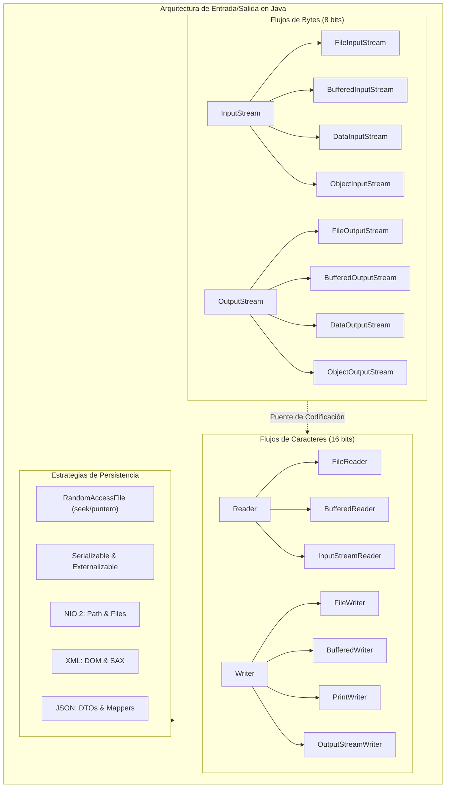
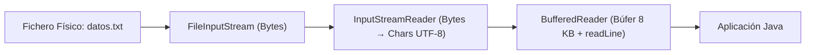

## Objetivos de Aprendizaje (RA2, RA3, RA4 y RA5 — 22 horas)

Al finalizar esta unidad didáctica serás capaz de:

* Comprender el concepto de **flujo de datos (*stream*)** como canal unidireccional de comunicación, clasificando las corrientes según su sentido (entrada o salida), la unidad de información transferida (bytes o caracteres) y su nivel de abstracción (flujos de bajo nivel orientados a nodo frente a decoradores de procesamiento).
* Dominar la **jerarquía de clases del paquete `java.io`** aplicando el patrón de diseño **Decorator** para componer tuberías de E/S enriquecidas con búferes de memoria, lectura de tipos primitivos formateados y serialización de objetos.
* Gestionar de forma robusta las **excepciones de entrada/salida (`IOException`, `FileNotFoundException`)** y garantizar la liberación incondicional de descriptores de fichero mediante la instrucción **`try-with-resources`** y la interfaz `AutoCloseable`.
* Manipular rutas y elementos del sistema de archivos mediante **`java.io.File`** y la moderna **API NIO.2 (`java.nio.file.Path` y `Files`)**, gestionando operaciones atómicas de creación, borrado recursivo, comprobación de atributos, copia, movimiento y búsqueda mediante streams perezosos (`Files.lines`, `Files.walk`).
* Implementar la **persistencia de objetos** mediante la interfaz `Serializable`, comprendiendo el papel de `serialVersionUID`, los campos omitidos (`transient`), la herencia/composición en grafos de objetos y la solución técnica a la colisión de cabeceras en escrituras consecutivas (*append*) mediante clases derivadas de `ObjectOutputStream`.
* Diseñar estructuras de datos persistentes con **acceso directo y aleatorio** mediante **`RandomAccessFile`**, controlando el puntero de lectura/escritura (`seek`, `getFilePointer`) e implementando operaciones CRUD sobre registros de longitud fija y longitud variable con borrado lógico y compactación física (*pack*).
* Procesar documentos semiestructurados en formatos estándar del sector: análisis de **XML** mediante los enfoques **DOM** (árbol navegable en memoria) y **SAX** (procesador secuencial guiado por eventos), así como serialización y deserialización de datos en formato **JSON** mediante librerías del ecosistema Java moderno.



---

## 1. Fundamentos de Entrada/Salida y Tipos de Streams

### 1.1. ¿Qué es un Stream de Entrada/Salida?
En programación, todas las variables, arrays y colecciones que creamos durante la ejecución de un programa residen en la **memoria principal (RAM)**. Esta memoria es volátil: cuando el programa finaliza o el ordenador se apaga, toda la información desaparece. Para lograr que los datos trasciendan a la ejecución del proceso necesitamos **persistencia**, es decir, almacenar los datos en dispositivos de memoria secundaria (discos duros HDD, unidades SSD, memorias flash USB o almacenamiento en red).

Para interactuar con el exterior de manera uniforme, Java abstrae la entrada y salida mediante el concepto de **flujo de datos (*Stream*)**:

> [!NOTE] Definición de Stream (Flujo de E/S)
> Un **Stream** es una secuencia ordenada, continua y unidireccional de datos que fluye entre un **origen (*source*)** y un **destino (*destination*)**. El programa actúa como consumidor cuando lee datos de un flujo de entrada (*InputStream* / *Reader*) o como productor cuando escribe datos hacia un flujo de salida (*OutputStream* / *Writer*).

:::important[Diferencia conceptual crucial]
No debes confundir la **API Stream de colecciones** vista en la Unidad 7 (`java.util.stream.Stream<T>`, orientada a la manipulación funcional y declarativa de secuencias de elementos en memoria) con los **Streams de entrada/salida** del paquete `java.io` (`InputStream`, `OutputStream`), diseñados para transferir secuencias físicas de bytes o caracteres entre dispositivos.
:::

### 1.2. Clasificación de los Streams en `java.io`
Java clasifica sus flujos según tres ejes ortogonales:

1. **Según la dirección del flujo:**
   - **Streams de Entrada (*Input Streams / Readers*):** Transportan datos desde una fuente externa (teclado, fichero, socket de red) hacia el programa. Disponen del método fundamental `read()`.
   - **Streams de Salida (*Output Streams / Writers*):** Transportan datos desde el programa hacia un destino externo (pantalla, fichero, impresora, socket). Disponen del método fundamental `write()`.
2. **Según el tipo de dato básico transportado:**
   - **Flujos orientados a Byte (binarios, 8 bits):** Heredan de las clases abstractas `InputStream` y `OutputStream`. Procesan la información como cadenas de bytes puros sin interpretar su significado. Son los adecuados para imágenes (`.png`, `.jpg`), audio, vídeo, ficheros comprimidos (`.zip`), ejecutables o datos binarios estructurados.
   - **Flujos orientados a Carácter (texto, 16 bits Unicode):** Heredan de las clases abstractas `Reader` y `Writer`. Trabajan con caracteres Unicode (`char`), realizando automáticamente la traducción entre los bytes del fichero y los caracteres de Java mediante un juego de caracteres (*Charset*, como UTF-8 o ISO-8859-1). Son los adecuados para código fuente, ficheros `.txt`, `.csv`, `.json` o `.xml`.
3. **Según su nivel de abstracción y función:**
   - **Flujos de bajo nivel o de nodo (*Node Streams*):** Se conectan directamente al soporte físico real. Ejemplos: `FileInputStream`, `FileOutputStream`, `FileReader`, `FileWriter`, `ByteArrayInputStream`.
   - **Flujos de alto nivel o de procesamiento (*Filter/Processing Streams*):** No pueden conectarse directamente al dispositivo físico; reciben otro stream en su constructor y le añaden una funcionalidad adicional (búferes de memoria, conversión de tipos primitivos, compresión, cifrado o serialización de objetos). Ejemplos: `BufferedReader`, `BufferedWriter`, `DataInputStream`, `ObjectOutputStream`.

### 1.3. El Patrón Decorador (*Decorator*) en `java.io`
La arquitectura de `java.io` es uno de los ejemplos más puros del **patrón estructural Decorador**. En lugar de crear una clase para cada combinación posible de características (lo que causaría una explosión de subclases inmanejable), Java define componentes básicos de nodo y componentes decoradores que envuelven a otros streams:

```java
// Ejemplo de encadenamiento con el patrón Decorador:
// 1. Nodo: Fichero físico en disco
// 2. Decorador de rendimiento: Búfer de memoria intermedia de 8 KB
// 3. Decorador de funcionalidad: Lectura de líneas de texto completas
BufferedReader lector = new BufferedReader(
    new InputStreamReader(
        new FileInputStream("datos.txt"), 
        StandardCharsets.UTF_8
    )
);
```



### 1.4. Flujos Estándar del Sistema y Consola
La clase `java.lang.System` proporciona tres streams estáticos abiertos automáticamente por la Máquina Virtual Java al arrancar:

* **`System.in` (`InputStream`):** Entrada estándar del sistema (asociada por defecto al teclado).
* **`System.out` (`PrintStream`):** Salida estándar del sistema (asociada por defecto a la pantalla/consola).
* **`System.err` (`PrintStream`):** Salida de errores del sistema (muestra mensajes de diagnóstico; en la mayoría de terminales e IDEs aparece resaltada en color rojo).

Para leer de teclado de forma moderna y estructurada se emplea `java.util.Scanner`:

```java
try (Scanner sc = new Scanner(System.in)) {
    System.out.print("Introduce tu nombre: ");
    String nombre = sc.nextLine();
    System.out.print("Introduce tu edad: ");
    int edad = sc.nextInt();
    System.out.println("Hola, " + nombre + " (" + edad + " años)");
}
```

:::warning[Precaución con `Scanner(System.in)`]
Si cierras un `Scanner` que envuelve a `System.in` mediante `sc.close()`, se cerrará también el descriptor subyacente `System.in`. Una vez cerrado, la entrada estándar no podrá volver a abrirse en toda la vida del proceso Java.
:::

---

## 2. Gestión de Recursos y Excepciones: `try-with-resources`

### 2.1. El problema del cierre manual de recursos
Cuando un programa solicita al sistema operativo abrir un fichero, el núcleo asigna un recurso finito denominado **descriptor de fichero (*file descriptor*)**. Si el programa no cierra explícitamente estos flujos, se produce una **fuga de descriptores (*resource leak*)**, que puede impedir que otros procesos accedan al archivo o agotar los descriptores disponibles en el sistema operativo. Además, en flujos de salida con búfer, los datos que no hayan sido vaciados (*flushed*) se perderán.

El esquema tradicional de Java 6 con `try-catch-finally` resultaba farragoso y propenso a errores, ya que invocar `.close()` en el bloque `finally` requería otro bloque `try-catch` anidado para capturar la posible `IOException` del cierre.

### 2.2. La sentencia `try-with-resources` (Java 7+)
A partir de Java 7, cualquier clase que implemente la interfaz `java.lang.AutoCloseable` (de la cual hereda `java.io.Closeable`) puede ser instanciada dentro de los paréntesis del bloque `try(...)`. La JVM garantiza que el método `close()` se invocará **automáticamente** al abandonar el bloque, tanto si la ejecución finaliza con éxito como si se produce una excepción:

```java
// El stream se cerrará automáticamente al llegar a la llave de cierre
try (FileReader fr = new FileReader("config.txt");
     BufferedReader br = new BufferedReader(fr)) {
    
    String primeraLinea = br.readLine();
    System.out.println("Configuración: " + primeraLinea);
    
} catch (FileNotFoundException fnf) {
    System.err.println("Fichero no encontrado: " + fnf.getMessage());
} catch (IOException ioe) {
    System.err.println("Error de lectura: " + ioe.getMessage());
}
```

> [!TIP] Excepciones suprimidas (*Suppressed Exceptions*)
> Si ocurre una excepción dentro del bloque `try` y además el método `close()` lanza otra excepción al cerrar el recurso, la excepción principal del bloque `try` es la que se propaga, y la del cierre se adjunta a ella como una *excepción suprimida*. Puedes inspeccionarla invocando `e.getSuppressed()`.

---

## 3. Gestión del Sistema de Ficheros con `java.io.File`

### 3.1. Naturaleza y Propósito de la Clase `File`
La clase `java.io.File` (presente desde Java 1.0) representa una **ruta abstracta (*path name*)** dentro del sistema de archivos.

:::important[La clase `File` no es el archivo físico]
Instanciar un objeto `File` **no crea ningún archivo en el disco** ni verifica si dicho archivo existe en el sistema. Representa simplemente una cadena con una ruta sobre la que posteriormente podremos consultar información o ejecutar operaciones de gestión.
:::

```java
// Instanciamos el objeto: esto NO crea el archivo en disco
File f = new File("datos/informe.txt");
System.out.println("¿Existe físicamente?: " + f.exists()); // true o false
```

### 3.2. Rutas Absolutas vs. Rutas Relativas
* **Ruta Absoluta:** Especifica la ubicación unívoca de un elemento desde la raíz del sistema de ficheros:
  - En Windows: `C:\Users\master\documentos\notas.txt`
  - En Linux / macOS: `/home/usuario/documentos/notas.txt`
* **Ruta Relativa:** Se especifica sin raíz inicial y toma como punto de partida el **directorio de trabajo actual** del proceso (`System.getProperty("user.dir")`):
  - Ejemplo: `documentos/notas.txt`

```java
// El separador multiplataforma:
// Aunque Windows usa '\', Java admite la barra inclinada '/' en todos los sistemas operativos.
// También se puede consultar la constante File.separator
File archivo = new File("subcarpeta" + File.separator + "documento.txt");
```

### 3.3. Métodos Clave de la Clase `File`

| Método | Tipo devuelto | Descripción |
| :--- | :--- | :--- |
| `exists()` | `boolean` | Devuelve `true` si la ruta existe en disco. |
| `isFile()` | `boolean` | Comprueba si la ruta existe y corresponde a un fichero regular. |
| `isDirectory()` | `boolean` | Comprueba si la ruta existe y corresponde a un directorio. |
| `getName()` | `String` | Devuelve el nombre simple del fichero o carpeta (último elemento). |
| `getParent()` | `String` | Devuelve la ruta del directorio padre (o `null` si es la raíz). |
| `getAbsolutePath()` | `String` | Devuelve la ruta absoluta completa en el sistema operativo. |
| `length()` | `long` | Tamaño del archivo en **bytes** (devuelve `0L` si no existe). |
| `lastModified()` | `long` | Marca de tiempo en milisegundos desde la época Unix (1 de enero de 1970). |
| `createNewFile()` | `boolean` | Crea un archivo nuevo vacío si no existía previamente. |
| `mkdir()` | `boolean` | Crea el directorio indicado (su carpeta padre debe existir). |
| `mkdirs()` | `boolean` | Crea el directorio y **todos los directorios padres intermedios** inexistentes. |
| `delete()` | `boolean` | Elimina el archivo o directorio (los directorios deben estar vacíos). |
| `renameTo(File dest)` | `boolean` | Renombra o traslada el archivo o directorio a una nueva ubicación. |
| `listFiles()` | `File[]` | Devuelve los elementos contenidos en el directorio como array de `File`. |
| `listFiles(FilenameFilter f)`| `File[]` | Devuelve los elementos filtrados por nombre o extensión. |

### 3.4. Ejemplo: Recorrido y Borrado Recursivo de Directorios
Un directorio que contiene archivos o subcarpetas no puede ser eliminado directamente con `delete()`. Se requiere una función recursiva:

```java
public class UtilidadesFichero {

    /**
     * Elimina recursivamente un archivo o un directorio con todo su contenido.
     */
    public static boolean borrarTodo(File f) {
        if (!f.exists()) return false;
        
        if (f.isDirectory()) {
            File[] hijos = f.listFiles();
            if (hijos != null) {
                for (File hijo : hijos) {
                    borrarTodo(hijo); // Llamada recursiva
                }
            }
        }
        return f.delete(); // Ahora que está vacío, se puede borrar
    }

    /**
     * Muestra el árbol de directorios con sangría según el nivel de profundidad.
     */
    public static void listarArbol(File dir, String sangria) {
        System.out.println(sangria + (dir.isDirectory() ? "[+DIR] " : "[-ARX] ") + dir.getName());
        if (dir.isDirectory()) {
            File[] elementos = dir.listFiles();
            if (elementos != null) {
                // Ordenamos: primero directorios, luego archivos por orden alfabético
                Arrays.sort(elementos, Comparator.comparing(File::isFile)
                        .thenComparing(File::getName, String.CASE_INSENSITIVE_ORDER));
                
                for (File elem : elementos) {
                    listarArbol(elem, sangria + "    ");
                }
            }
        }
    }
}
```

---

## 4. Ficheros de Texto (Flujos Orientados a Carácter)

### 4.1. Codificaciones y el Estándar UTF-8
Los caracteres no se guardan directamente en disco: se traducen a secuencias de bytes mediante una tabla de codificación (*Charset*). 
* **ASCII:** 7 bits (128 caracteres, solo alfabeto inglés básico).
* **ISO-8859-1 (Latin-1):** 8 bits (256 caracteres, incluye tildes españolas y `ñ`, pero no alfabetos asiáticos ni emojis).
* **UTF-8:** Longitud variable (de 1 a 4 bytes). Es el estándar universal de la web y el software moderno. 

:::caution[Cuidado con la codificación por defecto]
En versiones antiguas de Java, instanciar `new FileReader("f.txt")` utilizaba la codificación por defecto del sistema operativo (Windows-1252 en Windows en español, UTF-8 en Linux). A partir de **Java 18**, la propiedad `file.encoding` es **UTF-8 por defecto** en todas las plataformas. Aun así, se recomienda especificar siempre explícitamente `StandardCharsets.UTF_8` en el constructor.
:::

### 4.2. Lectura con `FileReader` y `BufferedReader`
`BufferedReader` almacena bloques de caracteres en un búfer interno en memoria RAM (normalmente de 8.192 caracteres), reduciendo drásticamente las lecturas físicas al disco y ofreciendo el método `readLine()`:

```java
public class LecturaTextoApp {
    public static void main(String[] args) {
        File archivo = new File("alumnos.txt");

        try (BufferedReader br = new BufferedReader(new FileReader(archivo, StandardCharsets.UTF_8))) {
            String linea;
            int numLinea = 1;

            // readLine() devuelve null cuando alcanza el final del fichero (EOF)
            while ((linea = br.readLine()) != null) {
                System.out.printf("%03d: %s%n", numLinea++, linea);
            }
        } catch (IOException e) {
            System.err.println("Error leyendo fichero: " + e.getMessage());
        }
    }
}
```

### 4.3. Escritura con `FileWriter`, `BufferedWriter` y `PrintWriter`
Para escribir texto disponemos de tres alternativas complementarias:

1. **`FileWriter`:** Escribe caracteres en el archivo. Su segundo parámetro booleano (`append`) indica si se debe añadir al final (`true`) o sobrescribir el archivo eliminando su contenido previo (`false`):
   ```java
   new FileWriter("log.txt", true); // Modo append (añadir al final)
   ```
2. **`BufferedWriter`:** Envuelve al `FileWriter` para acumular caracteres en un búfer y escribirlos en bloque, ofreciendo además el método `newLine()` que inserta el salto de línea adecuado según el sistema operativo (`\r\n` en Windows, `\n` en Linux/macOS).
3. **`PrintWriter`:** Proporciona los métodos de alto nivel `print()`, `println()` y `printf()`, tratando automáticamente la conversión de tipos primitivos a texto y evitando lanzar `IOException` en cada escritura (dispone del método `checkError()`):

```java
public class EscrituraTextoApp {
    public static void main(String[] args) {
        File destino = new File("reporte.txt");

        // FileWriter en modo append con búfer y decorador PrintWriter
        try (PrintWriter pw = new PrintWriter(
                new BufferedWriter(
                        new FileWriter(destino, StandardCharsets.UTF_8, true)))) {
            
            pw.println("=== REPORTE DE VENTAS ===");
            pw.printf("Fecha: %s | Total: %.2f EUR%n", LocalDate.now(), 1450.75);
            pw.println("Estado: COMPLETADO");
            
            System.out.println("Reporte añadido con éxito a " + destino.getAbsolutePath());
        } catch (IOException e) {
            System.err.println("Error al escribir el reporte: " + e.getMessage());
        }
    }
}
```

---

## 5. Ficheros Binarios y Tipos Primitivos

### 5.1. Flujos Básicos de Bytes: `FileInputStream` y `FileOutputStream`
Cuando el contenido no es texto legible, se deben utilizar flujos de bytes puros:

```java
public class CopiaBinariaApp {
    public static void main(String[] args) {
        File origen = new File("imagen.png");
        File copia = new File("imagen_copia.png");

        long inicio = System.currentTimeMillis();

        // Transferencia eficiente mediante búfer de bytes de 4 KB
        try (InputStream in = new BufferedInputStream(new FileInputStream(origen));
             OutputStream out = new BufferedOutputStream(new FileOutputStream(copia))) {
            
            byte[] buffer = new byte[4096];
            int bytesLeidos;

            // in.read(buffer) devuelve el número de bytes reales leídos o -1 al llegar a EOF
            while ((bytesLeidos = in.read(buffer)) != -1) {
                out.write(buffer, 0, bytesLeidos);
            }

            long tiempoTotal = System.currentTimeMillis() - inicio;
            System.out.println("Copia realizada en " + tiempoTotal + " ms.");
        } catch (IOException e) {
            System.err.println("Error en la copia: " + e.getMessage());
        }
    }
}
```

:::tip[Rendimiento de los Búferes]
Copiar un fichero de 50 MB byte a byte con `fis.read()` sin búfer puede tardar varios minutos debido a las 50 millones de llamadas al sistema operativo (*system calls*). Utilizando un búfer de 4 KB o `BufferedInputStream`, la misma operación se completa en menos de medio segundo.
:::

### 5.2. Datos Tipados con `DataOutputStream` y `DataInputStream`
Permiten escribir y leer datos primitivos de Java (`int`, `double`, `boolean`, `char`) en su representación binaria nativa fija e independiente de la plataforma:

* `writeInt(int v)`: Escribe 4 bytes.
* `writeDouble(double v)`: Escribe 8 bytes según el estándar IEEE 754.
* `writeBoolean(boolean v)`: Escribe 1 byte (`0x01` o `0x00`).
* `writeUTF(String s)`: Escribe la cadena en formato UTF-8 modificado precedida por 2 bytes con su longitud.

```java
public class RegistroBinarioPrimitivos {
    public static void main(String[] args) {
        File fichero = new File("sensores.dat");

        // 1. Escritura binaria de mediciones
        try (DataOutputStream dos = new DataOutputStream(
                new BufferedOutputStream(new FileOutputStream(fichero)))) {
            
            dos.writeInt(101);             // ID sensor
            dos.writeUTF("Temperatura");    // Magnitud
            dos.writeDouble(23.85);        // Valor medido
            dos.writeBoolean(true);        // Operativo
            
        } catch (IOException e) {
            e.printStackTrace();
        }

        // 2. Lectura binaria en EXACTAMENTE el mismo orden
        try (DataInputStream dis = new DataInputStream(
                new BufferedInputStream(new FileInputStream(fichero)))) {
            
            while (dis.available() > 0) {
                int id = dis.readInt();
                String magnitud = dis.readUTF();
                double valor = dis.readDouble();
                boolean operativo = dis.readBoolean();
                
                System.out.printf("Sensor #%d [%s]: %.2f (Activo: %s)%n", id, magnitud, valor, operativo);
            }
        } catch (IOException e) {
            e.printStackTrace();
        }
    }
}
```

---

## 6. Persistencia de Objetos y Serialización

### 6.1. Concepto de Serialización
La **serialización** es el proceso de convertir el estado completo de un grafo de objetos en una secuencia de bytes para almacenarlo en disco o transmitirlo a través de una red. El proceso inverso, reconstruir los objetos en memoria a partir de los bytes, se denomina **deserialización**.

Para que una clase sea serializable en Java debe implementar la interfaz marcadora `java.io.Serializable` (que no declara ningún método abstracto).

### 6.2. La Constante `serialVersionUID` y el Modificador `transient`
* **`serialVersionUID`:** Es un código hash único de 64 bits que identifica la versión de la clase. Si modificas los atributos de una clase y no defines explícitamente esta constante, la JVM calculará un hash nuevo y lanzará una excepción `java.io.InvalidClassException` al intentar deserializar objetos guardados con la versión anterior.
* **`transient`:** Los atributos marcados con la palabra clave `transient` son ignorados por el mecanismo de serialización. Al deserializar, tomarán su valor por defecto (`null` para objetos, `0` para números, `false` para booleanos). Se utiliza para contraseñas, claves criptográficas, conexiones a bases de datos o referencias a hilos de ejecución.

```java
public class CuentaUsuario implements Serializable {
    @Serial
    private static final long serialVersionUID = 1L;

    private String login;
    private transient String passwordHash; // No se serializa por seguridad
    private int puntos;

    public CuentaUsuario(String login, String passwordHash, int puntos) {
        this.login = login;
        this.passwordHash = passwordHash;
        this.puntos = puntos;
    }

    @Override
    public String toString() {
        return "CuentaUsuario[login=" + login + ", passwordHash=" + passwordHash + ", puntos=" + puntos + "]";
    }
}
```

### 6.3. Serialización con `ObjectOutputStream` y `ObjectInputStream`

```java
public class SerializacionBasicaApp {
    public static void main(String[] args) {
        File destino = new File("usuarios.obj");

        // 1. Serializar una lista de objetos
        List<CuentaUsuario> listaOriginal = List.of(
                new CuentaUsuario("ana", "hashSecret1", 150),
                new CuentaUsuario("carlos", "hashSecret2", 280)
        );

        try (ObjectOutputStream oos = new ObjectOutputStream(
                new BufferedOutputStream(new FileOutputStream(destino)))) {
            oos.writeObject(listaOriginal);
            System.out.println("Lista serializada con éxito.");
        } catch (IOException e) {
            e.printStackTrace();
        }

        // 2. Deserializar la lista
        try (ObjectInputStream ois = new ObjectInputStream(
                new BufferedInputStream(new FileInputStream(destino)))) {
            
            @SuppressWarnings("unchecked")
            List<CuentaUsuario> listaRecuperada = (List<CuentaUsuario>) ois.readObject();
            
            System.out.println("Objetos deserializados:");
            for (CuentaUsuario u : listaRecuperada) {
                System.out.println("   " + u); // passwordHash será null
            }
        } catch (IOException | ClassNotFoundException e) {
            e.printStackTrace();
        }
    }
}
```

### 6.4. El Problema de la Cabecera en `append` y `MiObjectOutputStream`
Cada vez que se instancia un `ObjectOutputStream`, este escribe automáticamente en el fichero una cabecera de 4 bytes (`STREAM_MAGIC = 0xaced` y `STREAM_VERSION = 0x0005`).

Si abres un fichero existente en modo *append* (`new FileOutputStream("f.obj", true)`) y vuelves a instanciar un `ObjectOutputStream`, se escribirá una segunda cabecera en mitad del archivo. Cuando más adelante intentes leerlo con `ObjectInputStream`, la JVM encontrará una cabecera donde esperaba un objeto y lanzará una excepción fatal **`StreamCorruptedException: invalid type code: AC`**.

Para solucionarlo, se crea una clase derivada que no escriba cabecera si el archivo ya existe:

```java
public class MiObjectOutputStream extends ObjectOutputStream {

    public MiObjectOutputStream(OutputStream out) throws IOException {
        super(out);
    }

    /**
     * Sobrescribimos el método para evitar escribir la cabecera en archivos existentes.
     */
    @Override
    protected void writeStreamHeader() throws IOException {
        // No escribir nada para no corromper el flujo
        reset();
    }
}
```

Factoría para elegir el stream de escritura adecuado:

```java
public static ObjectOutputStream obtenerOOS(File archivo) throws IOException {
    if (archivo.exists() && archivo.length() > 0) {
        return new MiObjectOutputStream(new FileOutputStream(archivo, true));
    } else {
        return new ObjectOutputStream(new FileOutputStream(archivo));
    }
}
```

---

## 7. Ficheros de Acceso Aleatorio (`RandomAccessFile`)

### 7.1. Acceso Secuencial vs. Acceso Aleatorio
En los streams tradicionales el acceso es estrictamente secuencial: para leer el registro 1.000 es obligatorio leer los 999 registros anteriores.

La clase **`RandomAccessFile`** permite desplazarse a **cualquier posición del fichero** al instante, permitiendo tanto operaciones de lectura como de escritura sobre el mismo objeto. Modos de apertura:
* `"r"`: Solo lectura (el fichero debe existir).
* `"rw"`: Lectura y escritura (si no existe, se crea).

### 7.2. Métodos de Posicionamiento y Registros de Tamaño Fijo
* `getFilePointer()`: Devuelve la posición actual del puntero en bytes (`long`).
* `seek(long pos)`: Sitúa el puntero en la posición absoluta de byte especificada.
* `length()`: Devuelve el tamaño actual del fichero en bytes.

Para implementar una base de datos basada en ficheros con `RandomAccessFile`, los registros deben tener un **tamaño constante en bytes (`TAMA_REGISTRO`)**:

> **Posición del registro `n` en bytes** = `n × TAMA_REGISTRO`

```java
public class BancoRegistrosAleatorios {

    // Estructura del registro fijo (Total: 4 + 40 + 8 + 1 = 53 bytes)
    // - int id: 4 bytes
    // - char[20] nombre: 20 * 2 = 40 bytes
    // - double saldo: 8 bytes
    // - boolean borradoLogico: 1 byte
    public static final int TAMA_REGISTRO = 53;

    public static void escribirRegistro(RandomAccessFile raf, int numReg, int id, String nombre, double saldo) throws IOException {
        raf.seek((long) numReg * TAMA_REGISTRO);
        raf.writeInt(id);

        // Ajustamos la cadena a exactamente 20 caracteres rellenando con espacios
        StringBuilder sb = new StringBuilder(nombre);
        sb.setLength(20);
        raf.writeChars(sb.toString());

        raf.writeDouble(saldo);
        raf.writeBoolean(false); // No borrado
    }

    public static void leerRegistro(RandomAccessFile raf, int numReg) throws IOException {
        long pos = (long) numReg * TAMA_REGISTRO;
        if (pos >= raf.length()) {
            System.out.println("Registro fuera de límites.");
            return;
        }

        raf.seek(pos);
        int id = raf.readInt();

        char[] charsNombre = new char[20];
        for (int i = 0; i < 20; i++) charsNombre[i] = raf.readChar();
        String nombre = new String(charsNombre).trim();

        double saldo = raf.readDouble();
        boolean borrado = raf.readBoolean();

        if (borrado) {
            System.out.printf("Reg #%d: [REGISTRO BORRADO LÓGICAMENTE]%n", numReg);
        } else {
            System.out.printf("Reg #%d: ID=%d, Nombre='%s', Saldo=%.2f EUR%n", numReg, id, nombre, saldo);
        }
    }
}
```

---

## 8. La Moderna API Java NIO.2 (`java.nio.file`)

Introducida en Java 7 y expandida en versiones posteriores, **NIO.2** sustituye y mejora a `java.io.File` ofreciendo mejor rendimiento, soporte para enlaces simbólicos, atributos avanzados y métodos atómicos.

### 8.1. `Path` y `Files`: Operaciones Básicas
* **`Path`:** Representa una ruta en el sistema de archivos (inmutable y segura para concurrencia). Se crea mediante `Path.of("carpeta", "fichero.txt")`.
* **`Files`:** Clase utilitaria con métodos estáticos para operar sobre rutas `Path`.

```java
Path ruta = Path.of("datos", "usuarios.txt");

// 1. Escritura y lectura de texto en una sola línea (Java 11+)
Files.writeString(ruta, "Ana, 34\nCarlos, 28\n", StandardCharsets.UTF_8);
String contenido = Files.readString(ruta, StandardCharsets.UTF_8);

// 2. Comprobaciones y operaciones atómicas
boolean existe = Files.exists(ruta);
Path copia = Path.of("datos", "usuarios_backup.txt");
Files.copy(ruta, copia, StandardCopyOption.REPLACE_EXISTING);

// 3. Crear directorios completos
Path dirCompleto = Path.of("backup", "2025", "mayo");
Files.createDirectories(dirCompleto);
```

### 8.2. Streams Funcionales de NIO.2
`Files` se integra directamente con la API Stream de Java:

```java
// Files.lines devuelve un Stream<String> perezoso (¡debe cerrarse con try-with-resources!)
try (Stream<String> lineas = Files.lines(Path.of("servidor.log"), StandardCharsets.UTF_8)) {
    List<String> erroresCriticos = lineas
            .filter(l -> l.contains("ERROR 500"))
            .map(String::trim)
            .toList();
    
    System.out.println("Errores encontrados: " + erroresCriticos.size());
}

// Files.walk recorre un árbol de directorios de manera recursiva
try (Stream<Path> arbol = Files.walk(Path.of("src"))) {
    long totalArchivosJava = arbol
            .filter(Files::isRegularFile)
            .filter(p -> p.toString().endsWith(".java"))
            .count();
    System.out.println("Total archivos .java: " + totalArchivosJava);
}
```

---

## 9. Formatos Estructurados: XML y JSON

### 9.1. Procesamiento de XML con DOM y SAX

#### Enfoque 1: Parser DOM (*Document Object Model*)
Carga todo el documento XML en memoria RAM creando un árbol de nodos (`Document`). Permite navegar en cualquier dirección y modificar el documento, pero consume mucha memoria en ficheros grandes:

```java
public class ParseadorDomXML {
    public static void main(String[] args) throws Exception {
        DocumentBuilderFactory factory = DocumentBuilderFactory.newInstance();
        DocumentBuilder builder = factory.newDocumentBuilder();
        Document doc = builder.parse(new File("empleados.xml"));

        doc.getDocumentElement().normalize();
        System.out.println("Elemento raíz: " + doc.getDocumentElement().getNodeName());

        NodeList listaEmpleados = doc.getElementsByTagName("empleado");
        for (int i = 0; i < listaEmpleados.getLength(); i++) {
            Node nodo = listaEmpleados.item(i);
            if (nodo.getNodeType() == Node.ELEMENT_NODE) {
                Element elemento = (Element) nodo;
                String id = elemento.getAttribute("id");
                String nombre = elemento.getElementsByTagName("nombre").item(0).getTextContent();
                double sueldo = Double.parseDouble(elemento.getElementsByTagName("sueldo").item(0).getTextContent());
                System.out.printf("Empleado [%s]: %s - %.2f EUR%n", id, nombre, sueldo);
            }
        }
    }
}
```

#### Enfoque 2: Parser SAX (*Simple API for XML*)
Procesa el documento de forma secuencial hacia adelante mediante eventos (`startElement`, `characters`, `endElement`). No carga el documento en memoria, por lo que su consumo de RAM es mínimo y constante:

```java
public class ParseadorSaxXML {
    public static void main(String[] args) throws Exception {
        SAXParserFactory factory = SAXParserFactory.newInstance();
        SAXParser saxParser = factory.newSAXParser();

        DefaultHandler manejador = new DefaultHandler() {
            boolean enNombre = false;

            @Override
            public void startElement(String uri, String localName, String qName, Attributes attributes) {
                if ("empleado".equalsIgnoreCase(qName)) {
                    System.out.println("ID: " + attributes.getValue("id"));
                } else if ("nombre".equalsIgnoreCase(qName)) {
                    enNombre = true;
                }
            }

            @Override
            public void characters(char[] ch, int start, int length) {
                if (enNombre) {
                    System.out.println("Nombre: " + new String(ch, start, length));
                    enNombre = false;
                }
            }
        };

        saxParser.parse(new File("empleados.xml"), manejador);
    }
}
```

### 9.2. Serialización y Deserialización de JSON
JSON (*JavaScript Object Notation*) es el formato dominante en servicios web REST y microservicios. En Java moderno se emplean librerías como Jackson o Gson:

```java
// Ejemplo conceptual de serialización y deserialización con Jackson:
public record ProductoDTO(int id, String denominacion, double precio) {}

ObjectMapper mapper = new ObjectMapper();

// 1. Objeto Java a JSON (Serialización)
ProductoDTO p = new ProductoDTO(10, "Monitor Gaming", 249.99);
mapper.writeValue(new File("producto.json"), p);

// 2. JSON a Objeto Java (Deserialización)
ProductoDTO leido = mapper.readValue(new File("producto.json"), ProductoDTO.class);
```

---

## 10. Diálogos Gráficos para Ficheros: `JFileChooser`

Para aplicaciones de escritorio (Swing), Java proporciona el diálogo estándar de selección de ficheros `JFileChooser`:

```java
public class SelectorFicheroGrafico {
    public static Optional<File> seleccionarImagen() {
        JFileChooser chooser = new JFileChooser();
        
        // Configuramos filtros de extensión
        FileNameExtensionFilter filtro = new FileNameExtensionFilter(
                "Imágenes (*.jpg, *.png, *.bmp)", "jpg", "jpeg", "png", "bmp");
        chooser.setFileFilter(filtro);
        chooser.setDialogTitle("Selecciona una fotografía para el perfil");

        int resultado = chooser.showOpenDialog(null);
        if (resultado == JFileChooser.APPROVE_OPTION) {
            return Optional.of(chooser.getSelectedFile());
        }
        return Optional.empty();
    }
}
```

---

## ⭐ Be the Code: Ejercicios de Trazado Mental

### Reto 1: El misterio de los bytes y caracteres
Analiza el siguiente código sin ejecutarlo en el ordenador:

```java
File f = new File("misterio.txt");
try (FileWriter fw = new FileWriter(f)) {
    fw.write("65");
    fw.write(65);
}
```
¿Qué contenido exacto tendrá el archivo `misterio.txt` al abrirlo con un editor de texto?

<details>
<summary>🔍 Ver explicación razonada</summary>

El archivo contendrá la cadena **`65A`** (3 bytes de tamaño):
1. `fw.write("65")`: Recibe un `String`, por lo que escribe literalmente los caracteres `'6'` y `'5'`.
2. `fw.write(65)`: Recibe un entero primitivo `int`, por lo que escribe el carácter Unicode correspondiente al código numérico 65 en la tabla ASCII, que es la letra mayúscula **`'A'`**.
</details>

---

### Reto 2: El puntero viajero en `RandomAccessFile`
Calcula qué valor imprimirá el siguiente fragmento:

```java
File f = new File("prueba.bin");
try (RandomAccessFile raf = new RandomAccessFile(f, "rw")) {
    raf.writeInt(100);    // int: 4 bytes
    raf.writeDouble(5.5); // double: 8 bytes
    raf.writeInt(200);    // int: 4 bytes
    
    raf.seek(4);
    double valor = raf.readDouble();
    System.out.println("Puntero: " + raf.getFilePointer() + " | Valor: " + valor);
}
```

<details>
<summary>🔍 Ver explicación razonada</summary>

Imprimirá: `Puntero: 12 | Valor: 5.5`.
- `writeInt(100)` avanza el puntero de `0` a `4`.
- `writeDouble(5.5)` avanza el puntero de `4` a `12`.
- `writeInt(200)` avanza el puntero de `12` a `16`.
- `raf.seek(4)` sitúa el puntero de nuevo en el byte `4`.
- `raf.readDouble()` lee 8 bytes (desde la posición 4 hasta la 12), obteniendo el valor `5.5` y dejando el puntero en el byte `12`.
</details>

---

## ¡No Hay Preguntas Tontas! (FAQ)

:::tip[¿Por qué `File.delete()` devuelve `false` y no lanza una excepción?]
El diseño original de `java.io.File` en Java 1.0 utilizaba valores de retorno booleanos (`true`/`false`) para indicar el éxito o fracaso de las operaciones de disco. La gran desventaja es que cuando falla no sabemos la causa (¿falta de permisos? ¿archivo bloqueado por otro proceso? ¿directorio no vacío?). Por eso se introdujo **NIO.2 (`Files.delete(Path)`)**, que sí lanza excepciones descriptivas (`NoSuchFileException`, `DirectoryNotEmptyException`, `AccessDeniedException`).
:::

:::tip[¿Qué diferencia hay entre `flush()` y `close()`?]
`flush()` fuerza la escritura inmediata en disco de todos los datos que permanezcan acumulados en los búferes de memoria RAM, pero deja el flujo abierto para seguir escribiendo. `close()` ejecuta primero un `flush()` interno y a continuación cierra el flujo, liberando el descriptor en el sistema operativo.
:::

:::tip[¿Por qué un fichero serializado pesa más que los datos que contiene?]
Porque `ObjectOutputStream` no guarda solo los valores numéricos o cadenas: almacena metadatos sobre la clase (nombre del paquete, firma, versión `serialVersionUID`, nombres y tipos de atributos) para que la JVM pueda reconstruir los objetos de forma segura durante la deserialización.
:::

---

## Test de Autoevaluación Interactivo (15 Preguntas)

Responde mentalmente a cada pregunta y despliega la solución para comprobar tu aprendizaje:

1. **¿Qué stream es el más adecuado para leer datos binarios primitivos (`int`, `double`) desde un fichero?**
   <details><summary>Respuesta</summary>`DataInputStream` (habitualmente envolviendo a un `BufferedInputStream` y un `FileInputStream`).</details>

2. **Si abres un `FileWriter` con `new FileWriter("datos.txt", false)` y el archivo ya existía:**
   <details><summary>Respuesta</summary>El archivo se sobrescribe por completo, perdiéndose todo su contenido anterior.</details>

3. **¿Qué interfaz deben implementar los objetos que se van a guardar con `ObjectOutputStream`?**
   <details><summary>Respuesta</summary>`java.io.Serializable` (o en su defecto `java.io.Externalizable`).</details>

4. **¿Qué ocurre con los atributos marcados como `transient` al serializar un objeto?**
   <details><summary>Respuesta</summary>Se omiten en el flujo binario y al deserializarse toman su valor por defecto (`null`, `0` o `false`).</details>

5. **¿Qué excepción se lanza al intentar deserializar un fichero con `ObjectInputStream` si se añadió contenido con `new ObjectOutputStream(new FileOutputStream(f, true))`?**
   <details><summary>Respuesta</summary>`StreamCorruptedException` (debido a la cabecera duplicada de control).</details>

6. **¿Qué método de `RandomAccessFile` permite cambiar la posición del puntero de lectura/escritura?**
   <details><summary>Respuesta</summary>`seek(long pos)`.</details>

7. **¿En qué se diferencian los parsers XML DOM y SAX?**
   <details><summary>Respuesta</summary>DOM carga todo el documento en memoria como un árbol de nodos; SAX procesa el fichero secuencialmente disparando eventos sin ocupar memoria adicional.</details>

8. **¿Qué clase de NIO.2 sustituye a `java.io.File` para representar rutas abstractas?**
   <details><summary>Respuesta</summary>`java.nio.file.Path`.</details>

9. **¿Por qué debe utilizarse `try-with-resources` con `Files.lines(Path)`?**
   <details><summary>Respuesta</summary>Porque `Files.lines()` mantiene abierto un descriptor de fichero del sistema operativo que debe liberarse cerrando el `Stream`.</details>

10. **¿Qué método de `File` permite crear una carpeta y todas sus carpetas intermedias?**
    <details><summary>Respuesta</summary>`mkdirs()`.</details>

11. **¿Qué método de `BufferedReader` devuelve `null` al llegar al final de un archivo de texto?**
    <details><summary>Respuesta</summary>`readLine()`.</details>

12. **¿Cuál es el juego de caracteres por defecto en Java desde la versión 18?**
    <details><summary>Respuesta</summary>UTF-8.</details>

13. **¿Se puede borrar con `File.delete()` un directorio que contiene archivos en su interior?**
    <details><summary>Respuesta</summary>No; para borrar un directorio con la API clásica debe estar completamente vacío.</details>

14. **¿Qué componente de Swing permite mostrar una ventana gráfica para seleccionar un archivo?**
    <details><summary>Respuesta</summary>`JFileChooser`.</details>

15. **¿Qué método de `Files` permite leer todo el contenido de un fichero de texto en un solo `String`?**
    <details><summary>Respuesta</summary>`Files.readString(Path)`.</details>
